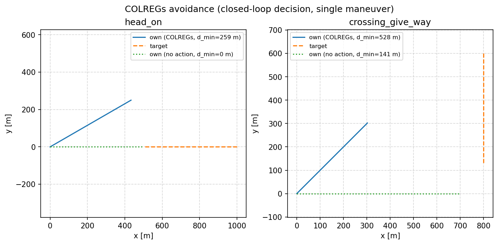

# USV 会遇局面判定与 COLREGs 避让

两条船相遇时，「谁让路、往哪让、让多少」由《国际海上避碰规则》(COLREGs) 规定。
本页给出可判定的实现：先算 CPA/TCPA，再分类会遇局面并给出建议动作，最后用五个
场景对比「按规则避让」与「不动作」的净距。

源码：`src/water/usv_colregs_avoidance/`。

## 1. 判定逻辑

相对方位 `beta` 以本船航向为 0、右正左负；相对运动算 CPA/TCPA：

```
v_rel = v_other - v_own
tcpa  = -(r · v_rel) / |v_rel|^2
dcpa  = |r + v_rel * tcpa|
```

**先算 CPA/TCPA、再分类**，避免「远距离高速目标被当成安全」：

| 条件 | 局面 | 规则 |
| --- | --- | --- |
| `tcpa < 0`（正在拉开） | `opening` | 无危险，保持 |
| `dcpa > 500 m` 且 `tcpa > 180 s` | `clear` | 无危险，保持 |
| `\|beta\| > 112.5°` | 被追越 | Rule 17(a)；危险时 Rule 17(b) |
| `\|beta\| <= 5°` 且航向差 >= 170° | 对遇 | Rule 14，右转 30° |
| 目标在前方 ±45°、同向、本船更快 | 本船追越 | Rule 13，右转 30° + 减速 |
| `0 < beta <= 112.5°` | 右舷交叉 | Rule 15/16，右转 45° + 减速 |
| `-112.5° <= beta < 0` | 左舷交叉 | 本船直航，Rule 17(a) |

只有确实存在风险（`dcpa <= 500 m` 或 `tcpa <= 180 s`）才机动，否则给出「保持监视」。

## 2. 实测（WSL2 Ubuntu 24.04 + Python 3.12）

闭环判定（每步重算 CPA/TCPA），只执行一次机动（模拟驾驶员打一次舵后保持），
目标船匀速直航；`dt = 1 s`，初始距离见表：

| 场景 | 初始局面 | 初始距离 | 规则 | 最小距离（按规则） | 最小距离（不动作） |
| --- | --- | --- | --- | --- | --- |
| head_on | 对遇 | 1000 m | Rule 14（+30°） | 258.8 m | 0.0 m |
| crossing_give_way | 右舷交叉 | 1000 m | Rule 15/16（+45°） | 528.1 m | 141.4 m |
| overtaken | 被追越 | 800 m | Rule 17(b)（+30°） | 450.4 m | 1.0 m |
| overtaking_own | 本船追越 | 1000 m | Rule 13（+30°） | 764.5 m | 1.0 m |
| opening | 同向更快、正在拉开 | 1000 m | 保持监视 | 1000.0 m | 1000.0 m |



上表是「本船单次机动 + 目标船匀速直航」的结果，不是普适的避让距离。

## 3. 运行

```bash
python3 -m usv_colregs_avoidance.main          # 五个场景的对照报告
ros2 run usv_colregs_avoidance main --node     # ROS 2 节点
ros2 launch usv_colregs_avoidance main.launch.py
```

节点话题与参数：

| 话题 | 类型 | 方向 | 数据 |
| --- | --- | --- | --- |
| `/usv/own_state` | `std_msgs/Float32MultiArray` | 订阅 | `[x, y, 航向 deg, 速度 m/s]` |
| `/usv/other_state` | `std_msgs/Float32MultiArray` | 订阅 | 同上 |
| `/usv/colregs` | `std_msgs/Float32MultiArray` | 发布 | `[建议转角 deg, 速度系数, 紧急度 0/1/2, DCPA m, TCPA s]`，TCPA 无穷时发 `-1` |

参数：`cpa_safe_m`（500）、`cpa_warn_m`（300）、`tcpa_warn_s`（180）、
`tcpa_danger_s`（60），可按船型调整。

## 4. 测试

```bash
python3 -m pytest -q test/     # 20 项，纯 Python
```

覆盖：方位归一化、四类会遇边界、`opening` 不误判为危险、3 km 外高速对开不判 `clear`、
本船追越按 Rule 13、同向同速判 `clear`、无风险时只监视、Rule 17(a)/(b) 切换、
让路方向必须右转、五个场景净距与初始条件记录。

## 5. 限制

- 只处理两船开阔水域，不含狭水道、分道通航制、能见度不良（Rule 19）；
- 目标船匀速直航，不模拟对方响应；
- 「一次机动后保持」是简化，真实驾驶会持续微调；
- 500/300 m、180/60 s 是演示阈值，可通过参数调整；
- 位置话题用 `Float32MultiArray` 简化传输，未带 frame_id/时间戳。
