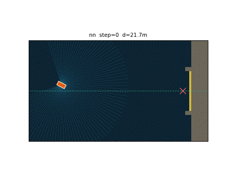
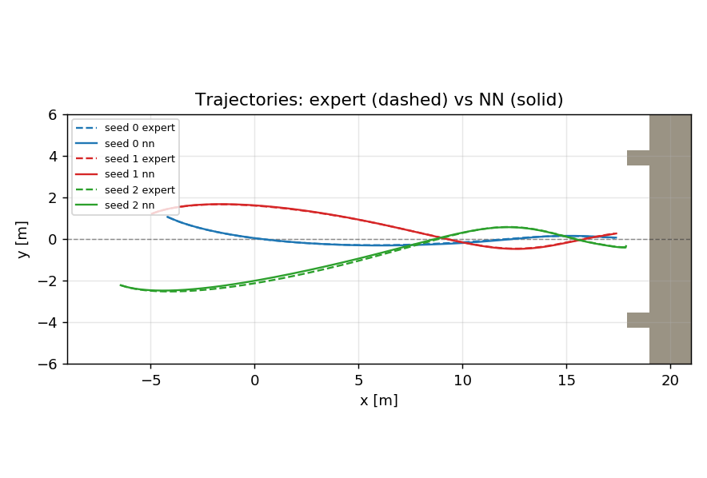
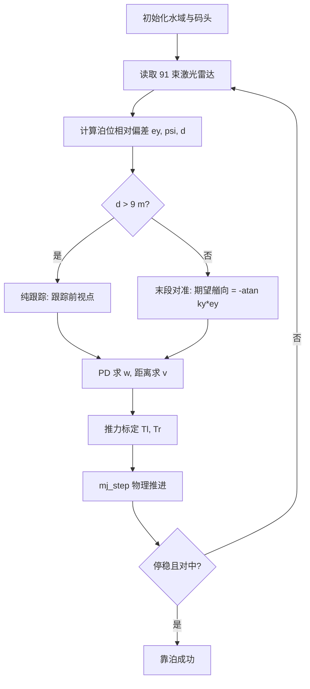

# 无人艇自主靠泊：激光雷达与神经网络末段对准

本文在 MuJoCo 中搭建一艘水面无人艇与一处凹入式码头，用射线投射模拟二维激光雷达，先用「纯跟踪 + 末段对准」的专家控制器实现靠泊，再用行为克隆把策略蒸馏进多层感知机，最后封装为 ROS Noetic 节点。

与仓库中已有的水域载具教程（HoloOcean 水下 ROV、侧扫声呐、声呐 SLAM）不同，本文处理的是**低速、终端精度**问题：船要贴边、摆正、停稳，指标是厘米级的位置误差与角度误差，而不是"能不能避开障碍"。

## 效果



黄色为航迹，青色为当前帧激光雷达，橙色为无人艇，右侧灰色为码头（上下两臂 + 后端靠岸墙），红色叉号为泊位目标点。

专家与神经网络在同一组起点上的轨迹对比：



## 运行环境

| 项 | 版本 |
|---|---|
| 操作系统 | Ubuntu 20.04 |
| ROS | Noetic |
| Python | 3.8 |
| MuJoCo | 3.2.3 |
| NumPy | 1.17.4 |
| Matplotlib | 3.1.2 |

## 仿真场景

场地为 48 m × 48 m 水域。码头位于 x ≈ 17.5 处，开口朝 -x 方向：

| 参数 | 值 |
|---|---|
| 泊位开口宽度 | 6.9 m（两臂内沿 ±3.45 m） |
| 靠岸墙内沿 | x = 18.65 m |
| 目标停船点 | (17.0, 0) |
| 起始区域 | x ∈ [-8, -2]，\|y\| ∈ [1.0, 2.5]，艏向 ∈ ±0.5 rad |

成功判据（全部满足）：

$$
15.0 \le x \le 18.0,\quad |y| \le 0.45\ \mathrm{m},\quad |\psi| \le 0.15\ \mathrm{rad},\quad |v| \le 0.20\ \mathrm{m/s}
$$

## 运行步骤

```bash
# 1. 训练（60 回合示范 + 40 epoch）
cd src/water/usv_docking_nn/scripts
python3 train.py --episodes 60 --epochs 40

# 2. 评测（专家 vs 神经网络，20 个相同起点）
python3 evaluate.py --seeds 20

# 3. 可视化 / 导出 GIF
python3 main.py --mode nn --save-gif dock.gif --every 6

# 4. ROS 节点
cd ~/usv_ws && catkin_make && source devel/setup.bash
roslaunch usv_docking_nn main.launch mode:=nn
```

## 算法原理

### 1. 船体平面动力学

三自由度平面模型，两个滑移关节（x、y）加一个艏摇关节：

$$
m\ddot{x} = (T_l + T_r)\cos\psi - c\dot{x},\qquad
m\ddot{y} = (T_l + T_r)\sin\psi - c\dot{y},\qquad
I\ddot{\psi} = (T_l - T_r)\,b - c_\psi\dot{\psi}
$$

其中 \(c = 20\ \mathrm{N\cdot s/m}\) 为平动阻尼，\(c_\psi = 15\ \mathrm{N\cdot m\cdot s/rad}\) 为艏摇阻尼，\(b = 0.26\ \mathrm{m}\) 为推进器到中轴线的距离。

### 2. 推力标定（踩过的坑，见后文）

稳态时 \(c\dot{x} = T_l + T_r\)，因此若要指令线速度为 \(v\)，每侧推力应为 \(c v / 2\)：

$$
T_l = \tfrac{1}{2}c\,v + \tfrac{1}{2}k_w\,w,\qquad
T_r = \tfrac{1}{2}c\,v - \tfrac{1}{2}k_w\,w
$$

取 \(k_w = 30\ \mathrm{N/(rad/s)}\)，对应艏摇时间常数 \(\tau_\psi = I/c_\psi \approx 0.45\ \mathrm{s}\)。

### 3. 激光雷达

91 束射线，视场 270°，量程 \(R_{\max} = 12\ \mathrm{m}\)：

$$
r_i = \min\big(\mathrm{mj\_ray}(\mathbf{p},\ [\cos\theta_i, \sin\theta_i, 0]^\top),\ R_{\max}\big),\qquad \theta_i = \psi + \alpha_i
$$

### 4. 专家控制器：远距纯跟踪 + 末段对准

参考路径按起点动态生成：起点 → 引导点 (8, 0) → 沿泊位轴线到 (17, 0)。寻点索引**单调递增**，只向前看。

**远距段**（到目标点距离 > 9 m）用几何纯跟踪：

$$
\alpha = \mathrm{atan2}(y_t - y,\ x_t - x) - \psi
$$

$$
w = \mathrm{clip}\big(k_\alpha \alpha - k_d \dot{\psi},\ \pm 0.6\big),\qquad
v = v_{\max}\Big(1 - \frac{|\alpha|}{1.2}\Big)
$$

其中 \(k_\alpha = 0.6\)，\(k_d = 0.30\)，\(v_{\max} = 0.85\ \mathrm{m/s}\)。加入 \(-\dot{\psi}\) 项是因为艏摇是一阶惯性环节，纯比例控制会振荡。

**末段**（距离 ≤ 9 m）改为通道对准，期望艏向由横向偏差直接给出：

$$
\psi_d = -\arctan(k_y\, e_y),\qquad
w = \mathrm{clip}\big(k_p\,\mathrm{wrap}(\psi_d - \psi) - k_d \dot{\psi},\ \pm 0.5\big)
$$

$$
v = \begin{cases} 0.40 & d_{end} > 1.2\\ \max(0.10,\ 0.40\,d_{end}) & \text{otherwise}\end{cases}
$$

其中 \(k_y = 0.7\)，\(k_p = 0.8\)。贴岸且横向偏差仍大于 0.55 m 时执行**倒退恢复**（\(v = -0.22\)），避免船被岸墙卡死。

### 5. 神经网络

输入为 95 维特征：激光雷达 91 束 + 横向偏差 \(e_y\) + 艏向偏差 \(\psi\) + 纵向距离 \(d\) + 当前速度。

结构为两层隐藏层的 MLP（95-128-128-2），输出归一化的 \((v, w)\)：

$$
\mathbf{h}_1 = \mathrm{ReLU}(W_1\mathbf{x} + \mathbf{b}_1),\quad
\mathbf{h}_2 = \mathrm{ReLU}(W_2\mathbf{h}_1 + \mathbf{b}_2),\quad
\mathbf{y} = W_3\mathbf{h}_2 + \mathbf{b}_3
$$

损失为均方误差，参数用 Adam 更新（\(\beta_1=0.9,\ \beta_2=0.999,\ \epsilon=10^{-8}\)，学习率 \(1.2\times10^{-3}\)，\(L_2\) 正则 \(10^{-5}\)，batch 256）。

部署时对输出做一阶低通平滑（系数 0.5），抑制逐帧抖动引起的附加回转。

## 算法流程



训练阶段把 E/F 的输出作为标签，让 MLP 直接从 (雷达 + 偏差 + 速度) 回归 \((v, w)\)；部署阶段只用 MLP。

## 代码结构

| 文件 | 作用 |
|---|---|
| `models/usv_dock.xml` | 码头（两臂 + 靠岸墙）与三自由度船体 |
| `scripts/sim_core.py` | 激光雷达、推力标定、泊位偏差、成功/碰撞判定 |
| `scripts/oracle.py` | 参考路径生成 + 纯跟踪 + 末段对准 |
| `scripts/nn.py` | 纯 NumPy 的 MLP 与 Adam |
| `scripts/train.py` | 采集专家示范并训练 |
| `scripts/evaluate.py` | 专家 vs 神经网络闭环评测 |
| `scripts/main.py` | 可视化与 GIF 导出 |
| `scripts/test_expert.py` | 专家控制器单独诊断工具 |
| `scripts/make_figures.py` | 生成文档配图 |
| `nodes/usv_dock_node.py` | ROS Noetic 节点 |
| `launch/main.launch` | 启动文件 |

## 实验结果

训练：**51155** 个样本，95 维特征，验证集 MSE **0.010959**。

闭环评测（20 个相同起点）：

| 策略 | 成功率 | 碰撞率 | 平均步数 | 末态横向误差 | 末态艏向误差 |
|---|---|---|---|---|---|
| 纯跟踪 + 末段对准（专家） | **100%** | 0% | 848.0 | 0.2435 m | 0.1077 rad |
| 神经网络（部署） | **100%** | 0% | 842.8 | 0.2330 m | 0.0997 rad |

神经网络在成功率上与专家持平，末态横向误差还略小（0.233 m vs 0.243 m）。轨迹对比图显示两条曲线基本重合。

## 调试记录（两个真实 bug）

本项目在调通过程中暴露了两个不调参解决不了的问题，记录如下：

**1. 推力标定错误，指令速度被放大 2.7 倍**

最初写成 \(T = k_v v + T_0\)（\(k_v = 18\)，\(T_0 = 3\)），但稳态物理关系是 \(F = c\dot{x}\)（\(c = 20\)）。指令 \(v = 0.45\ \mathrm{m/s}\) 时实际跑出 **1.24 m/s**，船每次都冲过头撞墙。改为 \(T = \tfrac{1}{2}cv\) 后速度才跟上指令。

**2. 寻点索引回跳，导致船原地打转**

纯跟踪原本用"离船最近的点"作为索引起点。船一旦越过路径第一个点，最近点就变成身后那个点，而它已超岀前视距离，索引不再前进——于是目标跳到身后，\(\alpha \approx 2.95\ \mathrm{rad}\)，船掉头追自己的起点，实测出现连续转了两圈的情况。改为**单调递增索引**后解决。

## 已知限制

1. 三自由度平面模型，未建模横摇、纵摇、垂荡，也无侧推器；
2. 激光雷达为理想射线模型，无测距噪声、无雨雾衰减；
3. 泊位为静止刚性结构，未考虑风、流与码头动态响应；
4. 靠泊依赖"先对准再进港"的几何引导路径，若起点位于码头侧后方需要额外的绕行规划；
5. 神经网络只在训练分布（起点 x ∈ [-8,-2]、横向 1~2.5 m）内验证过，超出该范围的泛化性未测试。

## 声明

本作业的代码与文档在编写过程中使用了大模型辅助。
