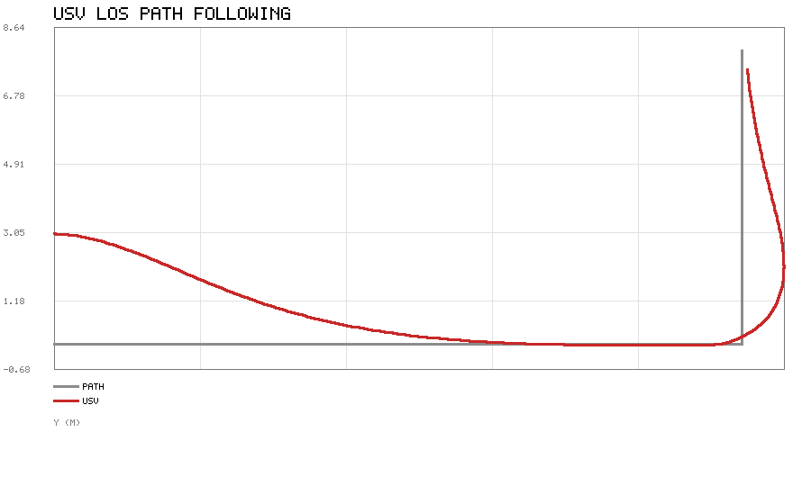
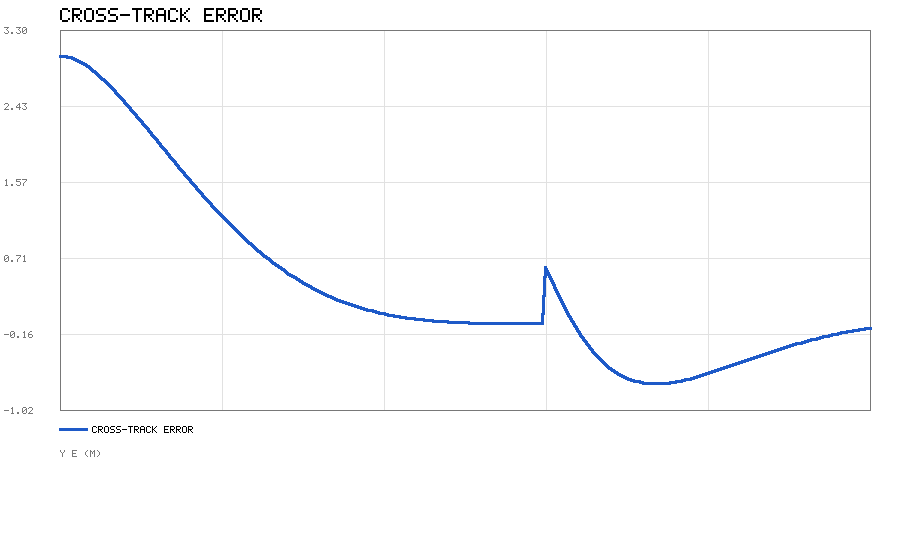

# 水面无人艇（USV）视线（LOS）路径跟踪制导

## 1. 作业概述与背景

水面无人艇（Unmanned Surface Vehicle, USV）在测绘、巡检、搜救等任务中需要沿预定航线
自主航行。对**欠驱动**（仅有前向推进、靠舵/差速转向）的 USV，无法直接横向平移，
因此"路径跟踪"本质上是一个制导（guidance）问题：给定一条由航点连成的路径，实时计算出
期望航向，再由底层航向控制器去跟随。

**视线（Line-of-Sight, LOS）制导**是一类经典且工程上极常用的方案：它把船相对当前路径段的
横向偏移（横漂误差）转换为一个前视的修正航向，使船自动被"拉回"航线。本模块给出恒速
运动学下的 LOS 制导仿真，纯 Python 标准库实现，可直接运行。

## 2. 运行环境

- Python 3（仅标准库）
- 运行方式：

```bash
cd src/water/usv_los_guidance
python3 scripts/main.py --outdir scripts
```

生成 `los_path.png`（俯视轨迹：路径与船轨迹）与 `los_crosstrack.png`（横漂误差衰减），
并输出末位置与最终横漂。

## 3. 核心代码文件清单

```
src/water/usv_los_guidance/
├── scripts/
│   ├── los_model.py      # 运动学模型、LOS 制导律、航点跟踪仿真
│   ├── simulate.py       # 组装轨迹与横漂曲线并作图
│   ├── simple_plot.py    # 仅用 zlib 的极简折线图输出
│   └── main.py           # 命令行入口
├── tests/
│   └── test_los.py
├── package.xml
├── CMakeLists.txt
├── launch/main.launch
├── README.md
└── requirements.txt
```

## 4. 处理原理

### 4.1 运动学模型

恒速 $U$、仅考虑航向 $\psi$ 的简化运动学：

$$\dot{x} = U\cos\psi,\qquad \dot{y} = U\sin\psi,\qquad \dot{\psi} = K\,\mathrm{wrap}(\chi_d-\psi)$$

其中 $\chi_d$ 为 LOS 给出的期望航向，$K>0$ 为一阶航向跟踪增益，$\mathrm{wrap}(\cdot)$ 把
角度归一化到 $(-\pi,\pi]$。

### 4.2 LOS 制导律

对当前路径段 $P_1\to P_2$，其切线角为
$\chi_p = \mathrm{atan2}(P_{2y}-P_{1y},\,P_{2x}-P_{1x})$。把船位置投影到路径坐标系，
得垂迹（横漂）误差：

$$y_e = -(x-P_{1x})\sin\chi_p + (y-P_{1y})\cos\chi_p$$

LOS 期望航向为：

$$\chi_d = \chi_p + \mathrm{atan2}(-y_e,\ \Delta)$$

其中 $\Delta>0$ 为**前视距离**。当船在路径右侧（$y_e<0$）时 $\chi_d$ 偏向路径，反之亦然；
$y_e\to 0$ 时 $\chi_d\to\chi_p$，船与路径对齐。前视距离 $\Delta$ 越大，转向越平缓、超调越小，
但收敛越慢——这是 LOS 的主要调参项。

### 4.3 航点推进

船接近当前段终点 $P_2$（距离小于阈值）时切换到下一段；到达最后一个航点即结束。

## 5. 仿真结果

路径取 L 形折线：航点 $(0,0)\to(12,0)\to(12,8)$；船从 $(0,3)$ 出发，初始航向沿 $x$ 轴，
恒速 $U=1.5\,\mathrm{m/s}$，取 $K=1.2,\ \Delta=3.0\,\mathrm{m}$。





从轨迹图可见：船从初始偏移 $(0,3)$ 出发，先平滑收敛到水平段并向右航行，到拐点后转入竖直段
继续贴合；最终位置 $(12.09,7.47)$ 接近终点 $(12,8)$，最终横漂约 $0.09\,\mathrm{m}$，
说明 LOS 制导能有效消除横漂误差。

## 6. 小结

- LOS 制导用前视距离把横漂误差转化为修正航向，结构简单、对恒值扰动与模型误差鲁棒；
- 前视距离 $\Delta$ 是核心权衡项：大则平稳但慢，小则快但易超调；
- 该方案只依赖位置与航向，不要求精确的动力学模型，非常适合工程落地；
- 本实现为运动学层级，真实系统还需在底层接入航向/速度控制器。

## 参考

- T. I. Fossen, *Handbook of Marine Craft Hydrodynamics and Motion Control*, 2011
- S. E. Thorvaldsen et al., *Line-of-sight path following for marine vessels*, 2012
- R. Skjetne, T. I. Fossen, *Nonlinear maneuvering and control of ships*, 2001

> 说明：本模块仅依赖 Python 标准库，开箱即跑；文档与代码在编写过程中使用 AI 辅助，
> 但均经实跑验证（单元测试与 `python3 main.py` 生成上图），作者对内容正确性负责。
