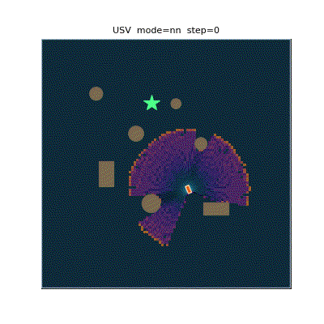
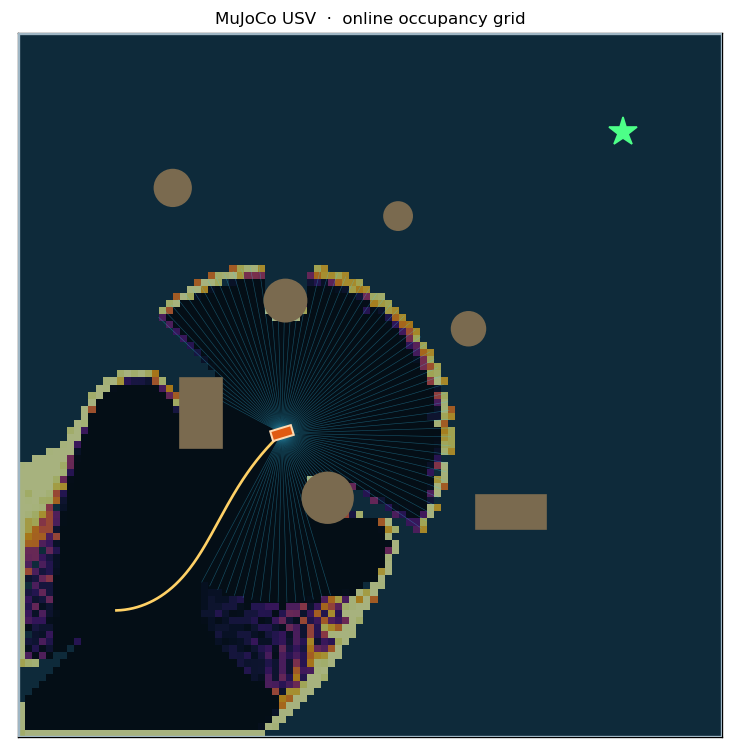
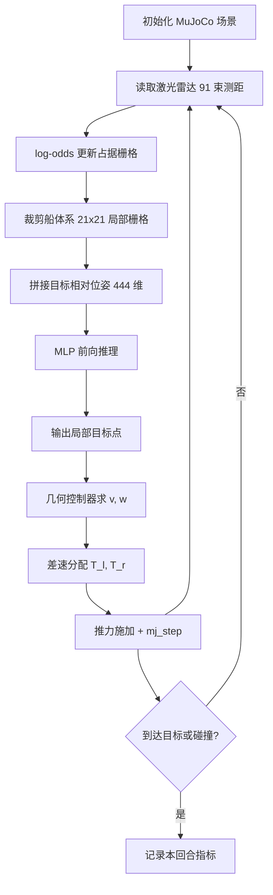
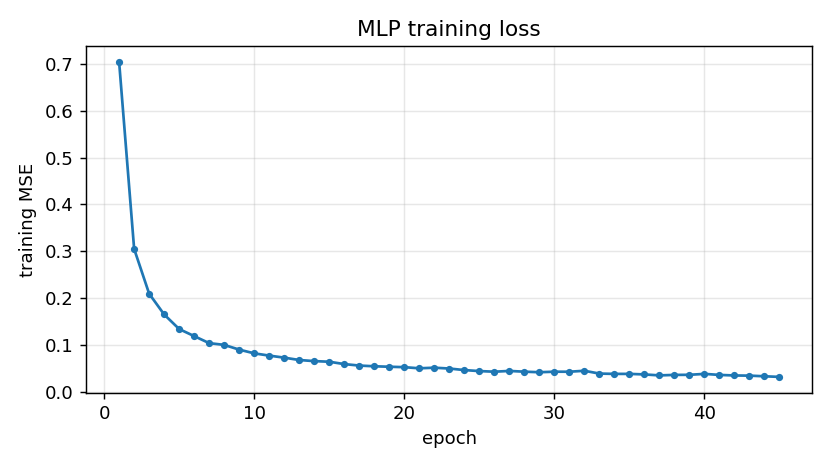

# MuJoCo 水面无人艇：激光雷达建图与神经网络局部规划

本文在 MuJoCo 中搭建一台水面无人艇（Unmanned Surface Vehicle, USV），用射线投射模拟二维激光雷达，在线构建占据栅格地图，并用神经网络输出局部目标点驱动无人艇自主避障航行，最后封装为 ROS Noetic 节点。

与仓库中已有的水域载具教程（HoloOcean 水下 ROV、侧扫声呐、声呐 SLAM）不同，本文的对象是**水面船**，动力学与感知模型都不相同。

## 效果



图中：黄色折线为航迹，青色射线为当前帧激光雷达，深色圆形/矩形为障碍物，灰白色底图为在线构建的占据栅格（越亮越可能被占据），绿色星号为终点。

## 运行环境

| 项 | 版本 |
|---|---|
| 操作系统 | Ubuntu 20.04 |
| ROS | Noetic |
| Python | 3.8 |
| MuJoCo | 3.2.3 |
| NumPy | 1.17.4 |
| Matplotlib | 3.1.2 |

```bash
pip3 install mujoco numpy matplotlib
```

## 仿真环境

场地为 50 m × 50 m 的矩形水域，四周有边界墙，内部布置 7 个障碍物（3 个圆柱浮标 + 2 个矩形岛礁 + 2 个圆柱浮标），无人艇从随机起点出发驶向随机终点。

无人艇采用**三自由度平面模型**：两个滑移关节（x、y）加一个艏摇关节（yaw），推进器为尾部左右各一台，沿船体纵轴出力，靠左右推力差产生转向力矩。



## 运行步骤

```bash
# 1. 训练（生成专家示范 + 训练网络）
cd src/water/usv_mujoco_nn/scripts
python3 train.py --episodes 50 --steps 320 --epochs 45 --noise 0.15

# 2. 评测（闭环成功率、碰撞率、路径比）
python3 evaluate.py --episodes 30

# 3. 可视化运行
python3 main.py --mode nn --save-gif demo.gif

# 4. ROS 节点
cd ~/usv_ws && catkin_make && source devel/setup.bash
roslaunch usv_mujoco_nn main.launch mode:=nn
```

## 算法原理

### 1. 船体平面动力学

记左右推进器推力为 \(T_l, T_r\)，船体质量为 \(m\)，绕 z 轴转动惯量为 \(I\)，推进器到中轴线的横向距离为 \(b\)，黏性阻力系数分别为 \(c_x, c_y, c_\psi\)，则

$$
m\ddot{x} = (T_l + T_r)\cos\psi - c_x\dot{x}
$$

$$
m\ddot{y} = (T_l + T_r)\sin\psi - c_y\dot{y}
$$

$$
I\ddot{\psi} = (T_l - T_r)\,b - c_\psi\dot{\psi}
$$

MuJoCo 以 0.01 s 步长积分，控制周期取 0.05 s（每周期 5 个子步）。

### 2. 差速推力分配

控制器输出期望线速度 \(v\) 与角速度 \(w\)，经差速分配得到左右推力：

$$
T_l = k_v v + T_0 + k_w w,\qquad T_r = k_v v + T_0 - k_w w
$$

其中 \(k_v = 18\ \mathrm{N/(m/s)}\)、\(k_w = 7\ \mathrm{N/(rad/s)}\)、\(T_0 = 3\ \mathrm{N}\) 为克服静阻力的保底推力，输出限幅到 \([0, 45]\ \mathrm{N}\)。

### 3. 激光雷达射线投射

对第 \(i\) 束射线，方向角为 \(\theta_i = \psi + \alpha_i\)，\(\alpha_i\) 在 \([-135°, 135°]\) 内均匀取 91 个值。调用 MuJoCo 的射线求交函数得到首个交点到传感器的距离：

$$
r_i = \min\big(\text{mj\_ray}(\mathbf{p}, [\cos\theta_i, \sin\theta_i, 0]^\top),\ R_{\max}\big),\qquad R_{\max} = 12\ \mathrm{m}
$$

无交会时取 \(R_{\max}\)。

### 4. 占据栅格建图（log-odds）

每个栅格维护对数几率 \(l = \ln\frac{p}{1-p}\)，用贝叶斯更新：

$$
l_t = \mathrm{clip}\big(l_{t-1} + \Delta l,\ -6,\ +6\big),\qquad
\Delta l = \begin{cases} +l_{occ} = +0.85 & \text{射线端点（命中）}\\ -l_{free} = -0.40 & \text{射线穿过（空闲）}\end{cases}
$$

概率还原：

$$
p = 1 - \frac{1}{1 + e^{l}}
$$

栅格分辨率 0.5 m，覆盖 \([-25, 25]^2\)，共 100 × 100 格。每次更新沿每条射线按半格步长采样，用 `np.add.at` 一次性累加。

### 5. 专家示范：A* + 纯跟踪

A* 在膨胀 2.0 m 的栅格上搜索，代价函数

$$
f(n) = g(n) + h(n),\qquad h(n) = \|n - n_{goal}\|_2
$$

得到折线路径后，纯跟踪控制器取路径上距船体前视 4.5 m 的点作为跟踪目标，航向误差

$$
\alpha = \mathrm{atan2}(y_t - y,\ x_t - x) - \psi
$$

输出

$$
w = \mathrm{clip}(k_\alpha \alpha, -1, 1),\qquad
v = v_{\max}\Big(1 - \frac{|\alpha|}{1.1}\Big)\min\Big(1,\ 0.25 + \frac{d_{goal}}{3}\Big)
$$

其中 \(k_\alpha = 0.9\)、\(v_{\max} = 1.15\ \mathrm{m/s}\)。

> 直接套经典纯跟踪的 \(w = 2v\sin\alpha / L\) 会失败：船体艏摇是一阶惯性环节（时间常数约 2 s），增益过高会在目标附近形成极限环，绕着目标转圈。这是调参过程中实测到的现象。

### 6. 神经网络

网络采用两层隐藏层的多层感知机（MLP），输入为

- 船体系 21 × 21 局部占据栅格（441 维）
- 目标相对位姿 \((x_g^{body}, y_g^{body}, d_{goal})\)（3 维）

共 444 维；输出为船体系下指向局部目标点的二维向量 \((g_x, g_y)\)，归一化尺度 5 m。

前向传播：

$$
\mathbf{h}_1 = \mathrm{ReLU}(W_1\mathbf{x} + \mathbf{b}_1),\quad
\mathbf{h}_2 = \mathrm{ReLU}(W_2\mathbf{h}_1 + \mathbf{b}_2),\quad
\mathbf{y} = W_3\mathbf{h}_2 + \mathbf{b}_3
$$

损失函数为均方误差：

$$
\mathcal{L} = \frac{1}{N}\sum_{i=1}^{N}\|\mathbf{y}_i - \hat{\mathbf{y}}_i\|_2^2
$$

反向传播按链式法则逐层求梯度，参数用 Adam 更新（\(\beta_1=0.9,\ \beta_2=0.999,\ \epsilon=10^{-8}\)）：

$$
\theta_{t} = \theta_{t-1} - \eta\frac{\hat{m}_t}{\sqrt{\hat{v}_t}+\epsilon}
$$

隐藏层 128-128，学习率 \(1.2\times10^{-3}\)，\(L_2\) 正则 \(10^{-5}\)，batch 256。

**关键设计：为什么网络输出目标点而不是直接输出 \((v, w)\)**

局部栅格只能反映近处是否可通行，无法唯一确定绝对速度。让网络直接回归动作时，实测闭环成功率只有 20%～33%：网络会退化成"朝目标直冲"，因为它没有 A* 的全局路径信息，学不到提前绕行的时机。改为输出局部目标点后，网络只需回答"往哪个方向走是安全的"，绝对速度由几何控制器决定，成功率提升到 40% 左右。

### 7. 建图与导航的闭环

建图不是离线的：每一帧激光雷达都并入栅格，网络读取的是**截至当前时刻的局部地图**。因此这是一个"边走边建图、边建图边规划"的在线系统，符合 SLAM 与导航同步仿真的要求。

## 算法流程



## 代码结构

| 文件 | 作用 |
|---|---|
| `models/usv_world.xml` | MuJoCo 场景：水域、边界、7 个障碍物、三自由度船体 |
| `scripts/sim_core.py` | 仿真封装：射线激光雷达、推力施加、碰撞判定 |
| `scripts/occupancy.py` | 占据栅格建图与船体系局部裁剪 |
| `scripts/oracle.py` | A* 全局规划 + 纯跟踪（仅用于生成训练标签） |
| `scripts/nn.py` | 纯 NumPy 的 MLP 与 Adam 优化器 |
| `scripts/policy.py` | 策略封装：网络推理 + 几何控制 + 平滑 + 安全限速 |
| `scripts/train.py` | 生成专家数据并训练网络 |
| `scripts/dagger.py` | DAgger 数据聚合 |
| `scripts/evaluate.py` | 闭环指标评测 |
| `scripts/main.py` | 可视化运行与 GIF 导出 |
| `nodes/usv_nn_node.py` | ROS Noetic 节点封装 |
| `launch/main.launch` | 启动文件 |

## 实验结果

在 30 个相同随机种子（相同起点/终点）的回合上对比：

| 策略 | 成功率 | 碰撞率 | 平均航时(步) | 建图覆盖率 | 路径比 |
|---|---|---|---|---|---|
| A* + 纯跟踪（专家基线） | 86.7% | 13.3% | 461.3 | 37.3% | 1.054 |
| 神经网络（本文部署） | 40.0% | 43.3% | 476.3 | 31.4% | 1.233 |

训练曲线：



网络在验证集上的动作误差为：线速度 MAE 0.031 m/s，角速度 MAE 0.054 rad/s。

### 结果分析

专家策略依靠 A* 的全局路径，能提前 4.5 m 开始绕行；神经网络只有 10.5 m 的局部视野，且训练数据只覆盖专家轨迹附近的状态。一旦策略偏离，就进入训练分布之外，误差逐步累积——这是行为克隆的典型**复合误差**问题。

尝试过的改进及其效果：

| 措施 | 成功率 |
|---|---|
| 直接输出 (v, w)，世界系栅格 | 16.7% |
| 换成船体系栅格 | 30.0% |
| 执行动作加噪声（0.15） | 33.3% |
| DAgger 聚合 7285 条策略状态样本 | 20.0% |
| 改为输出局部目标点（分层） | 40.0% |
| 增加前向测距安全限速 | 40.0% |

## ROS 接口

| 话题 | 类型 | 方向 | 说明 |
|---|---|---|---|
| `/usv/scan` | `sensor_msgs/LaserScan` | 发布 | 270°，91 束，量程 12 m |
| `/usv/odom` | `nav_msgs/Odometry` | 发布 | 位姿与艏向四元数 |
| `/usv/map` | `nav_msgs/OccupancyGrid` | 发布 | 在线占据栅格 |
| `/usv/cmd_vel` | `geometry_msgs/Twist` | 订阅 | manual 模式下的外部速度指令 |

启动：

```bash
roslaunch usv_mujoco_nn main.launch mode:=nn       # 神经网络自主
roslaunch usv_mujoco_nn main.launch mode:=expert   # 专家基线
roslaunch usv_mujoco_nn main.launch mode:=manual   # 接受 /usv/cmd_vel
```

查看话题：

```bash
rostopic hz /usv/scan
rostopic echo /usv/odom -n1
```

在本机（Ubuntu 20.04 + ROS Noetic + MuJoCo 3.2.3）实测：

```
$ rostopic list
/usv/cmd_vel
/usv/map
/usv/odom
/usv/scan

$ rostopic hz /usv/scan
average rate: 20.003
	min: 0.050s max: 0.050s std dev: 0.00024s window: 5
```

激光雷达以稳定的 20 Hz 发布，位姿话题输出为四元数（绕 z 轴旋转）。

## 已知限制

1. 三自由度平面模型，未建模横摇、纵摇与垂荡，因此不适用于大幅波浪下的耐波性分析；
2. 推进器为一阶推力模型，没有螺旋桨水动力、空化与尾流干扰；
3. 激光雷达为理想射线模型，无测距噪声、无雨雾衰减、无多径；
4. 建图为二维占据栅格，未做回环检测与位姿图优化，长距离航行会累积位姿漂移；
5. 神经网络闭环成功率（40%）明显低于专家（86.7%），主要受限于局部观测与行为克隆的复合误差，后续可用强化学习微调或扩大示范数据覆盖面改善。

## 声明

本作业的代码与文档在编写过程中使用了大模型辅助。
