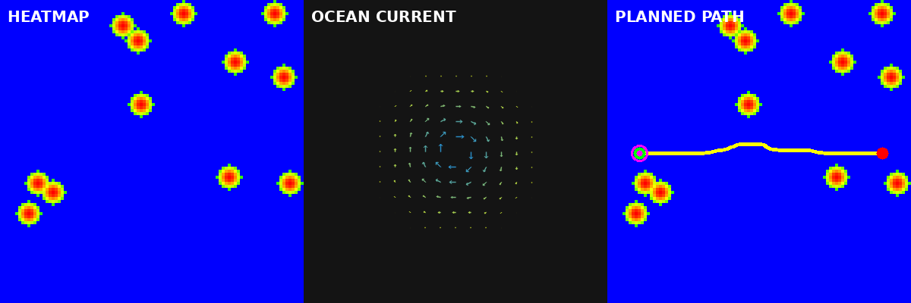

# 基于热力图的洋流干扰下 ROV 自适应路径规划 ROS 2 模块

## 1. 作业概述与背景

遥控水下机器人（ROV）在海底作业时面临两类典型导航挑战：一是海底礁石、沉船等障碍物需要规避，二是洋流会对 ROV 产生持续推力干扰，逆流航行能耗高、顺流航行易偏航。传统的全局路径规划（如纯 A*）只考虑障碍物距离，忽略了洋流的动态影响，导致规划出的路径在实际洋流中能耗大甚至无法到达。

本模块基于 OpenCV 与 A* 算法实现一条"热力图 + 洋流补偿"的自适应路径规划链路：将海底环境离散化为风险热力图，用向量场建模洋流，并在 A* 的代价函数中同时考虑障碍物风险、洋流推力（顺流奖励、逆流惩罚）和路径长度，从而规划出兼顾安全与节能的路径。模块附带演示节点，可自动生成海底障碍物和起终点触发规划。

## 2. 运行环境

- 操作系统：Ubuntu 20.04（虚拟机）
- ROS 2 版本：Humble
- 依赖库：rclcpp、nav_msgs、geometry_msgs、std_msgs、sensor_msgs、cv_bridge、image_transport、OpenCV 4.x、Eigen3
- 演示动图渲染脚本依赖：python3-opencv、python3-numpy、python3-pil（由 rosdep 自动安装）

## 3. 核心代码文件清单

本模块包含以下核心文件，均已提交至仓库：

```
src/water/water_rov_path_planning/
├── include/water_rov_path_planning/
│   ├── heatmap.hpp            # 热力图：参数结构与类声明
│   ├── ocean_current.hpp      # 洋流场：四种模式（均匀/涡流/潮汐/剪切）
│   └── path_planner.hpp       # A* 路径规划器：代价函数与平滑
├── src/
│   ├── heatmap.cpp            # 障碍物风险高斯扩散实现
│   ├── ocean_current.cpp      # 洋流向量场计算与可视化
│   ├── path_planner.cpp       # A* + 洋流顺逆流补偿 + 加权平均平滑
│   ├── planning_node.cpp      # 主节点：环境更新 + 路径规划
│   └── demo_node.cpp          # 演示节点：生成障碍物与起终点
├── launch/
│   └── main.launch.py         # 一键启动
├── config/
│   └── params.yaml            # 参数配置
├── rviz/
│   └── path_planning.rviz     # RViz2 可视化配置
├── scripts/
│   └── render_demo.py         # 订阅节点输出并离线渲染演示动图
├── CMakeLists.txt
├── package.xml
└── README.md
```

## 4. 处理原理

### 4.1 热力图风险建模

将 50m×50m 海域离散化为 100×100 网格（分辨率 0.5m）。每个障碍物在其位置产生峰值风险 1.0，并按高斯函数向周围扩散：

$$
R(x,y) = \exp(-\alpha \cdot d^2)
$$

其中 \(d\) 为格子到障碍物的距离（米），\(\alpha\) 为衰减系数（默认 0.15），障碍物影响半径为 2 m。风险在 2 m 处截断：截断处风险约为 0.55，之后直接归零，因此热力图存在 0.55→0 的台阶；按风险阈值 0.7，实际封禁（不可通行）区域半径约 1.54 m。热力图风险仅由障碍物产生；洋流的影响在 A* 代价函数中单独计算，见 4.3 节。颜色映射为蓝（低风险）经绿、黄过渡到红（高风险）。

### 4.2 洋流场建模

支持四种洋流模式：

- **均匀流**：全海域流速大小方向一致，模拟开阔海域的定向洋流。
- **涡流**：以某点为中心的旋转流，流速随距离中心增大而衰减，模拟海底涡旋。
- **潮汐振荡**：流速随时间正弦变化，模拟潮汐周期。
- **剪切流**：流速随坐标线性变化，模拟海峡中的流速梯度。

### 4.3 自适应 A* 代价函数

A* 的每步代价由三部分加权组成，权重分别为长度 1.0、风险 5.0、洋流 3.0；顺流奖励系数 \(k=0.5\)：

**逆流（\(\hat{u} \cdot v < 0\)）：**

$$
C = w_l \cdot d + w_r \cdot R \cdot d + w_c \cdot |v| \cdot (-\hat{u} \cdot v)
$$

**顺流（\(\hat{u} \cdot v > 0\)）：**

$$
C = w_l \cdot d + w_r \cdot R \cdot d - k \cdot w_c \cdot |v| \cdot (\hat{u} \cdot v)
$$

- \(d\) 为本步移动距离；
- \(R\) 为目标格子的热力图风险（超过阈值 0.7 则不可通行）；
- \(v\) 为该格子处的洋流速度向量，\(\hat{u}\) 为本步移动方向的单位向量，\(|v|\) 为流速大小；
- 横向洋流（点积接近 0）几乎不改变代价。

顺流奖励系数 \(k=0.5\) 使规划器倾向于选择顺流段，降低 ROV 推进能耗。实测均匀流（+x 顺流）场景下总代价较默认涡流场景下降约 19.2，可确认该系数生效。

需要说明的是，启发函数使用欧氏距离，而边代价含风险项（最高可达 6 倍距离）且顺流时可低于距离代价，因此在当前权重下启发函数不满足可采纳性，A* 返回的是该加权代价下的近优解，不保证全局最优。

### 4.4 路径平滑

A* 输出的网格路径存在锯齿，通过 3 次迭代加权平均平滑中间点（权重 0.5、0.25、0.25），得到更连续、可执行的路径。

## 5. 运行步骤

1. 新建标准工作空间并进入 src 目录：

   ```
   mkdir -p ~/ros2_ws/src
   cd ~/ros2_ws/src
   ```

2. 从 ros2 仓库拷贝模块代码到工作空间：

   ```
   cp -r ~/ros2/src/water/water_rov_path_planning ~/ros2_ws/src/
   cd ~/ros2_ws
   ```

3. 安装依赖并编译工作空间、部署环境：

   ```
   rosdep install --from-paths src --ignore-src -r -y
   colcon build --packages-select water_rov_path_planning
   source install/setup.bash
   ```

   若系统存在多个 OpenCV 版本导致找不到 OpenCV 配置，编译时显式指定：

   ```
   colcon build --packages-select water_rov_path_planning --cmake-args -DOpenCV_DIR=/usr/lib/x86_64-linux-gnu/cmake/opencv4
   ```

4. 启动演示节点（自动生成 12 个障碍物 + 起点终点 + 路径规划）：

   ```
   ros2 launch water_rov_path_planning main.launch.py
   ```

5. 另开终端查看路径代价与规划结果：

   ```
   source install/setup.bash
   ros2 topic echo /rov/path_cost
   ros2 topic echo /rov/planned_path
   ```

6. 可选：打开 RViz2 查看热力图、洋流场与规划路径：

   ```
   ros2 run rviz2 rviz2 -d install/water_rov_path_planning/share/water_rov_path_planning/rviz/path_planning.rviz
   ```

## 6. 话题与参数

| 话题 | 类型 | 方向 | 说明 |
| --- | --- | --- | --- |
| `/rov/obstacle` | `geometry_msgs/PointStamped` | 输入 | 障碍物位置（米） |
| `/rov/start` | `geometry_msgs/PointStamped` | 输入 | 起点位置 |
| `/rov/goal` | `geometry_msgs/PointStamped` | 输入 | 终点位置（触发规划） |
| `/rov/planned_path` | `nav_msgs/Path` | 输出 | 规划路径 |
| `/rov/heatmap` | `sensor_msgs/Image` | 输出 | 热力图可视化（蓝=安全，红=危险） |
| `/rov/ocean_current` | `sensor_msgs/Image` | 输出 | 洋流场向量图 |
| `/rov/path_cost` | `std_msgs/Float32MultiArray` | 输出 | [总代价, 路径长度(m), 路径点数] |

| 参数 | 默认值 | 说明 |
| --- | --- | --- |
| `grid_size` | 100 | 热力图网格边长 |
| `resolution` | 0.5 | 每个格子对应实际尺寸（米） |
| `risk_weight` | 5.0 | 热力图风险权重 |
| `current_weight` | 3.0 | 洋流权重 |
| `current_compensation` | 0.5 | 顺流奖励系数（0～1） |
| `max_risk_threshold` | 0.7 | 风险阈值，超过则不可通行 |
| `current_pattern` | vortex | 洋流模式（uniform/vortex/tidal/shear） |
| `current_magnitude` | 0.4 | 基础洋流流速（m/s） |
| `current_direction` | 0.0 | 均匀流方向（弧度） |

演示节点参数：

| 参数 | 默认值 | 说明 |
| --- | --- | --- |
| `world_size` | 50.0 | 海域边长（米） |
| `num_obstacles` | 12 | 随机障碍物数量 |
| `obstacle_seed` | 42 | 障碍物随机种子 |
| `start_x` / `start_y` | 5.0 / 25.0 | 起点坐标（米） |
| `goal_x` / `goal_y` | 45.0 / 25.0 | 终点坐标（米） |

## 7. 运行效果

默认参数下，演示节点在 50m×50m 海域内随机生成 12 个障碍物，起点 (5, 25)、终点 (45, 25)，洋流模式为涡流（中心 (25, 25)，半径 15m，基础流速 0.4 m/s）。规划器输出的路径会：

- 绕开风险超过阈值 0.7 的区域（热力图红色核心），障碍物所在格子完全不可通行，风险低于阈值的过渡带允许通行；
- 路径总长度略长于直线距离。

需要说明的是，默认场景并不能体现顺流节能效果。起点与终点都沿 y=25 布置，而涡流中心位于 (25, 25)，该直线上各格子的切向速度沿 ±y 方向，与 +x 的移动方向点积约等于 0，洋流项对路径的净影响很小：实测总代价 80.02，按纯长度代价估算约 80.2（40.10 m ÷ 0.5 m ≈ 80.2 格），洋流项净贡献约 -0.18；路径长度 40.10 m，与直线距离 40.00 m 基本一致，GIF 中路径近似直线穿过涡流。

在虚拟机上以默认参数（grid_size 100、resolution 0.5、涡流模式、基础流速 0.4 m/s、障碍物种子 42、起点 (5, 25)、终点 (45, 25)）启动后连续运行，规划器实测输出稳定在：路径点数 81，路径长度 40.10 m，总代价 80.02。演示节点每 5 秒触发一次重规划，由于环境静态，多次规划结果一致。

若要验证洋流补偿本身，可将洋流改为与路径同向的均匀流：

```
ros2 launch water_rov_path_planning main.launch.py current_pattern:=uniform current_magnitude:=0.4 current_direction:=0.0
```

此时 +x 方向的每一步都是顺流，总代价会明显低于默认涡流场景（实测数据见下表）。上述配置只改变代价数值，路径形状不变，因为均匀流在整个海域方向一致，不存在可绕行的低阻区域。

| 场景 | 路径点数 | 路径长度 | 总代价 |
| --- | --- | --- | --- |
| 涡流（默认） | 81 | 40.10 m | 80.02 |
| 均匀流（+x 顺流） | 81 | 40.00 m | 60.80 |

均匀流场景下总代价由 80.02 降至 60.80，下降约 19.2，即洋流补偿项在该场景下确实生效；两种场景的路径形状相同，因为障碍物分布与起终点不变。



> 上图为节点实际输出数据经 scripts/render_demo.py 离线渲染的三联对比动图（非 RViz 截图）：左侧 HEATMAP 为热力图（蓝=安全，红=危险），中间 OCEAN CURRENT 为洋流场向量图，右侧 PLANNED PATH 为叠加在热力图上的规划路径（黄色折线，绿色起点，红色终点）。

## 8. 验证范围说明

本模块已在虚拟机上完成以下验证：节点正常启动、话题正常收发、热力图随障碍物添加正确更新、洋流场可视化正常输出、A* 在有障碍物和洋流的环境下成功规划出避开高风险区的路径、路径平滑后无明显锯齿。

当前版本使用合成演示数据（随机障碍物 + 解析洋流场），尚未接入真实海底声呐或多波束数据；洋流场为稳态解析模型，未考虑时间动态变化（潮汐模式有周期变化但未做实测验证）；路径规划为全局一次性规划，未实现随洋流变化的动态重规划（演示节点 5 秒后会触发一次重规划作为示意）。

## 大模型使用声明

本模块代码与文档由大模型辅助生成，作者已在 Ubuntu 20.04 + ROS 2 Humble 虚拟机中实际运行验证，作者对提交内容负责。
