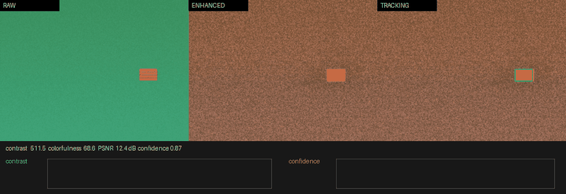

# 基于 OpenCV 的浑浊水体视觉增强与目标追踪 ROS 2 模块

## 作业概述与背景

水下机器人（ROV/AUV）在浑浊水体中作业时，相机图像面临三类典型退化：一是**色彩衰减**，红光被水强烈吸收导致画面偏蓝绿色；二是**对比度下降**，悬浮颗粒对光的前向散射使图像雾化、细节模糊；三是**亮度不均**，光源随距离衰减造成局部过暗。这些退化会显著降低目标检测与追踪的可靠性。

本模块基于 OpenCV 实现一条完整的水下视觉增强与目标追踪链路，包括白平衡、通道增益校正、CLAHE 局部对比度增强、暗通道先验去散射，以及在增强图像上运行 KCF/CSRT/MOSSE 目标追踪器。模块附带合成视频演示节点，可在无外部相机或仿真环境时独立验证整条链路。

## 运行环境

- 操作系统：Ubuntu 22.04（虚拟机）
- ROS 2 版本：Humble
- 依赖库：rclcpp、sensor_msgs、geometry_msgs、std_msgs、cv_bridge、image_transport、tf2_ros、OpenCV 4.5.4（含 opencv_contrib 追踪模块）；scripts/render_demo.py 另需 python3-pil（rosdep 可自动安装）
- 追踪器命名空间：KCF / CSRT 始终位于 `cv`，MOSSE 自 OpenCV 4.5.1 起迁入 `cv::legacy`，代码按 `CV_VERSION_*` 编译期自动切换

## 核心代码文件清单

本模块包含以下核心文件，均已提交至仓库：

```
src/water/water_vision_enhancement/
├── include/water_vision_enhancement/
│   ├── image_enhancer.hpp        # 图像增强器：参数结构与类声明
│   └── object_tracker.hpp        # 目标追踪器：KCF/CSRT/MOSSE 封装
├── src/
│   ├── image_enhancer.cpp        # 色彩校正+CLAHE+去散射实现
│   ├── object_tracker.cpp        # 追踪器初始化、更新、置信度估计
│   ├── vision_node.cpp           # 主节点：订阅→增强→追踪→发布
│   └── video_demo_node.cpp       # 演示节点：合成浑浊水体视频
├── launch/
│   └── main.launch.py            # 一键启动文件
├── config/
│   └── params.yaml               # 参数配置
├── rviz/
│   └── vision_enhancement.rviz   # RViz2 可视化配置
├── scripts/
│   └── render_demo.py            # 离线渲染演示 GIF（抓取节点实际输出合成三联对比动图）
├── resource/
│   └── water_vision_enhancement  # 无后缀空文件
├── CMakeLists.txt
├── package.xml
└── README.md
```

## 处理原理

1. **白平衡。** 基于灰世界假设，将各通道均值拉向 128，消除整体色偏。
2. **通道增益校正。** 水下环境红光衰减最快，蓝光相对充足。对 R/G/B 三通道分别施加增益（默认 R=1.35、G=1.0、B=0.85），补偿水体吸收造成的色彩失衡。先做白平衡再施加增益，避免白平衡把各通道均值重新拉平而抵消增益效果。红增益取 1.35 是在 1.8 的基础上回退得到的：1.8 在顺序调整后会使整幅图明显偏橙红，属过校正。
3. **CLAHE 局部对比度增强。** 转到 Lab 色彩空间，仅对 L（亮度）通道做限制对比度自适应直方图均衡，提升局部细节而不过度放大噪声。
4. **去散射。** 大气光由参数 atmosphere_light 给定（默认 0.95），基于暗通道先验估计透射率，按 `J = (I - A) / t + A` 恢复无雾图像，削弱悬浮颗粒造成的雾化。
5. **目标追踪。** 在增强后图像上用 OpenCV 追踪器（KCF/CSRT/MOSSE）连续估计目标边界框，输出归一化中心点与置信度。

## 运行步骤

1. 新建标准工作空间并进入 src 目录：

   ```
   mkdir -p ~/ros2_ws/src
   cd ~/ros2_ws/src
   ```

2. 从 ros2 仓库拷贝模块代码到工作空间：

   ```
   cp -r ~/ros2/src/water/water_vision_enhancement ~/ros2_ws/src/
   cd ~/ros2_ws
   ```

3. 安装依赖并编译工作空间、部署环境：

   ```
   rosdep install --from-paths src --ignore-src -r -y
   colcon build --packages-select water_vision_enhancement
   source install/setup.bash
   ```

   注：追踪器依赖 opencv_contrib 的 tracking 模块。若系统中存在多套 OpenCV（例如 /usr 与 /usr/local 各一套），编译时需显式指定带 contrib 模块的那一套，例如：

   ```
   colcon build --packages-select water_vision_enhancement --cmake-args -DOpenCV_DIR=/usr/lib/x86_64-linux-gnu/cmake/opencv4
   ```

4. 启动演示节点（合成浑浊水体视频）与视觉处理节点：

   ```
   ros2 launch water_vision_enhancement main.launch.py
   ```

5. 另开终端查看增强质量指标与目标位置：

   ```
   source install/setup.bash
   ros2 topic echo /enhancement_metrics
   ros2 topic echo /tracked_object
   ```

6. 可选：打开 RViz2 对比原始、增强、追踪三幅图像：

   ```
   ros2 run rviz2 rviz2 -d install/water_vision_enhancement/share/water_vision_enhancement/rviz/vision_enhancement.rviz
   ```

## 话题与参数

| 话题 | 类型 | 方向 | 说明 |
| --- | --- | --- | --- |
| `/camera/image_raw` | `sensor_msgs/Image` | 输入 | 原始水下图像（演示节点发布） |
| `/enhanced_image` | `sensor_msgs/Image` | 输出 | 增强后图像 |
| `/tracking_result` | `sensor_msgs/Image` | 输出 | 带绿色边界框与红色中心点的追踪可视化 |
| `/tracked_object` | `geometry_msgs/PointStamped` | 输出 | 目标归一化中心点（x、y 为 0～1，z 为置信度） |
| `/enhancement_metrics` | `std_msgs/Float32MultiArray` | 输出 | [对比度, 色彩度, PSNR(dB), 追踪置信度] |

| 参数 | 默认值 | 所属节点 | 说明 |
| --- | --- | --- | --- |
| `red_gain` | 1.35 | water_vision_node | 红光通道增益（补偿水体吸收） |
| `green_gain` | 1.0 | water_vision_node | 绿光通道增益 |
| `blue_gain` | 0.85 | water_vision_node | 蓝光通道增益（抑制偏蓝） |
| `use_clahe` | true | water_vision_node | 是否启用 CLAHE |
| `clahe_clip_limit` | 2.0 | water_vision_node | CLAHE 裁剪阈值 |
| `clahe_tile_grid` | 8 | water_vision_node | CLAHE 网格大小 |
| `use_dehaze` | true | water_vision_node | 是否启用去散射 |
| `dehaze_strength` | 0.6 | water_vision_node | 去散射强度（0～1） |
| `atmosphere_light` | 0.95 | water_vision_node | 大气光估计值（0～1） |
| `tracker_type` | KCF | water_vision_node | 追踪器类型（KCF/CSRT/MOSSE） |
| `min_confidence` | 0.3 | water_vision_node | 追踪置信度下限 |
| `auto_reinit` | true | water_vision_node | 丢失后是否自动重置追踪器 |
| `detect_interval` | 30 | water_vision_node | 自动重置前的连续丢失帧数 |
| `init_bbox_x/y/w/h` | 290 / 220 / 60 / 40 | water_vision_node | 初始追踪框，对准演示目标初始位置 |
| `turbidity` | 0.5 | water_video_demo_node | 合成水体浑浊度（0～1） |
| `target_speed` | 80.0 | water_video_demo_node | 目标移动速度（px/s） |
| `width / height / fps` | 640 / 480 / 20 | water_video_demo_node | 输出图像尺寸与帧率 |

## 运行效果

默认参数下，演示节点生成 640×480、20 fps 的浑浊水体视频：蓝绿色背景叠加雾化与颗粒噪声，一个橙色矩形目标在画面内做反弹运动。视觉节点依次完成增强与追踪。

在虚拟机上以默认参数（浑浊度 0.5、KCF 追踪器、初始框 [290, 220, 60, 40]，演示目标固定为 60×40、初始中心 (320, 240)，初始框与目标基本重合）启动后连续运行，`/enhancement_metrics` 实测稳定在：对比度（拉普拉斯方差）506～511，色彩度 68.6，PSNR 12.4 dB；`/tracked_object` 持续输出目标中心点。追踪置信度为当前追踪区域与初始框灰度模板的归一化互相关系数（TM_CCOEFF_NORMED，0～1），稳定追踪期实测约 0.84～0.88，随目标运动与噪声逐帧波动，不再是固定常数。长时间运行后，追踪框可能漂移退化，置信度低于 min_confidence 时判定为丢失，auto_reinit 按 detect_interval（默认 30 帧）自动重置追踪器，并以参数指定的初始框重新初始化，此时追踪框回到初始位置而非跟随运动目标，此现象与“初始框由参数指定、未实现自动检测初始化”的设计一致。



> 上图为节点实际输出数据经 scripts/render_demo.py 离线渲染的三联对比动图（非 RViz 截图）：左侧 RAW 为原始浑浊图像，中间 ENHANCED 为增强后图像，右侧 TRACKING 为追踪可视化（绿色边界框与红色中心点），底部为对比度与置信度实时曲线。动图已压缩至 5 MB 以内，符合仓库配图大小要求。

## 验证范围说明

本模块已在 Ubuntu 22.04 + ROS 2 Humble（OpenCV 4.5.4）虚拟机上完成以下验证：节点正常启动、话题正常收发、增强与追踪链路连续运行、追踪器在目标移动过程中持续输出边界框与中心点、`/enhancement_metrics` 数值随画面变化正常波动（对比度 506～511、色彩度 68.6、PSNR 12.4 dB）。需要说明的是，增强在提升对比度的同时也放大了颗粒噪声，PSNR 偏低；红色通道补偿使画面整体偏暖棕色调，属简化算法的已知局限。

当前版本使用合成视频演示，尚未接入真实水下相机或 HoloOcean 仿真；追踪器初始框由参数指定，未实现自动检测初始化。去散射采用暗通道先验简化实现，对极端浑浊或强光场景效果有限。
