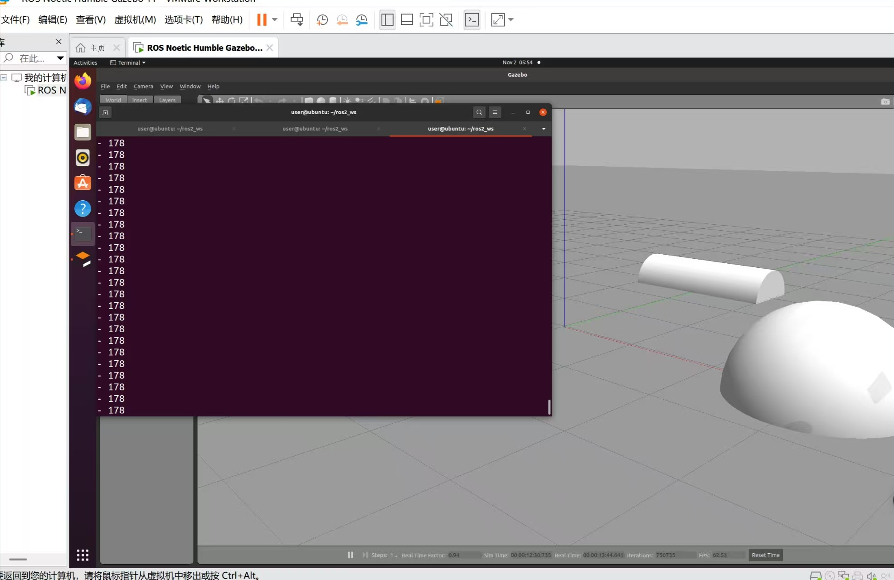
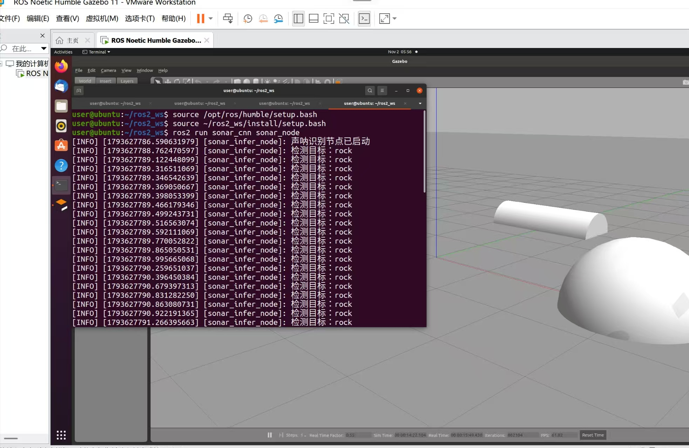

# water 功能包：水下 ROV 声呐图像 CNN 目标识别

## 概述

`water` 是 ROS2 Python 功能包，用 Gazebo 搭建水下场景，通过相机采集图像，用 3 层卷积网络对图像做 3 类目标分类（rock / pipe / sand），并把带标注的结果图发布到 RViz 或 `rqt_image_view`。

> 说明：当前 Gazebo 世界中使用的是普通 RGB 相机（`libgazebo_ros_camera.so`）模拟声呐成像，不是真实侧扫声呐传感器。若用于论文实验，应改为真实声呐数据集离线推理，或在文中如实说明"以相机图像代理声呐图像验证流程"。

## 目录结构

```
src/water
├── water/
│   ├── __init__.py
│   ├── sonar_model.py        # 网络定义（训练/推理共用）
│   ├── sonar_infer_node.py   # 推理节点
│   └── train_sonar.py        # 训练脚本（ImageFolder 数据集）
├── launch/
│   └── rov.launch.py
├── worlds/
│   └── underwater.world
├── weights/                  # 训练输出目录（*.pth，可选安装）
├── resource/
│   └── water
├── package.xml
├── setup.cfg
└── setup.py
```

## 环境依赖

- ROS2（Humble 及以上）+ Gazebo classic
- `sudo apt install ros-$ROS_DISTRO-gazebo-ros-pkgs ros-$ROS_DISTRO-cv-bridge python3-opencv`（注意：是 Ubuntu 侧的 ROS2 环境，不是 Windows PowerShell）
- pip 依赖：

```bash
pip install torch torchvision --index-url https://download.pytorch.org/whl/cpu
pip install opencv-python -i https://pypi.tuna.tsinghua.edu.cn/simple
```

## 编译

```bash
colcon build --packages-select water
source install/setup.bash

```bash
cd src/water
python3 -m water.train_sonar --data /path/to/dataset --epochs 20 \
    --out weights/sonar_cnn_weights.pth
cd ../..
colcon build --packages-select water     # 重新编译，把 weights/*.pth 装进 share/water/weights
source install/setup.bash
```

训练脚本会打印 `class_to_idx`，节点的 `classes` 参数顺序必须与之相同。

## 运行

```bash
ros2 launch water rov.launch.py
```

## 效果图




