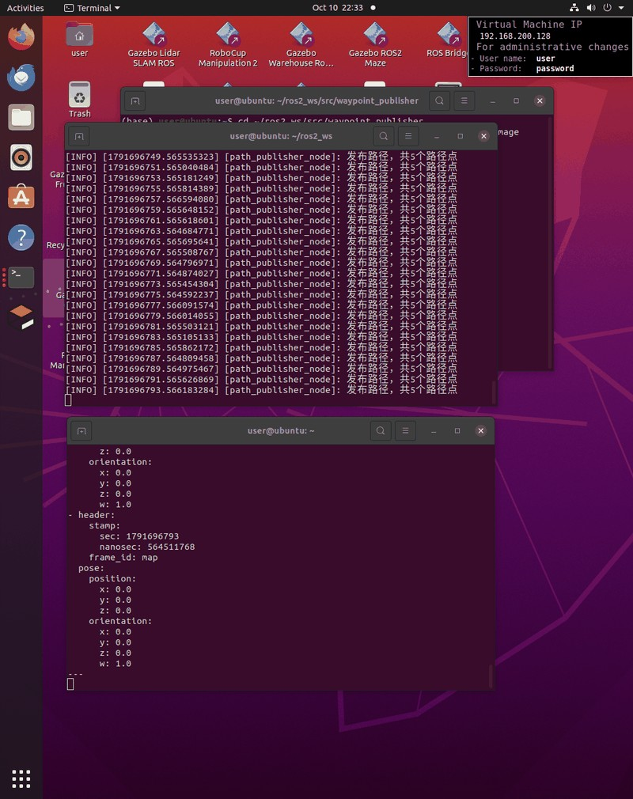
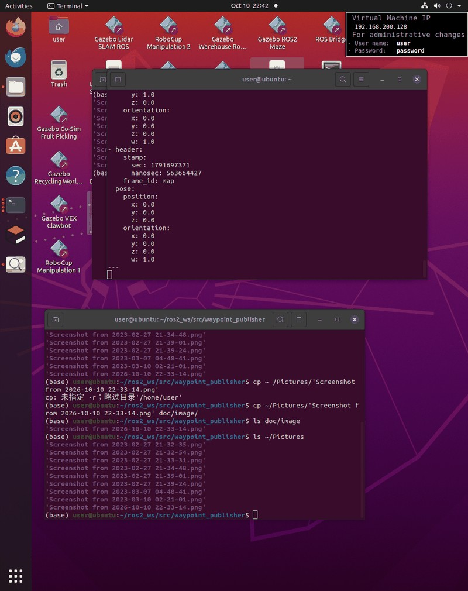
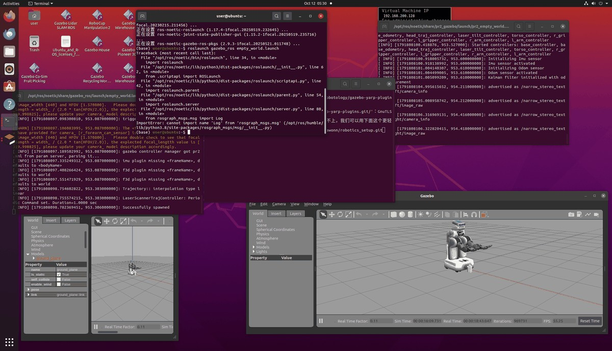

# ROS2 Humble 路径点发布器
## 1 项目简介
本项目基于 ROS2 Humble，编写路径点发布节点，向 Nav2 发布路径（Path）消息，可在 RViz2 可视化观察规划路径，用于机器人定点导航。
### 使用工具
1. 虚拟机：VMware Workstation
2. 操作系统：Ubuntu 22.04
3. ROS平台：ROS 2 Humble
4. 可视化工具：RViz2
5. 编程语言：Python3
6. 版本管理：Git + GitHub
## 2 环境准备
- 系统：Ubuntu 22.04
- ROS版本：ROS2 Humble
- 依赖包：`rclpy`、`nav_msgs`、`geometry_msgs`

安装依赖（如果缺少）：
```bash
sudo apt update
sudo apt install ros-humble-nav-msgs ros-humble-geometry-msgs
```
## 3. 创建 ROS2 功能包
在工作空间src目录下创建功能包：
```bash
cd ~/ros2_ws/src
ros2 pkg create --build-type ament_python waypoint_publisher
cd waypoint_publisher/waypoint_publisher
```
新建`waypoint_pub.py`文件，写入路径发布代码。
## 4.核心代码
```python
import rclpy
from rclpy.node import Node
from nav_msgs.msg import Path
from geometry_msgs.msg import PoseStamped

class WaypointPublisher(Node):
    def __init__(self):
        super().__init__('waypoint_publisher')
        self.publisher_ = self.create_publisher(Path, '/plan', 10)
        timer_period = 1.0
        self.timer = self.create_timer(timer_period, self.timer_callback)

    def timer_callback(self):
        path_msg = Path()
        path_msg.header.frame_id = "map"
        path_msg.header.stamp = self.get_clock().now().to_msg()

        # 路径点
        poses = [
            (0.0, 0.0),
            (1.0, 0.0),
            (1.0, 1.0),
            (2.0, 1.0)
        ]
        for x,y in poses:
            pose = PoseStamped()
            pose.header.frame_id = "map"
            pose.header.stamp = self.get_clock().now().to_msg()
            pose.pose.position.x = x
            pose.pose.position.y = y
            pose.pose.orientation.w = 1.0
            path_msg.poses.append(pose)

        self.publisher_.publish(path_msg)
        self.get_logger().info("发布路径点成功")

def main(args=None):
    rclpy.init(args=args)
    node = WaypointPublisher()
    rclpy.spin(node)
    node.destroy_node()
    rclpy.shutdown()

if __name__ == '__main__':
    main()
```
## 5.编译与运行
```bash
cd ~/ros2_ws
colcon build --packages-select waypoint_publisher
source install/setup.bash
ros2 run waypoint_publisher waypoint_pub
```
## 6.RViz2配置
按以下步骤完成可视化配置：
1.  新开终端，启动RViz2：
    ```bash
    rviz2
    ```
2.  将全局坐标系 `Fixed Frame` 设置为 `map`
3.  点击 Add，添加 `Path` 可视化插件
4.  在 Path 插件的 Topic 下拉框中选择 `/plan` 话题
5.  此时即可在RViz2中看到节点发布的路径折线




## 7.验证消息
新开终端，执行以下命令查看话题消息：
```bash
ros2 topic echo /plan
```
终端打印出路径消息内容，即代表节点正常发布。
## 8.总结
本节点可以自定义waypoint数组，修改坐标即可更改机器人目标路径，发布的Path消息可直接供给Nav2导航栈使用，在RViz2中实现可视化路径。

---
# 附录：ROS Noetic PR2人形机器人仿真部署指南
## 一.环境概览
- 操作系统: Ubuntu 20.04 LTS
- ROS 版本: ROS Noetic Ninjemys
- 仿真工具: Gazebo
- 机器人模型: PR2 (Personal Robot 2)
- Python 环境: Anaconda (Base) / System Python
## 二. 使用工具清单
本项目部署过程中涉及以下核心工具：
- Gazebo: 3D 动态仿真器，用于加载物理世界和机器人模型。
- RViz: ROS 可视化工具（可选），用于查看传感器数据。
- Terminal (终端): 用于执行 ROS 命令和环境配置。
- Anaconda: Python 环境管理工具（本次部署中需暂时退出以避免冲突）。
- Git / GitHub: 用于版本控制和文档管理。
## 三.部署步骤
第一步：安装 PR2 功能包
```bash
sudo apt update 
sudo apt install ros-noetic-pr2-simulator
```
第二步：解决 Anaconda 环境冲突:
由于 Anaconda 的 Python 环境可能会覆盖 ROS 所需的系统 Python 库（导致 No module named 'rospkg' 错误），启动前必须先退出 Conda 环境。
```bash
conda deactivate
```
第三步：加载 ROS 环境
确保当前终端已 sourced ROS 的环境变量：
```bash
source /opt/ros/noetic/setup.bash
```
第四步：启动 PR2 仿真
使用 roslaunch 启动 PR2 在空世界中的仿真：
```bash
roslaunch pr2_gazebo pr2_empty_world.launch
```
## 4. 运行结果
启动成功后，Gazebo 窗口将弹出，并加载 PR2 机器人模型。

