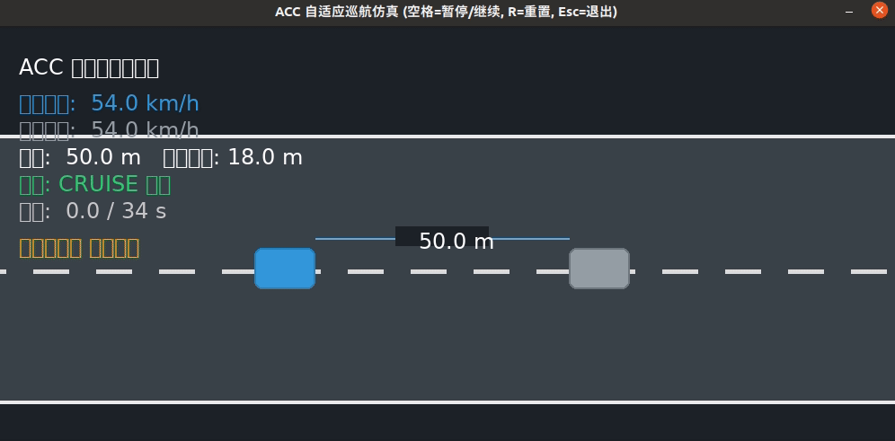

# acc_follow —— ACC 自适应巡航仿真

车辆沿直线行驶，ACC（自适应巡航）控制器自动完成"巡航 → 前车减速时跟随减速 → 前车停车时跟停 → 前车起步后自动跟随恢复巡航"的完整闭环。基于**恒定时距（Constant Time Gap, CTG）+ 平方根刹停曲线 + 刹停兜底**控制律。



## 1. 运行环境

- 操作系统：Windows 10/11、Ubuntu 20.04/22.04
- Python：3.8 ~ 3.12（开发与验证基于 3.10/3.11）
- 依赖：`pygame`（交互仿真）、`pillow`（录制演示动图，可选）
- ROS 节点入口：ROS Noetic（`rospy` / `geometry_msgs` / `std_msgs`）

```bash
pip3 install pygame pillow
```

## 2. 快速开始（无需 ROS）

```bash
# 方式一：交互仿真（空格=暂停/继续，R=重置，Esc=退出）
python3 scripts/acc_sim.py

# 方式二：无界面自动验证（打印 6 项指标 + PASS/FAIL）
python3 scripts/headless_test.py

# 方式三：无头录制动图（生成 demo.gif，Pillow 合成）
python3 scripts/acc_sim.py --record demo.gif --duration 34
```

场景：前车 15 m/s（54 km/h）巡航 → 8 s 开始减速 → 13 s 停稳 → 停止 7 s → 20 s 起步回巡航，总时长 34 s。

## 3. ROS 运行（ROS Noetic）

```bash
# 方案 A：roslaunch 一键启动（内置前车场景，发布 /cmd_vel）
roslaunch acc_follow main.launch

# 方案 B：接收外部前车状态（前车位置/速度由 /lead_state 提供）
#   话题：std_msgs/Float32MultiArray: [x_lead, v_lead]
roslaunch acc_follow main.launch use_external:=true
```

节点发布：

| 话题 | 类型 | 说明 |
|---|---|---|
| `/cmd_vel` | geometry_msgs/Twist | 本车目标速度（linear.x） |
| `/lead_state`（订阅） | std_msgs/Float32MultiArray | 前车状态 [x_lead, v_lead] |

## 4. 控制律（摘要）

> 说明：本项目中所有"车距"均指**保险杠间距**（两车保险杠之间的空隙），
> 由中心距换算得到：`d = d_center - 车长`（车长 `car_len = 4.5 m`）。
> `d0 = 3.0 m` 为停车安全保险杠间距。

- 期望保险杠车距：`d_des = d0 + t_gap * v_host + t_react * max(v_host - v_lead, 0)`
  - 前车比本车慢时额外加大期望车距，提前减速；
- 三区控制：
  - 巡航区 `d > d_enter`：`v_cmd = v_cruise`；
  - 减速区 `d0 < d <= d_enter`：`v_cmd = sqrt(2 * a_brk * (d - d0))`（平方根刹停曲线，到 `d0` 处速度恰好为 0）；
  - 停车区 `d <= d0`：`v_cmd = 0`；
- 安全兜底：`(v_host^2 - v_lead^2) / (2 * a_brk) > d - d0` 时全力制动。

## 5. 文件结构

```text
acc_follow/
├── scripts/
│   ├── main.py               # ROS Noetic 节点（发布 /cmd_vel）
│   ├── acc_sim.py            # Pygame 仿真 + 无头录制动图
│   ├── headless_test.py      # 无界面自动验证
│   ├── vehicle_model.py      # 一维纵向车辆运动学模型
│   └── acc_controller.py     # ACC 控制律（恒定时距 + 平方根刹停曲线）
├── launch/main.launch        # ROS launch 入口
├── docs/acc_follow.md        # 设计文档（控制律推导 + 测试结果）
├── docs/acc_demo.gif         # 演示动图
├── package.xml
└── CMakeLists.txt
```

## 6. 验证结果

| 指标 | 结果 |
|---|---|
| 全程最小保险杠车距 | 2.79 m（> 安全间距 3.0 m，不碰撞） |
| 前车停稳后本车跟停 | 停稳车距 2.79 m（期望 d0=3.0 m） |
| 全程最高车速 | 15.00 m/s（= 巡航限速，不超速） |
| 前车起步后 | 自动起步并恢复巡航（15.00 m/s） |
| 稳态跟车车距 | 20.25 m（≈ 期望 3 + 1.0×15 + 反应项） |

详细设计见 [docs/acc_follow.md](docs/acc_follow.md)。
