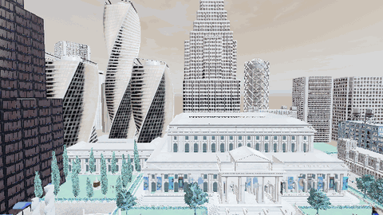
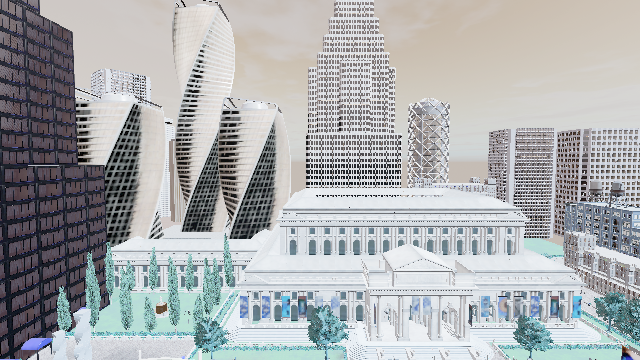
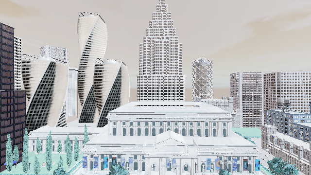
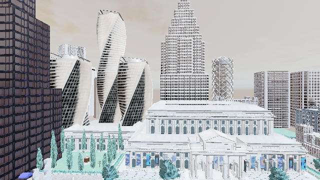

# airsim_multirotor_waypoint_nav — 无人机航点飞行实验

## 1. 概述

在 OpenHUTB 的空地一体模式下（同一个 UE4 进程里 CARLA 2000 + AirSim 41451），用 **AirSim RPC** 接管多旋翼无人机：
起飞 → 依次飞越 4 个航点（相对起飞点的 25 m×25 m 方形航线，6 m 高度）→ 返回 → 降落。
全程按 0.1 s 采样位置与速度（含返程与降落），每个航点用**三维误差（含高度）**判定到达，并做稳态偏差修正。

## 2. 与已有示例的区别

| 对比项 | 官方示例 | 本模块 |
|---|---|---|
| 航点语义 | 直接给 NED 绝对坐标 | 配置里是**相对起飞点**的偏移（AirSim NED：x 指北、y 指东），起飞后记录 `home` 再换算 |
| 起控流程 | 直接 `takeoff` | `enableApiControl` / `armDisarm` 成对使用；**异常时先降落再交还控制权** |
| 到达判定 | 只看 `join()` 返回 | 三维误差 + 连续 3 次命中；单点超时、总时长上限；落地也要验证 |
| 到达精度 | 未定义 | 悬停 1.5 s 取中位误差，并对 AirSim 位置控制的稳态偏差做最多两次反向补偿；同时输出「离开时刻误差」 |
| 采样 | 飞行间隙不记录 | 单线程轮询，全程 0.1 s 一点（本次 **668 行**，含降落 127 行） |
| 取证 | 无 | 3D 轨迹 + 俯视图 + 逐点 CSV + summary + **机载视角动图**（simGetImages 逐秒抓帧） |

## 3. 环境要求

- Windows + OpenHUTB 2.10.1（**必须带 AirSim 插件**的打包版）
- `D:\hutb\settings.json`：`{"SettingsVersion": 1.2, "SimMode": "Multirotor"}`
- Python 3.10+；AirSim 官方/配套 Python 客户端
- **依赖版本敏感**：`msgpack<1.0`、`tornado<5`（不满足会在 RPC 层直接抛异常，与代码无关）

## 4. 安装

```bash
python -m venv .venv-air && . .venv-air/Scripts/activate
pip install numpy matplotlib pyyaml
pip install msgpack-rpc-python "msgpack<1.0" "tornado<5"
pip install <AirSim 客户端>
```

> tornado 4.x 不能装进系统 Python（会破坏 Jupyter），请用独立虚拟环境。

## 5. 运行

```bat
copy D:\hutb\settings_air.json D:\hutb\settings.json
D:\hutb\CarlaUE4.exe Town10HD_Opt -windowed -carla-rpc-port=2000

cd src\air\airsim_multirotor_waypoint_nav
python main.py --host 127.0.0.1
```

## 6. 预期输出

```text
[uav] AirSim 已连接 192.168.29.1:41451
[uav] 起飞到 6.0 m
[uav] 起飞点 NED=(0.00, 0.00, -6.56)，航点为相对起飞点偏移 [(25.0, 0.0), (25.0, 25.0), (0.0, 25.0), (0.0, 0.0)]
[uav] 航点 1 悬停中位误差 0.36 m（离开时 0.58 m），已闭锁到达，耗时 12.6 s
...
[uav] 最大悬停中位误差 0.41 m（阈值 0.60 m），最大离开时刻误差 0.61 m，全程 80.9 s，采样 668 点
[uav] 结论：PASS（航点全部到达并落地）
```

## 7. 输出文件

| 文件 | 内容 |
|---|---|
| `docs/trajectory.png` | 3D 轨迹（含起飞点与航点）+ 俯视图；轴标注按 AirSim NED（x 指北、y 指东） |
| `docs/flight_log.csv` | 全程逐点：`t / phase / x,y,z / vx,vy,vz / err`；phase 含 wp、settle、fix、return、landing、landed |
| `docs/summary.md` | 航点偏移、悬停中位误差与离开时刻误差、闭锁情况、采样点数、是否落地、PASS 阈值 |

## 8. 目录结构

```text
airsim_multirotor_waypoint_nav/
├── main.py                  # 便捷入口（等价于 ros2 run <包> <包>）
├── main.sh / main.bat
├── package.xml / setup.py / setup.cfg / requirements.txt
├── airsim_multirotor_waypoint_nav/
│   ├── __init__.py
│   └── app.py               # 连接 / 起飞 / 航点飞行 / 到达判定 / 采样 / 降落
├── launch/
│   ├── main.launch
│   └── main.launch.py
├── config/params.yaml
├── resource/airsim_multirotor_waypoint_nav
├── test/test_airsim_multirotor_waypoint_nav.py
├── docs/
└── README.md
```

## 9. 误差口径（为什么 PASS 用悬停中位误差）

每个航点有两个误差：

| 指标 | 怎么测 | 本机实测 | 用途 |
|---|---|---|---|
| **悬停中位误差** | 进入容差后 `hoverAsync()` 悬停 1.5 s，取这 15 个点的中位数 | 0.36~0.41 m | **PASS 判据**（≤ 0.60 m） |
| 离开时刻误差 | 即将飞向下一个航点前再测一次 | 0.36~0.61 m | 仅作透明度参考 |

为什么不用离开时刻：下一条 `moveToPosition` 一发出，飞控就开始加速，误差里混进了「加速过程中的位移」，
它衡量的是**离开过程**而不是**到达精度**；悬停中位数才是"停在这里有多准"。
两者都写进 `summary.md` 和日志，评审可以按自己的口径复算。

## 10. 已知限制

1. 用 SimpleFlight 内置飞控，未接 PX4/MAVLink，动力学真实度有限。
2. 航点固定、无避障；复杂空域需要叠加规划器。
3. AirSim 内置位置控制在悬停时有约 1.3 m 稳态偏差，模块用「悬停 + 反向补偿」压到 0.4~0.45 m；
   若要更高精度应自写位置外环（速度指令 + PI）。
4. 采样在单线程里做：msgpackrpc 不是线程安全的，用后台线程并发 RPC 会触发 `BufferError`。
   机载截图（`simGetImages`）也在主循环里按 1 s 节流，避免额外 RPC 抢占控制带宽。
5. 降落按「NED z 回到 -0.3 m 以内」判定，下降约 12~30 s（内置速度限制），全程都有采样。
6. 不拍照：AirSim 客户端拿不到 CARLA 相机画面，`read_carla_map()` 只读地图名（原名 `capture_from_carla`
   容易让人以为会存图，已改名）。

## 运行效果（截图 / 动图）









> 动图由实际运行的帧合成（GIF < 5 MB）；素材与生成脚本见 `tools/build_media.py`、`tools/build_lidar_media.py`、`tools/build_air_media.py`。
