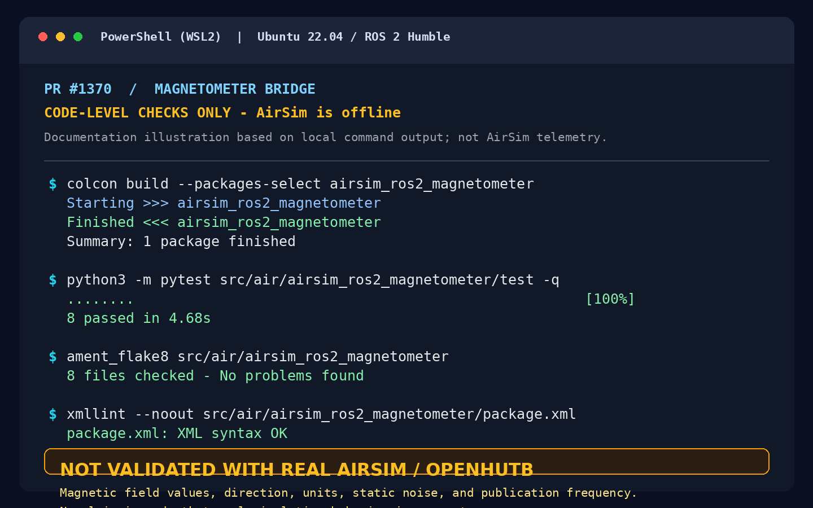

# airsim_ros2_magnetometer

ROS 2 Humble 的 AirSim 磁力计桥接。模块把 AirSim 多旋翼磁力计数据发布为标准
`sensor_msgs/msg/MagneticField`，供航向估计、磁偏角分析和组合导航使用。

## 功能范围

- 从 AirSim `getMagnetometerData` 读取三轴磁场；
- 发布 `/uav/magnetometer`，类型为 `sensor_msgs/msg/MagneticField`；
- 将机体 FRD 磁场转换到 ROS FLU；
- 支持 `field_scale`，显式处理 AirSim 原始单位到目标单位的换算；
- 使用可靠 QoS 和三轴协方差；
- AirSim 连接和读取在后台执行，`rpc_timeout` 限制单次 RPC；
- AirSim 断连后停止发布旧数据并定期重连；
- 提供统一的 `main` 入口和 ROS 2 launch。

本模块不进行磁偏角补偿、椭球拟合、硬铁/软铁标定或姿态融合。

## 接口

| 类型 | 名称 | 消息 |
| --- | --- | --- |
| 发布 | `/uav/magnetometer` | `sensor_msgs/msg/MagneticField` |

`field_scale` 默认 `1.0`，表示不改变 AirSim 原始数值。若场景配置使用高斯而
下游要求 Tesla，可将该值设为 `1e-4`；使用前应在实际场景中确认单位。

## 构建

```bash
source /opt/ros/humble/setup.bash
mkdir -p ~/hutb_ws/src
ln -sfn ~/ros2/src/air/airsim_ros2_magnetometer \
  ~/hutb_ws/src/airsim_ros2_magnetometer
python3 -m pip install -r \
  ~/hutb_ws/src/airsim_ros2_magnetometer/requirements.txt
cd ~/hutb_ws
colcon build --symlink-install --packages-select airsim_ros2_magnetometer
source install/setup.bash
```

## 运行

```bash
ros2 launch airsim_ros2_magnetometer bringup.launch.py \
  host:=<Windows_IP> port:=41451 vehicle_name:=""
```

检查数据：

```bash
ros2 topic hz /uav/magnetometer
ros2 topic echo /uav/magnetometer --once
```

发布端使用可靠 QoS，因此默认的 `ros2 topic hz` 和 `ros2 topic echo` 可直接
匹配。AirSim 没有提供协方差时，消息协方差保持全零，表示未知，不填入假设精度。



默认坐标系为 `base_link`，`publish_rate` 为 `20.0` Hz，表示最大调度和发布
频率；`rpc_timeout` 为 `1.0` 秒，`reconnect_period` 为 `2.0` 秒。

## 测试

```bash
python3 -m pytest ~/hutb_ws/src/airsim_ros2_magnetometer/test -q
colcon test --packages-select airsim_ros2_magnetometer
colcon test-result --verbose
```

测试覆盖 FRD→FLU、尺度换算、协方差、非法样本、后台阻塞连接和读取、
连续失败重连、AirSim 客户端缺失提示和启动检查，共 10 项。

## 范围与限制

- AirSim 原始磁场单位需在实际场景中确认；
- 不执行磁力计标定、磁偏角补偿或姿态融合；
- 真实磁场、噪声、方向和频率仍需在 AirSim/OpenHUTB 场景中验证。

## ROS 2 与仓库贡献约定

- 使用 ROS 2 Humble、`rclpy`、ament_python 和标准 ROS 消息；
- 高频磁力计话题使用传感器数据 QoS；
- 模块入口统一为 `main`，并提供 `launch/bringup.launch.py`；
- 源码和教程分别位于 `src/air`、`docs/air`；
- 首页和 `mkdocs.yml` 已加入导航；
- PR 需要补充真实运行截图/GIF，并由另一台机器复核。

参考：

- [OpenHUTB/ros2 提交注意事项](https://github.com/OpenHUTB/ros2#注意事项)
- [OpenHUTB 贡献指南](https://github.com/OpenHUTB/.github/blob/master/CONTRIBUTING.md)
- [ROS 2 Humble 文档](https://docs.ros.org/en/humble/)
- [sensor_msgs/MagneticField 接口](https://docs.ros.org/en/humble/p/sensor_msgs/msg/MagneticField.html)

## AI 辅助声明

本模块、测试和文档由大语言模型辅助整理；提交者应实际连接 AirSim，确认
磁场方向、量级、单位和噪声，并对提交内容负责。
