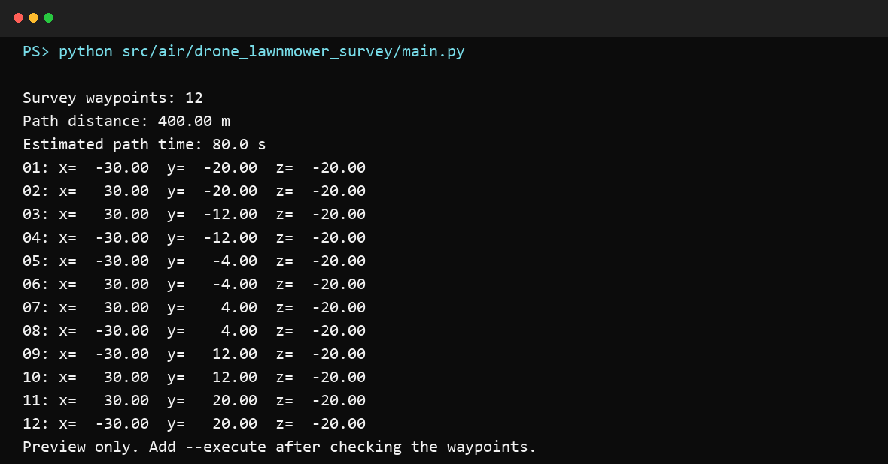

# AirSim 无人机弓字形区域勘测

本模块为 AirSim 多旋翼生成覆盖矩形区域的弓字形（lawnmower）航线，并通过
`moveOnPathAsync` 自动执行勘测任务。航线几何与 AirSim 连接层分离，因此无需启动
仿真器即可预览和测试航点。

实现思路参考 Microsoft AirSim Wiki 的
[Implementing a Drone Survey script](https://github.com/microsoft/AirSim/wiki/Implementing-a-Drone-Survey-script)，
并重新实现了参数校验、边界覆盖、安全预览和自动降落流程。

## 功能

- 根据区域长度、宽度和最大航线间距生成往返覆盖路径；
- 自动缩小实际间距，保证矩形两侧边界都被覆盖；
- 使用 AirSim NED 坐标，高度自动转换为负 z；
- 默认只预览航点，显式添加 `--execute` 才会起飞；
- 任务结束或出现异常时尝试悬停、降落、解锁并释放 API 控制权；
- 使用标准库 `unittest` 覆盖正常值和 `nan`、`inf`、零、负数等边界。

## 环境

- Python 3.8+
- CarlaAir / AirSim 多旋翼场景
- AirSim Python API（仅实际飞行需要）

```bash
pip install airsim
```

## 运行

先在仓库根目录预览默认航线。该命令不会连接 AirSim，也不会起飞：

```bash
python src/air/drone_lawnmower_survey/main.py
```

默认安全预览运行效果：



本次可复核的预览输出保存在
[`validation/preview_validation.log`](validation/preview_validation.log)。

确认航点后，启动 AirSim 场景并显式执行任务：

```bash
python src/air/drone_lawnmower_survey/main.py --execute \
  --length 60 --width 40 --lane-spacing 8 --altitude 20 --speed 5
```

远程仿真器或指定载具：

```bash
python src/air/drone_lawnmower_survey/main.py --execute \
  --ip 192.168.1.10 --port 41451 --vehicle Drone1
```

## ROS 2 启动入口

该目录是一个标准 `ament_python` 包，ROS 2 Humble 环境中可以从仓库根目录只构建
本模块。启动文件默认执行安全预览，不连接 AirSim；只有显式传入 `execute:=true`
才会把 `--execute` 传给脚本：

```bash
source /opt/ros/humble/setup.bash
cd ~/ros2
colcon build --packages-select drone_lawnmower_survey --symlink-install
source install/setup.bash
ros2 launch drone_lawnmower_survey survey.launch.py
ros2 launch drone_lawnmower_survey survey.launch.py \
  length:=60 width:=40 lane_spacing:=8 altitude:=20 speed:=5
```

确认预览航点和 AirSim 场景后，才执行真实任务：

```bash
ros2 launch drone_lawnmower_survey survey.launch.py \
  execute:=true ip:=127.0.0.1 port:=41451 vehicle:=Drone1
```

不使用 ROS 2 时，前面的 `python main.py` 命令与 launch 入口使用同一套参数和安全默认值。

| 参数 | 默认值 | 说明 |
| --- | ---: | --- |
| `--length` | 60 | NED x 方向区域长度（m） |
| `--width` | 40 | NED y 方向区域宽度（m） |
| `--lane-spacing` | 8 | 相邻航线允许的最大间距（m） |
| `--altitude` | 20 | 相对起飞点高度（m，输入正数） |
| `--speed` | 5 | 航线飞行速度（m/s） |
| `--ip` / `--port` | 127.0.0.1 / 41451 | AirSim RPC 地址 |
| `--vehicle` | 空 | 载具名；为空时选择第一架载具 |
| `--execute` | 关闭 | 显式允许连接和飞行 |

## 测试

测试只依赖 Python 标准库，不启动 AirSim：

```bash
python -m unittest discover -s src/air/drone_lawnmower_survey/tests -v
```

ROS 2 包文件和 launch 文件可在没有 ROS 安装的环境中先做语法检查；完整的
`colcon build` 和 `ros2 launch` 需要 Ubuntu 22.04 / ROS 2 Humble。

## 坐标与安全说明

AirSim 使用 NED 坐标系，z 轴向下为正，因此 20 m 高度对应局部 `z=-20`。
执行任务时，脚本以起飞前位置为区域中心和高度基准。当前实现只负责无障碍矩形覆盖，
不会感知或绕开障碍物；执行前应在无遮挡场景中检查预览航点和场地尺寸。
