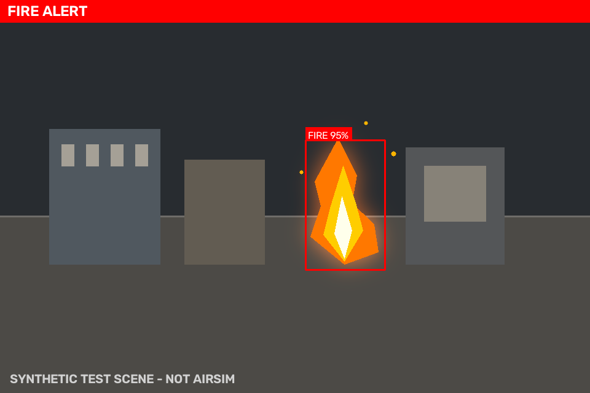

# 无人机火灾探测与自主巡检（fire_detection_drone）

基于 ROS 2 Humble 的无人机火灾探测与自主巡检功能包。相机图像经 HSV 火焰分割（可选 ONNX 分类器复核）生成火灾警报与目标框，巡检节点根据警报自动执行「悬停确认 → 盘旋取证 → 返航/降落」，并支持三种搜索场景。检测与状态机核心均为无 ROS 依赖的纯 Python 模块，可单独进行单元测试。

课程任务设计、状态机原理与实验步骤见 [课程文档](../../../docs/air/fire_detection_drone.md)。



> 合成图像检测结果，由 `tools/make_demo_image.py` 生成。

## 1. 功能特性

- HSV 火焰分割：橙色/黄色主区间 + 红色环绕区间，形态学去噪、面积/长宽比过滤、IoU 非极大值抑制。
- 多帧确认与报警保持，降低单帧误报；图像中断自动清除警报。
- 可选 ONNX 二分类器对 HSV 候选框进行复核，支持置信度融合权重。
- 三种巡检模式：`lawnmower`（弓字形覆盖）、`perimeter`（建筑/区域边界）、`spiral`（从中心向外螺旋）。
- 有限状态机：`PATROL → CONFIRM → EVIDENCE → RETURN_HOME → LAND`。
- 安全机制：位姿超时停车、警报超时清除、任务超时返航、速度限幅、手动 abort 返航。
- 标准话题输出：警报、目标框、目标方位角、标注图、JSON 状态。
- 支持 `nav_msgs/Odometry` 或 `geometry_msgs/PoseStamped` 作为位姿源；支持 AirSim NED 输入/输出转换。
- 无自定义消息，直接使用标准 ROS 2 消息，便于与现有桥接节点对接。

## 2. 目录结构

```text
src/air/fire_detection_drone/
├── config/fire_detection.yaml          # 两个节点的完整参数
├── launch/
│   ├── fire_detection_drone.launch.py  # 一键启动
│   └── main.launch.py                  # 符合仓库 main.* 入口约定
├── resource/fire_detection_drone
├── fire_detection_drone/
│   ├── detector_core.py                # 纯 OpenCV 检测（无 ROS 依赖）
│   ├── explorer_core.py                # 纯状态机（无 ROS 依赖）
│   ├── pose_utils.py                   # 四元数、NED/ENU 转换
│   ├── fire_detector_node.py           # 检测节点
│   ├── drone_explorer_node.py          # 巡检节点
│   ├── launch_builder.py               # 两个 launch 文件共享的启动描述
│   └── main.py                         # 单进程同时运行两个节点
├── test/                               # 纯算法单元测试
├── tools/make_demo_image.py            # 生成 README 合成测试图
├── package.xml
├── setup.py
├── setup.cfg
└── requirements.txt
```

## 3. 环境依赖

Ubuntu 22.04 LTS + ROS 2 Humble + Python 3.10。

此外需要 OpenCV、NumPy 与 `cv_bridge`：

```shell
sudo apt update
sudo apt install -y \
  ros-humble-cv-bridge \
  ros-humble-sensor-msgs \
  ros-humble-nav-msgs \
  ros-humble-geometry-msgs \
  python3-opencv \
  python3-numpy \
  python3-pytest \
  python3-colcon-common-extensions
```

若使用 ONNX 复核，`cv2.dnn` 由 `python3-opencv` 提供，无需额外安装 onnxruntime。

## 4. 编译

在课程仓库根目录（包含 `src/`）执行：

```shell
source /opt/ros/humble/setup.bash
cd ~/ros2                 # 换成你的仓库实际路径
rosdep install --from-paths src/air/fire_detection_drone --ignore-src -r -y
colcon build --packages-select fire_detection_drone
source install/setup.bash
```

验证可执行文件：

```shell
ros2 pkg executables fire_detection_drone
# main  fire_detector  drone_explorer
```

## 5. 启动与 Launch 参数

### 5.1 一键启动

```shell
source /opt/ros/humble/setup.bash
source install/setup.bash
ros2 launch fire_detection_drone fire_detection_drone.launch.py
```

`launch/main.launch.py` 与上面完全等价，符合仓库 `main.*` 入口约定：

```shell
ros2 launch fire_detection_drone main.launch.py
```

### 5.2 搜索场景示例

```shell
# 大面积开阔区域：弓字形覆盖
ros2 launch fire_detection_drone fire_detection_drone.launch.py \
  exploration_pattern:=lawnmower search_width:=16.0 search_height:=10.0

# 建筑/区域边界：矩形周长
ros2 launch fire_detection_drone fire_detection_drone.launch.py \
  exploration_pattern:=perimeter search_width:=12.0 search_height:=12.0

# 起飞点附近局部搜索：向外螺旋
ros2 launch fire_detection_drone fire_detection_drone.launch.py \
  exploration_pattern:=spiral search_width:=16.0 search_height:=16.0 \
  spiral_turns:=4.0
```

### 5.3 Launch 参数

| 参数 | 默认值 | 说明 |
| --- | --- | --- |
| `params_file` | 安装目录 `config/fire_detection.yaml` | 两个节点的参数文件 |
| `use_sim_time` | `false` | 使用仿真器 `/clock` |
| `start_detector` | `true` | 是否启动检测节点 |
| `start_explorer` | `true` | 是否启动巡检节点 |
| `image_topic` | `/camera/image_raw` | 检测节点输入图像 |
| `pose_topic` | `/odom` | 巡检节点位姿输入 |
| `pose_message_type` | `odometry` | `odometry` 或 `pose_stamped` |
| `cmd_vel_topic` | `/cmd_vel` | 机体系速度指令输出 |
| `exploration_pattern` | `lawnmower` | `lawnmower`、`perimeter` 或 `spiral` |
| `search_width` | `12.0` | 搜索区域宽度（m） |
| `search_height` | `8.0` | 搜索区域高度（m） |
| `spiral_turns` | `3.0` | 螺旋搜索圈数 |
| `ned_input` | `false` | 输入位姿按 NED 转 ENU |
| `ned_output` | `false` | 输出速度按 ENU 转 NED |
| `require_odometry` | `true` | 位姿超时停车 |
| `publish_debug_image` | `true` | 发布带检测框的标注图像 |
| `model_path` | 空 | ONNX 分类器路径，空值表示仅用 HSV |
| `log_level` | `info` | 两个节点的日志级别 |

`search_width`、`search_height`、`spiral_turns` 由 Launch 参数覆盖节点同名参数，其余节点参数从 `params_file` 读取。参数覆盖关系定义在 `fire_detection_drone/launch_builder.py`。

### 5.4 与 AirSim / 课程桥接对接

课程现有 AirSim 桥接常用：

| 桥接话题 | 本包参数 |
| --- | --- |
| `/drone/camera/image_raw` | `image_topic:=/drone/camera/image_raw` |
| `/drone/pose`（`PoseStamped`，NED） | `pose_topic:=/drone/pose pose_message_type:=pose_stamped ned_input:=true` |
| `/drone/cmd_vel`（NED 机体系） | `cmd_vel_topic:=/drone/cmd_vel ned_output:=true` |

示例：

```shell
ros2 launch fire_detection_drone fire_detection_drone.launch.py \
  image_topic:=/drone/camera/image_raw \
  pose_topic:=/drone/pose \
  pose_message_type:=pose_stamped \
  cmd_vel_topic:=/drone/cmd_vel \
  ned_input:=true \
  ned_output:=true \
  require_odometry:=true
```

NED 转换规则：位置 `(x, y, z) → (x, -y, -z)`，偏航 `yaw → -yaw`；机体系速度 `(vx, vy, vz, wz) → (vx, -vy, -vz, -wz)`。

> 仓库中的 `drone_ros_node.py` / `drone_airsim_bringup` 是 ROS 1 节点。若要在 ROS 2 中直接复用，需要 `ros1_bridge` 或改用 ROS 2 AirSim 桥接；本包只约定话题语义，不依赖 AirSim Python 客户端。

若桥接不发布位姿，可显式启用航位推算：

```shell
ros2 launch fire_detection_drone fire_detection_drone.launch.py \
  require_odometry:=false
```

航位推算仅根据速度指令积分，误差会随时间累积，只建议在短时仿真演示中使用。

### 5.5 手动触发与单节点启动

不启动相机也可以验证巡检逻辑。先只启动巡检节点，避免检测节点的 1 Hz 心跳把手动警报覆盖；若环境中没有 `/odom`，追加 `require_odometry:=false`：

```shell
ros2 launch fire_detection_drone fire_detection_drone.launch.py start_detector:=false

# 另开终端：触发火灾警报
ros2 topic pub --once /fire_detection/alert std_msgs/msg/Bool "{data: true}"

# 观察速度指令与状态机
ros2 topic echo /cmd_vel
ros2 topic echo /fire_detection/mission_status
```

只启动其中一个节点：

```shell
ros2 launch fire_detection_drone fire_detection_drone.launch.py start_explorer:=false
ros2 launch fire_detection_drone fire_detection_drone.launch.py start_detector:=false
```

## 6. 节点与通信接口

### 6.1 节点

| 节点 | 可执行文件 | 职责 |
| --- | --- | --- |
| `fire_detector` | `ros2 run fire_detection_drone fire_detector` | 图像 → 火焰候选框/警报 |
| `drone_explorer` | `ros2 run fire_detection_drone drone_explorer` | 巡检、确认、取证、返航 |
| 组合入口 | `ros2 run fire_detection_drone main --node both` | 单进程运行两个节点（默认 both） |

### 6.2 订阅话题

| 话题 | 类型 | 订阅者 | 说明 |
| --- | --- | --- | --- |
| `/camera/image_raw` | `sensor_msgs/Image` | fire_detector | 无人机相机图像，默认 `bgr8` 转换 |
| `/odom` | `nav_msgs/Odometry` | drone_explorer | 默认位姿源 |
| `/drone/pose` | `geometry_msgs/PoseStamped` | drone_explorer | 当 `pose_message_type:=pose_stamped` 时使用 |
| `/fire_detection/alert` | `std_msgs/Bool` | drone_explorer | 火灾警报 |
| `/fire_detection/bbox` | `std_msgs/Float32MultiArray` | drone_explorer | 目标框，用于偏航对准 |
| `/fire_detection/abort` | `std_msgs/Bool` | drone_explorer | `true` 立即返航 |

### 6.3 发布话题

| 话题 | 类型 | 发布者 | 说明 |
| --- | --- | --- | --- |
| `/fire_detection/alert` | `std_msgs/Bool` | fire_detector | 报警状态；变化时发布，并以 1 Hz 心跳重发 |
| `/fire_detection/bbox` | `std_msgs/Float32MultiArray` | fire_detector | 目标框与置信度，字段顺序见下 |
| `/fire_detection/target_bearing` | `std_msgs/Float32` | fire_detector | 目标相对相机光轴的方位角（rad，右正）；无目标时为 `NaN` |
| `/fire_detection/debug_image` | `sensor_msgs/Image` | fire_detector | 带框和报警横幅的 `bgr8` 图像 |
| `/fire_detection/status` | `std_msgs/String` | fire_detector | JSON：报警、置信度、FPS、后端、图像超时 |
| `/cmd_vel` | `geometry_msgs/Twist` | drone_explorer | 机体系速度；默认 ROS ENU，`ned_output:=true` 时转 NED |
| `/drone/land` | `std_msgs/Bool` | drone_explorer | 返航完成后发布一次 `true` |
| `/fire_detection/mission_status` | `std_msgs/String` | drone_explorer | JSON：状态、航点、位姿、home、任务时间、原因 |

`/fire_detection/bbox` 的 8 个元素固定为 `x_min`、`y_min`、`x_max`、`y_max`、`confidence`、`center_x`、`center_y`、`area_ratio`，与 `detector_core.Detection` 字段一致。前四项为像素坐标，`center_x`、`center_y` 为归一化目标中心，无目标时为空数组。

### 6.4 服务

本包不定义自定义服务。部分 AirSim 桥接通过 `/drone/takeoff`、`/drone/land` 服务提供起降；本包使用 `/drone/land` 话题，若桥接只提供服务，需要增加 `std_srvs/srv/Empty` 适配节点。包不负责起飞，启动前无人机应已解锁并处于安全高度。

## 7. 节点参数

完整参数见 [`config/fire_detection.yaml`](config/fire_detection.yaml)。常用参数：

| 参数 | 默认值 | 说明 |
| --- | --- | --- |
| `min_confidence` | 0.45 | 报警所需最低置信度 |
| `min_consecutive_frames` | 3 | 连续命中帧数 |
| `alert_hold_sec` | 2.0 | 检测丢失后警报保持时间 |
| `image_timeout_sec` | 2.0 | 图像超时后清除警报 |
| `process_every_n_frames` | 1 | 跳帧处理，降低 CPU 占用 |
| `lane_spacing` | 2.5 | 弓字形航线的相邻航带间距（m） |
| `search_altitude` | 3.0 | 搜索高度（m） |
| `confirm_hover_sec` | 2.0 | 悬停确认时间 |
| `alert_grace_sec` | 3.0 | 确认阶段警报消失的误报判定时间 |
| `evidence_sec` | 12.0 | 盘旋取证时间 |
| `max_mission_sec` | 300.0 | 任务总时长上限，超时返航 |
| `land_after_return` | true | 到家后是否请求降落 |

`search_width`、`search_height`、`spiral_turns` 同时是节点参数和 Launch 参数，推荐通过 Launch 命令行覆盖。

## 8. 可选 ONNX 推理

参考仓库的 `Fire_Detection_model.ipynb` 是自监督预训练实验，没有可直接部署的火灾检测权重。接入轻量分类器时，训练 `0=non-fire`、`1=fire` 的二分类器，输入 224×224 RGB，导出 ONNX 后指定模型路径：

```shell
ros2 launch fire_detection_drone fire_detection_drone.launch.py \
  model_path:=/absolute/path/fire_classifier.onnx
```

节点先用 HSV 定位候选框，再对每个 ROI 做 ONNX 分类，按 `model_weight` 融合两路置信度；模型加载失败时退回 HSV。相关参数包括 `model_path`、`model_input_size`、`model_fire_class_index`、`model_weight`。

## 9. 测试

```shell
cd src/air/fire_detection_drone
python3 -m pytest test -q
```

测试覆盖检测与干扰物抑制、报警确认与保持、三种巡检航点、火灾状态迁移、abort/超时返航、NED/ENU 转换，共 21 项。`colcon build --packages-select fire_detection_drone` 构建通过，0 errors、0 warnings。

## 10. 限制

- 巡检航线为固定几何路径，不包含避障，需在无障碍空域运行。
- HSV 检测对夕阳、红色/橙色物体和反光可能误报，可通过阈值和 ONNX 复核降低误报。
- 返航依赖位姿源；`require_odometry:=true` 时位姿超时会立即停车，纯航位推算不适合长时任务。
- `/drone/land` 为 `std_msgs/Bool` 话题，接入不同飞控桥接时需确认语义。

## 11. 参考

- [michael-2509/fire-detection-drone](https://github.com/michael-2509/fire-detection-drone)：AirSim 相机取图、检测过滤器及速度/偏航控制思路。
- 课程 AirSim 接口：`docs/air/drone_ros_teleop.md`、`src/air/drone_airsim_bringup/`。
