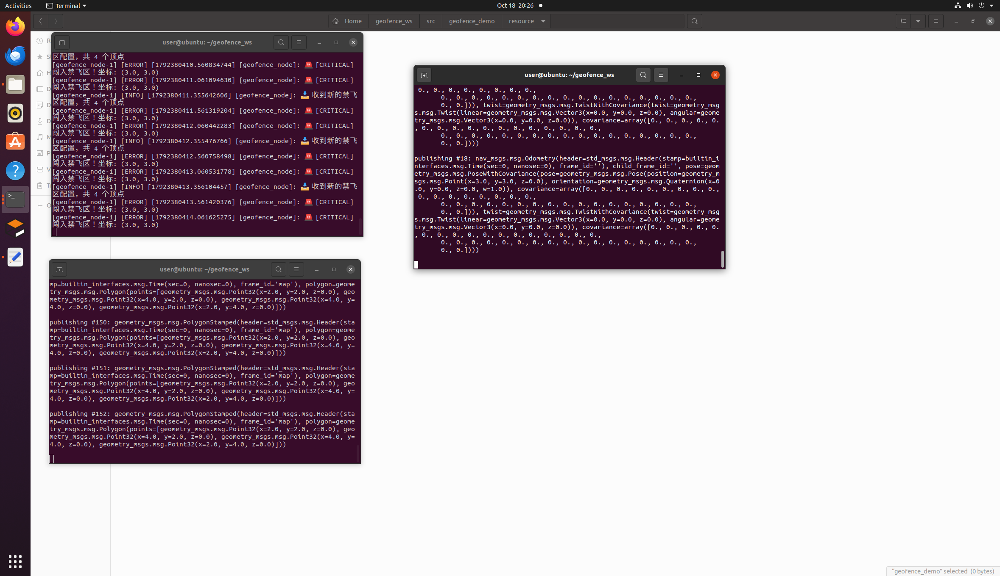

# 基于 ROS 2 的禁飞区（电子围栏）动态检测与安全预警系统

## 1. 项目简介
本项目是一个基于 ROS 2 的独立安全监控层模块。系统旨在为无人机等移动机器人提供实时的禁飞区（电子围栏）检测。
通过订阅载具的实时位姿与动态下发的禁飞区多边形边界，系统利用**射线法（Ray Casting）**实时判断载具状态，并输出 `SAFE`（安全）、`WARN`（接近预警）、`CRITICAL`（侵入告警）三级安全响应。

## 2. 目录结构
项目采用标准的 `ament_python` ROS 2 包结构：

```text
src/air/
└── geofence_demo/
    ├── geofence_demo/            # Python 核心源码目录
    │   ├── __init__.py           # 声明为 Python 模块
    │   └── geofence_node.py      # 核心检测节点代码
    ├── launch/                   # 启动脚本目录
    │   └── geofence.launch.py    # 一键启动节点脚本
    ├── resource/                 # ROS 2 索引资源目录
    ├── test/                     # 代码规范与自动化测试目录
    ├── package.xml               # 包依赖与元数据声明
    ├── setup.cfg                 # 编译配置文件
    └── setup.py                  # 编译脚本与程序入口点配置
```
## 3. 环境依赖
• Ubuntu 22.04
• ROS 2 Humble
• Python 3.10+

## 4. 编译与运行步骤
4.1 编译工作空间
```bash
 colcon build --symlink-install
source install/setup.bash
```
4.2 启动核心节点
在终端 1 中启动禁飞区检测节点：
```bash
ros2 launch geofence_demo geofence.launch.py
```
4.3 测试与验证
终端 2：发布禁飞区边界（X:2~4, Y:2~4 的矩形区域）
```bash
ros2 topic pub /geofence geometry_msgs/msg/PolygonStamped "{
  header: {frame_id: 'map'},
  polygon: {
    points: [{x: 2.0, y: 2.0}, {x: 4.0, y: 2.0}, {x: 4.0, y: 4.0}, {x: 2.0, y: 4.0}]
  }
}" -r 1
```
终端 3：发布载具位置进行状态测试
• 状态 A（安全 SAFE）：载具在 (0, 0)
```bash
ros2 topic pub /odom nav_msgs/msg/Odometry "{pose: {pose: {position: {x: 0.0, y: 0.0}}}}" -r 2
```
状态 B（入侵 CRITICAL）：按 Ctrl+C 停止上一条命令，修改坐标至禁飞区内部 (3, 3)
```bash
ros2 topic pub /odom nav_msgs/msg/Odometry "{pose: {pose: {position: {x: 3.0, y: 3.0}}}}" -r 2
```

## 5. 话题接口说明
订阅话题：

/odom (nav_msgs/Odometry)：载具实时位置

/geofence (geometry_msgs/PolygonStamped)：禁飞区多边形边界

发布话题：

/geofence_status (std_msgs/String)：分级安全状态输出



