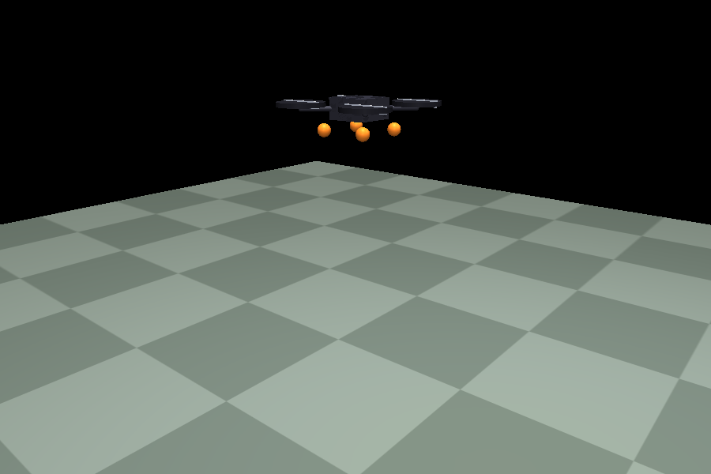
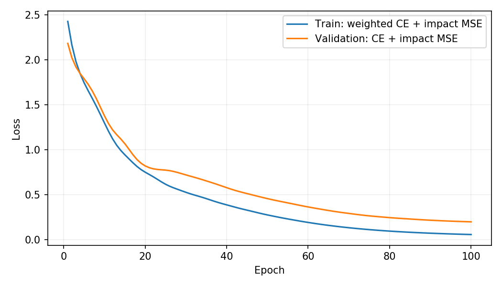
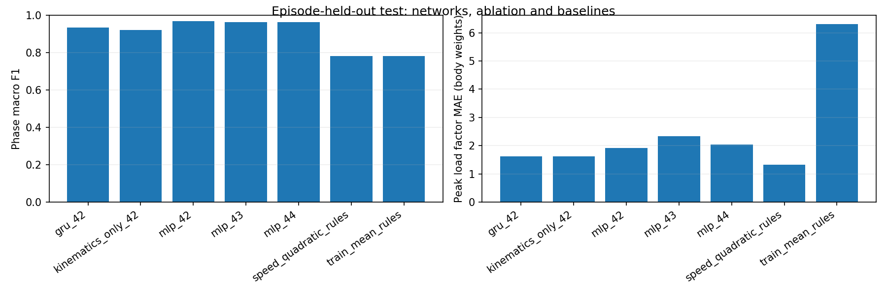
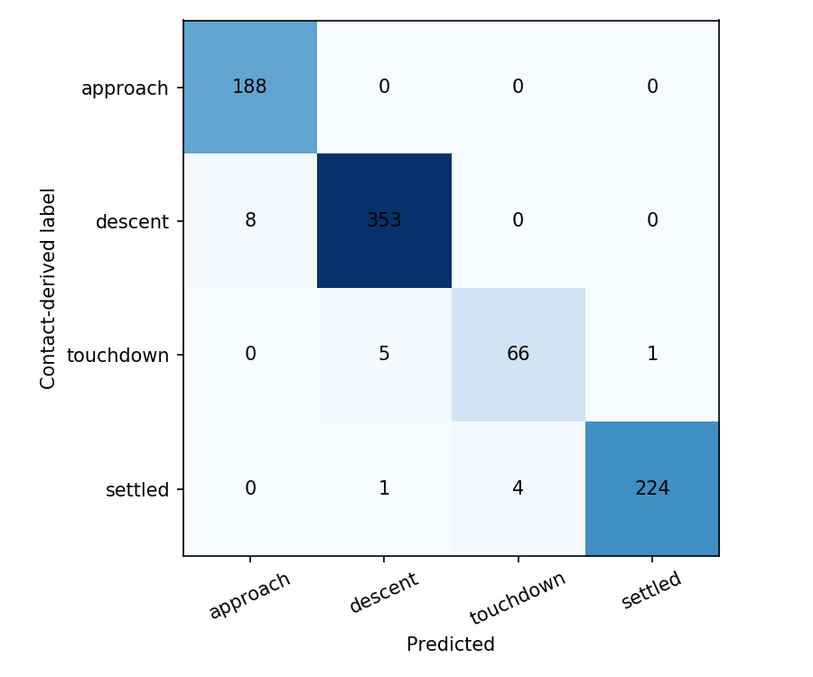
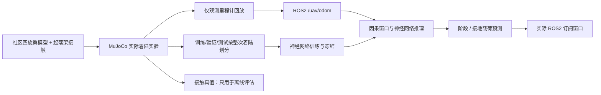

# 无人机着陆阶段识别与接地载荷预测

从最近 0.4 秒里程计识别“接近、下降、接地过渡、稳定”四个阶段，在足端高度首次降至 18 cm 时预测即将发生的接地峰值载荷。包含真实 MuJoCo 接触实验、神经网络训练、整次着陆划分、独立测试、消融、ROS2 封装和实际订阅可视化。

项目在 OpenHUTB 已有 [carlair_ros_bridge](https://github.com/OpenHUTB/ros2/tree/master/src/air/carlair_ros_bridge) 的 `/uav/odom` 里程计接口上增加下游着陆分析。仿真四旋翼 XML 原样复用社区 [PR #178](https://github.com/OpenHUTB/ros2/pull/178)，运行时添加起落架与地面接触。**该来源 PR 在开发时尚未合并**；具体提交、SHA256 和 MIT 声明见 [来源记录](models/source.json) 与 [第三方说明](THIRD_PARTY_NOTICES.md)。本项目不依赖该 PR 安装成功。

与已有轨迹分类、未来状态回归和遥测异常检测不同，本任务关注一次着陆的阶段以及接地载荷。



此图由实际 MuJoCo 仿真渲染，重跑数据与保存的同次实验逐元素相同。

## 1. 数据和目标

144 次实际物理仿真：80 次训练、16 次验证、24 次原始测试；固定模型和实验代码后，另运行 24 次最终测试。记录来自 MuJoCo 实际积分和接触求解，属于仿真生成数据，不是真实无人机飞行采集。

- 四旋翼质量、下降速度、初始高度、接触软度及小幅侧风在固定范围随机变化。
- 物理步长 1 ms，观测频率 20 Hz。控制器只用于产生着陆过程，不计作神经网络控制成果。
- 接触后关闭推力，记录首次接触后 250 ms 内总法向接触力峰值，除以重量 `m*g`，得到无量纲“体重倍数”。这不是加速度 g 值，也不是实机结构安全等级。
- 四阶段标签由仿真阶段、真实接触事件和稳定状态生成，仅在训练/评估使用。模型输入不含接触力、阶段标签、控制指令、飞行编号、质量或未来状态。
- 神经网络输入为 8 个因果采样点：足端估计高度、ENU 速度、后向差分加速度、横滚/俯仰、机体系角速度，共 12 通道。
- 每次着陆仅在首次低于 18 cm 的接地前观测处产生一次载荷预测样本。原始测试和最终测试均各有 24 个独立载荷预测样本；阶段窗口存在重叠，不能当作同等数量的独立飞行。

`assets/landing_corpus.zip` 随附全部原始观测和清单。清单含参数、划分、接触真值、载荷目标与 SHA256；数据准备验证校验和。完整着陆不会跨划分，归一化和基线拟合只使用训练集。

## 2. 方法与实验结果

主模型为共享 MLP 编码器加四阶段分类头、接地载荷回归头。训练目标为加权分类交叉熵和归一化 log(1+载荷) 均方误差。每组训练 100 轮，以验证集损失选择检查点，部署种子 42 在最终测试前固定。

对照包括三随机种子 MLP、GRU、仅保留高度/速度输入的消融、固定运动学阶段规则、训练集拟合的速度二次回归和训练均值载荷基线。载荷回归基线与神经网络使用相同的接地前决策窗口。

### 原始保留测试：24 次着陆

| 方法 | 阶段准确率 | 宏平均 F1 | 载荷 MAE | 载荷 RMSE |
|---|---:|---:|---:|---:|
| mlp_42 | 97.76% | 0.9690 | 1.909 | 2.525 |
| mlp_43 | 97.29% | 0.9628 | 2.342 | 3.064 |
| mlp_44 | 96.94% | 0.9622 | 2.044 | 2.603 |
| gru_42 | 94.71% | 0.9330 | 1.623 | 2.133 |
| kinematics_only_42 | 93.53% | 0.9208 | 1.620 | 2.137 |
| speed_quadratic_rules | 90.82% | 0.7810 | 1.319 | 2.010 |
| train_mean_rules | 90.82% | 0.7810 | 6.308 | 7.079 |

### 冻结后的最终测试：24 次新着陆

| 方法 | 阶段准确率 | 宏平均 F1 | 载荷 MAE | 载荷 RMSE |
|---|---:|---:|---:|---:|
| mlp_42 | 98.09% | 0.9779 | 1.733 | 2.236 |
| mlp_43 | 98.33% | 0.9799 | 1.686 | 2.086 |
| mlp_44 | 97.73% | 0.9724 | 1.754 | 2.196 |
| gru_42 | 95.23% | 0.9473 | 1.642 | 2.077 |
| kinematics_only_42 | 94.75% | 0.9399 | 1.596 | 2.134 |
| speed_quadratic_rules | 89.98% | 0.7542 | 1.115 | 1.543 |
| train_mean_rules | 89.98% | 0.7542 | 4.925 | 5.887 |

**结果解读：神经网络明显改善了本分布内的阶段识别，但载荷预测没有超过简单速度二次回归。** 接触软度等变量未进入输入，这限制了仅凭运动状态预测接地载荷的能力。保留较强基线和消融结果，不把神经网络描述为全面优越。最终测试与训练使用相同参数范围，只验证新的随机实验，不代表跨场景、跨仿真器或实机泛化。分类 softmax 分数未经置信度校准。






全部数值见 `results/metrics.json`、`results/final/metrics.json` 和对应逐次预测 CSV。`final_protocol.json` 保存最终测试前冻结的模型和实验源代码哈希；模型未根据最终测试结果重新训练。

## 3. 环境与快速运行

已验证：Windows 宿主机上的 VMware Ubuntu 20.04.6、现有 ROS2 Humble、Python 3.8.10、PyTorch 2.4.1+cpu、MuJoCo 3.1.6、NumPy 1.24.4。

以下假设代码位于 `~/ros2/src/air/landing_assessment`；独立解压时将第一行改为实际目录。已有可用虚拟环境可跳过创建。必须使用与系统 ROS2 匹配的 Python，不要在 Conda 的 Python 上创建 ROS 虚拟环境。

```bash
cd ~/ros2/src/air/landing_assessment
source /opt/ros/humble/setup.bash
/usr/bin/python3 -m venv --system-site-packages ~/uav_prediction_env
source ~/uav_prediction_env/bin/activate
python -m pip install -r requirements.txt
bash main.sh doctor
bash main.sh prepare
bash main.sh build
bash main.sh demo
```

MuJoCo 安装包包含物理引擎，无需下载大型城市场景。系统需已有 ROS2 的 rclpy/nav_msgs/std_msgs/launch_ros；Lark 和 colcon 插件在 requirements 中显式声明。创建 venv 缺少 ensurepip 时需安装 `python3-venv`；桌面图表需系统 `python3-tk` 和有效 DISPLAY。`UAV_ENV`、`ROS_SETUP` 可指定不同虚拟环境和 ROS setup 路径。

演示前先在第二个已激活相同环境的终端启动实际 ROS 订阅窗口：

```bash
python -m landing_assessment.dashboard --seconds 30
```

再执行 `bash main.sh demo`。默认回放 3 次真实仿真着陆，两个 ROS2 节点随后正常退出；窗口保存本次实际收到的曲线和消息计数。原始观测本身不包含给推理节点的接触力或标签。


## 4. ROS2 接口

| 话题 | 类型 | 内容 |
|---|---|---|
| `/uav/odom` | `nav_msgs/Odometry` | 仅位置、姿态、线速度和角速度 |
| `/landing/assessment` | `std_msgs/String` JSON | 是否预热完成、阶段、分类分数；跨越决策高度时额外发布峰值载荷预测 |
| `/landing/replay_done` | `std_msgs/String` | 有限回放结束通知 |

里程计位置采用世界 ENU，机体采用 FLU；`twist` 按 Odometry 规范在 child_frame_id 中表示。回放节点将世界速度旋转到机体，推理节点再转回世界坐标并作后向差分。所有推理特征仅来自消息，估计器不订阅标签。

输入约定为 20 Hz、地面高度为 0、该机型足端偏移 0.073 m。换用其他桥接、坐标原点、采样率或无人机时需要相应标定/重采样，不应直接套用固定 18 cm 决策门限。时间倒退或明显断流会清空历史并重新预热；非有限值和非法四元数也会重置。



## 5. 训练、测试和复现实验

```bash
bash main.sh prepare
bash main.sh test
python freeze_final.py
bash main.sh evaluate
bash main.sh report
```

从头训练请使用新目录，保留随附冻结模型：

```bash
bash main.sh train --models models/retrained
bash main.sh evaluate --models models/retrained --output results/retrained
```

重新进行物理采集（会控制仿真模型，不涉及实机）：

```bash
bash main.sh collect --output data/new_raw
```

查看独立最终测试的随附模型结果：

```bash
bash main.sh evaluate --data data/final --output results/final_check
```

真实场景重新渲染：桌面环境运行 `python render_validation.py`。它仅设置离屏画布和相机，重跑同一物理种子，并要求每条记录与随附原始数据完全相同。

已完成 7 项针对性测试：标签/接触力不进入特征、因果性、整次划分不交叉、离线与在线逐帧一致且预测先于接触、非法输入重置、时间倒退重置、ROS 坐标变换往返。实际 ROS2 演示处理 207 条观测、3 次接地前载荷预测，覆盖四阶段且正常退出。环境和验证记录见 `artifacts/environment.json`、`artifacts/validation.json`。

## 6. 提交状态与限制


未验证：真实无人机、复杂地形、不同起落架和材质、OpenHUTB Unreal 模拟器。采样和接触模型都经过简化，数据规模有限；尤其不能根据预测载荷给出实机结构安全结论。保留原始数据、较强基线和失败/不足结果，供课程分析。

AI 使用声明：使用 OpenAI Codex 辅助代码、实验脚本和文档；所有指标、物理渲染和 ROS2 曲线来自实际执行，未使用生成图片替代运行证据。
