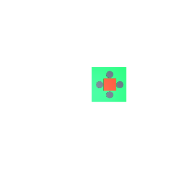
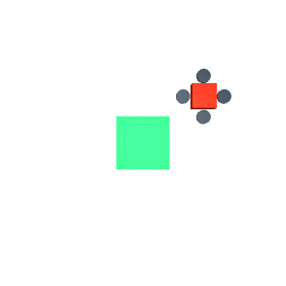

# MuJoCo 无人机视觉着陆与栅格导航

本模块以 MuJoCo 仿真无人机着陆，包含移动平台特征控制、单帧 RGB 端到端控制、键盘遥控和激光神经导航。

## 环境与运行

需要 Python 3.10 或更新版本。安装 `requirements.txt` 后，在模块目录中训练、运行闭环仿真、键盘遥控或二维建图导航：

```bash
python -m pip install -r requirements.txt
python main.py train --samples 5000
python main.py train-image --samples 6000
python main.py train-navigation
python main.py demo --steps 180 --output output
python main.py demo --controller image --steps 600 --output output
python main.py teleop --output output
python main.py navigate --output output
python -m pytest -q tests
```

`teleop` 每次在提示符输入一个命令并按回车：`W/A/S/D` 控制水平移动，`R/F` 控制升降，空行悬停，`Q` 退出。位置会在每次输入后更新。`--controller image` 使用单帧 32x32 RGB 图像直接预测速度，运行静止平台着陆基线。`navigate` 使用八向激光与目标相对位置预测网格动作，在三种固定障碍布局中逐步扫描和重规划。

运行文件写入 `output/`。着陆演示输出实际渲染的 `landing_scene.png`、`landing_run.gif`、轨迹和指标 JSON；键盘演示输出 `teleop_scene.png` 与指令轨迹；导航输出 `navigation_map.png`、`navigation_run.gif` 和覆盖率指标。模型保存为 `output/landing_controller.joblib`。

## 场景与方法

着陆场景由 MJCF 文件 `assets/moving_pad.xml` 定义。着陆平台沿 x/y 正弦轨迹移动，无人机由 MuJoCo 位置伺服关节驱动。OpenCV HSV 阈值从 RGB 渲染图像提取中心偏差；特征 MLP 结合高度和平台速度预测控制量。训练集按完整 episode 划分 80% 训练集与 20% 测试集，防止相邻时刻跨集合。`--samples` 精确指定样本数，最少为 200。

端到端基线直接将 32x32 RGB 像素送入两层 MLP，输出 `vx`、`vy`、`vz`；训练图像由 MuJoCo 相机在静止平台场景渲染，按完整 episode 留出测试集。静止平台的选取使单帧图像包含完成落点所需的视觉状态信息。

导航使用八向激光距离与归一化目标偏差作为 MLP 输入，网络输出四个栅格方向。MuJoCo slide-joint 状态提供位姿；每步运动后采集模拟激光射线并更新占据栅格。A* 用于离线生成训练动作标签，运行时只在神经网络动作会进入已知障碍或重复局部位置时选择地图上的安全一步。





## 仿真环境

移动平台特征控制基线：1200 条样本按 episode 留出，训练/测试为 960/240 条，测试 RMSE 为 0.036406 m/s。

端到端 RGB 控制：6000 帧按 episode 留出，训练/测试为 4800/1200 帧，测试 RMSE 为 0.099554 m/s。ROS 2 Humble 容器中 600 步静止平台闭环运行成功着陆，持续 12 秒，接近误差为 0.0963 m，最终高度为 0.23494 m。

激光神经导航：固定走廊、偏置屏障、交错障碍三种场景均到达目标，成功率为 3/3，平均地图覆盖率 99.22%，每场景步数分别为 46、32、30。

端到端 RGB 模型直接将相机图像缩放为 32x32 后输入 MLP，输出三轴速度；ROS 2 launch 可通过 `input_mode:=image` 订阅 `/camera/image_raw`。导航模型以八向激光测距和目标偏差为输入，在 MuJoCo 位姿状态推进中更新占据栅格并输出网格动作。

English summary: A MuJoCo UAV project with RGB-to-velocity neural control, feature-based moving-pad landing, keyboard teleoperation, and lidar neural navigation.
