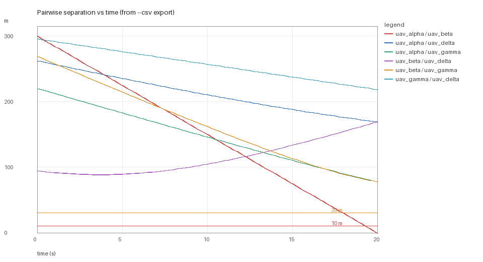
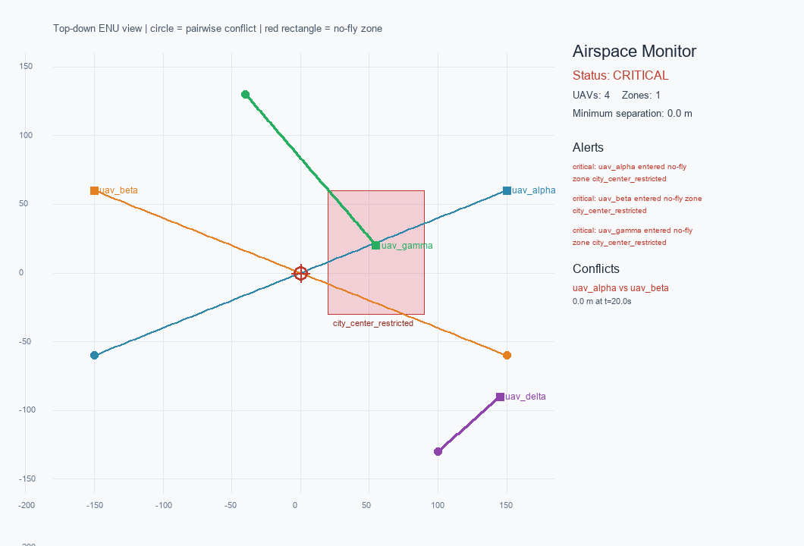

# multi_uav_airspace_monitor

面向多无人机低空任务的**多边形禁飞区 + 机间冲突**监测模块。它补上了现有
`no_fly_zone_check` 只检查单个经纬度点、只支持圆形禁飞区的不足，把输入扩展为
多架无人机的时间序列轨迹，并同时输出电子围栏告警和两两最近接近距离（CPA）。

## 与已有模块的关系

| 模块 | 关注点 | 本模块的区别 |
| --- | --- | --- |
| `no_fly_zone_check` | 单个点是否落在圆形禁飞区 | 支持多边形、高度层、缓冲区，以及多机轨迹 |
| `carlair_ros_bridge` | AirSim/CarlaAir 与 ROS 的坐标和话题桥接 | 不连接仿真器，只消费已经统一到 ENU 的轨迹 |
| `ap_cpp_overfomo` | 覆盖路径规划 | 不规划航迹，只对已有航迹做安全评估 |

这个模块可以独立运行，也可以作为规划器/控制器的安全监视层。核心代码不依赖
ROS 2、AirSim 或 GPU；ROS 2 节点只是可选外壳。

## 功能

- JSON 多边形禁飞区（顶点列表），支持 `floor_z`、`ceiling_z` 和水平缓冲区。
- 多架无人机的 ENU 轨迹输入，逐点检查电子围栏。
- 两两无人机最近接近距离、冲突时刻、告警等级（时间窗内取最小距离）。
- 确定性冲突解脱建议（爬升/减速），便于后续接入规划器。
- 输出 JSON 摘要和 PNG 俯视图，适合直接作为 PR 的运行效果。

## 运行环境

- Python 3.10+
- `numpy`
- `Pillow`

本机实际验证：Windows 11 `10.0.26200`、Python `3.12.14`、NumPy `2.3.5`、Pillow `12.3.0`。
离线演示不需要 ROS 2、AirSim、Unreal 或 GPU。

```bash
python -m pip install -r requirements.txt
```

## 快速开始

在模块目录执行：

```bash
cd src/air/multi_uav_airspace_monitor
python main.py demo                          # 生成 results/ 下的截图与 JSON
python main.py check --config scenario.json  # 评估自己的场景
python main.py demo --output /tmp/out        # 换输出目录
python main.py demo --csv results/sep.csv --plot results/separation_vs_time.png
python main.py check --config scenario.json --csv results/sep.csv
```

`--csv` / `--plot` 的示例输出都写进 `results/`（该目录已进模块 `.gitignore`），
这样直接复制命令不会在 `git status` 里留下未跟踪的生成文件。

`main.py demo --csv results/sep.csv --plot results/separation_vs_time.png` 的实际输出：

```text
==> multi_uav_airspace_monitor
    status=critical
    uavs=4 zones=1
    minimum_separation_m=0.0 (horizon 20.0 s)
    alerts=3 conflicts=1
    conflict uav_alpha vs uav_beta: 0.00 m at 20.00 s
    screenshot: results/demo_screenshot.png
    separation CSV: results/sep.csv (486 rows)
    separation chart: results/separation_vs_time.png
```

`--csv` 导出的表头为 `time_s,uav_a,uav_b,separation_m`，每个采样时刻、每一对无人机一行：

```text
time_s,uav_a,uav_b,separation_m
0.0,uav_alpha,uav_beta,300.0
0.0,uav_alpha,uav_delta,262.679
0.0,uav_alpha,uav_gamma,220.454
...
```

采样是**固定步长**：从两架飞机的公共起点按 `step_s` 采样，窗口长度不是步长整数倍时，
末尾补一个窗口结束点（例如 `horizon_s=1.1`、`step_s=0.4` 得到 `0.0/0.4/0.8/1.1`，
最后一格 0.3 s，不会把整段内所有采样点重新拉平）。冲突检测用的是同一套采样，所以 CSV 里
最小的 `separation_m` 就是汇总里的 `minimum_separation_m`。只有一个架次（没有机对）时也会写
表头，方便脚本直接读列名。

`--plot` 会把同一份 CSV 画成「机间距离随时间」的曲线（横轴 s、纵轴 m，附 30 m 告警与
10 m 临界参考线），用 Pillow 绘制，不额外引入 matplotlib：



原有俯视空域图（`demo` 默认产物，未改动）：



图中两条对角航迹在中心交叉，圆形标记为机间冲突；红色多边形为禁飞区，
`uav_gamma` 进入禁飞区，`uav_alpha` 与 `uav_beta` 在 20 s 时最近距离为 0 m。

命令退出码：

| 命令 | 退出码 |
| --- | --- |
| `demo` | 完成即 0（场景是否安全由测试断言，不影响退出码） |
| `check` | `critical` 返回 1；`safe` / `warning` 返回 0；读不到或解析不了场景返回 2 |

## 测试

```bash
python -m unittest discover -s tests -v     # 本机 35 个测试，约 0.2 s
```

覆盖点在多边形内/外/边界、点到边距离、经纬度往返、禁飞区高度层、缓冲区、
迎头冲突、平行安全航迹、窗口内告警与窗口外更近的接近、非法 `horizon_s`、
只有 warning 级冲突时的状态、`minimum_separation_m` 与冲突同窗口、
空场景拒绝、`check` 命令退出码和演示场景，以及逐时刻距离序列、CSV 导出与曲线绘制
（序列排序、固定步长与非整除窗口的末点、三机覆盖全部机对、`horizon_s` 截断、单机时只写表头、
CSV 往返与换行符、`step_s`/`horizon_s` 的零/负数/NaN/Inf 校验、`check`/`demo` 的 `--csv`、
`--plot` 出图与空数据的图）。

## ROS 2 节点

节点订阅 JSON 状态消息，而不是绑定某一种仿真器：

```text
/airspace/uav_states  std_msgs/String
{
  "stamp": 12.5,
  "uavs": [
    {"id": "uav_alpha", "x": 1.0, "y": 2.0, "z": 30.0}
  ]
}
```

输出 `/airspace/alerts`，内容与 `summary.json` 相同，额外带 `stamp`。

```bash
colcon build --packages-select multi_uav_airspace_monitor
source install/setup.bash
ros2 launch multi_uav_airspace_monitor main.launch.py
```

`launch/main.launch.py` 默认不加载禁飞区；实际使用时把 `zones_json` 参数替换为
场景中的 zone 列表。ROS 2 节点只做消息适配，核心算法仍由 `monitor.py` 提供，
因此可以在没有 ROS 的机器上完整测试。

## 输入格式

`main.py check --config scenario.json` 接受如下结构：

```json
{
  "horizon_s": 20.0,
  "warning_distance_m": 30.0,
  "critical_distance_m": 10.0,
  "zones": [
    {
      "name": "city_center_restricted",
      "polygon": [[20, -30], [90, -30], [90, 60], [20, 60]],
      "floor_z": 0,
      "ceiling_z": 120,
      "buffer_m": 20
    }
  ],
  "uavs": [
    {
      "id": "uav_alpha",
      "times": [0, 1, 2],
      "positions": [[0, 0, 60], [10, 0, 60], [20, 0, 60]]
    }
  ]
}
```

坐标统一为局部 ENU：`x` 东、`y` 北、`z` 上，单位米。`uavs` 不能为空，每条航迹
至少两个采样点且时间严格递增。

输出的 `minimum_separation_m` 与冲突检测使用同一个 `horizon_s` 时间窗，
`minimum_separation_full_m` 才是整段公共区间的最近距离——两者不一致时，
说明更近的接近发生在时间窗之外。

## 已知限制

- 轨迹在采样点之间采用线性插值；高速强机动场景应提高采样率。
- 冲突检测是离线/短时域 CPA：先截取公共起点起的 `horizon_s` 秒，再取窗口内最小距离，
  所以窗口外更近的接近不会掩盖窗口内的告警；整体仍不是完整的 UTM 航路调度器。
- 解脱建议是确定性规则，尚未接入速度障碍、MPC 或强化学习策略。
- 禁飞区是垂直棱柱，不支持任意三维网格；复杂地形可先做分层 zone。
- 当前尚未在 ROS 2 Humble 的 RViz 中做可视化，节点只发布 JSON 告警。

## 大模型使用声明

本模块的代码、测试和文档在 OpenAI Codex 辅助下完成；冲突重建、缺陷修复与截图
来自本机 Windows 11 + Python 3.12 的实际执行。提交者需复核代码并对提交内容负责。
