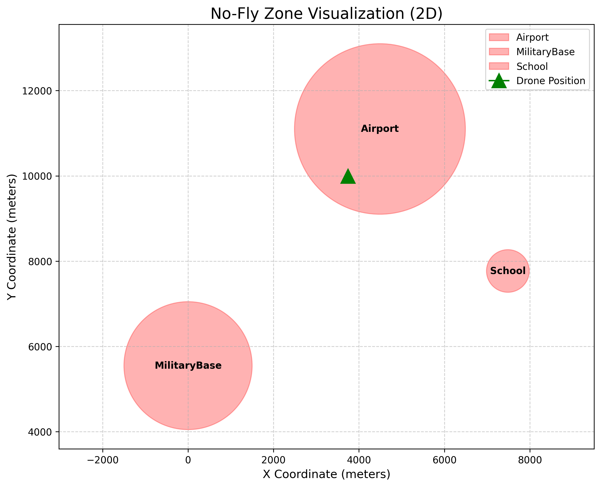

# 禁飞区检测模块

本模块调用 AirSim 模拟器接口获取无人机状态，并通过 Haversine 公式判断无人机是否进入预设的禁飞区（机场、军事基地、学校）。

## 运行环境

- Python 3.10
- 需要启动 AirSim 1.8.1 模拟器
- 第三方库：`airsim`、`matplotlib`

## 运行步骤

1. 启动 AirSim 1.8.1 模拟器（确保 RPC 端口 41451 已开放）。
2. 运行检测程序：
   cd src/air/no_fly_zone_check
   python main.py

## 2D 可视化

无需启动 AirSim，直接运行以下命令生成 2D 禁飞区示意图（红色圆圈代表禁飞区，绿色三角形代表无人机当前位置），结果将保存为图片：
   cd src/air/no_fly_zone_check
   python visualize.py

