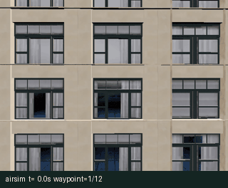

# Town10 立面自主巡航与图像采集



OpenHUTB Windows 2.10 的 Town10HD 场景已完成原生在线巡航：12/12 航点、12 张照片、79.109 s。相机与深度由服务端实时返回，采图位置最大误差0.1488 m。

模块提供 MuJoCo 纹理立面场景和原生 OpenHUTB/AirSim 两种后端，通过统一神经网络速度控制器执行蛇形扫描，按航点保存 RGB 图像、位姿清单、轨迹与性能指标。

扫描速度分量采用局部基向量映射到世界坐标。MuJoCo使用完整神经速度输出；原生后端使用有界神经网络前馈与三轴PD反馈，网络权重随航点误差减小而趋零，保持近点收敛。

MuJoCo 场景将补充数据包中的砖墙、灰墙和玻璃立面照片映射到 10 m × 8 m 平面。三平移自由度飞行器由控制力驱动，姿态由固定稳定器假设提供；平面场景用于巡航与采集流程验证。照片资产不包含原始相机外参，原始 Town10 城市几何没有通过照片恢复。

## Python 运行

```bash
python -m pip install -r requirements.txt
python main.py --backend mujoco --style brick --gif --output output/brick
python evaluate_scenarios.py --output output/three_scenes
```

Linux 无显示环境使用 `MUJOCO_GL=osmesa`，并安装 `libosmesa6`、`libgl1`。Windows 采用 MuJoCo 的本机 OpenGL 渲染。

原生后端连接运行中的多旋翼场景，使用真实状态、Scene 图像与 DepthPlanar 深度。安装可选依赖后，在已起飞悬停且正对墙面的姿态执行相对路线：

`settings.example.json` 给出 `front_cam` 相机配置：向机体前方偏移 1.5 m、向上偏移 0.2 m，避免机体遮挡图像。原生深度表示相机到表面的前向距离，不能直接当作机体中心到墙的距离。相机名称和载具名称应与实际场景配置一致。

```bash
python -m pip install airsim==1.8.1
python main.py --backend airsim --host 127.0.0.1 --camera front_cam --speed 0.5 --duration 150 --gif --output output/native
```

本次 Town10HD 原生运行使用 `drone1`、`front_cam`，以 NED `[29.02,38.91,38.53] m`、偏航90.5°作为一次性实验起点。先在已起飞悬停状态显式初始化，再执行相对扫描：

```bash
python prepare_airsim.py --vehicle drone1 --camera front_cam --position 29.02 38.91 38.53 --yaw 90.5 --camera-offset 1.5 0 -0.2
python main.py --backend airsim --vehicle drone1 --camera front_cam --speed 0.65 --rate 20 --capture-rate 2 --duration 200 --gif --output output/native
```

`prepare_airsim.py` 只调用一次 `simSetVehiclePose` 设置实验起点，不代表从出生点飞行至该位置。之后巡航只发送速度命令，由原生飞行动力学推进，运行过程中不改写载具位姿。起点悬停后的实际位姿记录在采集清单中。

默认相对路线从当前悬停点沿机体右侧横扫 6 m、向上扫描 3 m，共 12 点，保持启动时的平面法向位置和朝向。`--takeoff` 显式请求解锁起飞。`--route town10` 读取随包保存的 36 点 NED 路线，`--route-offset N E D` 用于校准原始坐标；必须先在对应场景核对起点、方向、建筑高度和路线空域。

```bash
python main.py --backend airsim --camera front_cam --route town10 --route-offset 0 0 0 --duration 600 --waypoint-timeout 180 --speed 0.5 --output output/town10_native
```

RPC 在同一任务线程串行执行。深度九点有效数少于 5 个时停止；前方最小深度低于 1.2 m 时终止并请求悬停，1.2–3.0 m 区间缩放速度。深度为中央视场采样，不能代替全向避障。碰撞、状态非有限值、任务时限、单航点超时和退出均进入停止流程。

AirSim保留历史碰撞记录，后端以连接时的碰撞时间戳为基线，只将之后发生的新碰撞作为本次任务终止条件。启动时仍独立检查真实前向深度。

## ROS 2 Humble

将本目录作为 `ament_python` 包放入工作区。安装 Python 依赖后：

```bash
colcon build --packages-select town10_facade_cruise_capture
source install/setup.bash
MUJOCO_GL=osmesa ros2 launch town10_facade_cruise_capture main.launch.py
ros2 launch town10_facade_cruise_capture main.launch.py backend:=airsim host:=host.docker.internal camera:=front_cam speed:=0.5
```

| 话题 | 类型 | 内容 |
|---|---|---|
| `/town10/image_raw` | `sensor_msgs/Image` | `rgb8`，默认 2 Hz |
| `/town10/odom` | `nav_msgs/Odometry` | ENU 位姿、FLU 机体速度 |
| `/town10/cmd_vel` | `geometry_msgs/Twist` | ENU 世界坐标线速度命令 |
| `/town10/status` | `std_msgs/String` | JSON 任务状态、已达航点数；末态保留 |

病害检测节点订阅 `/town10/image_raw` 即可接入。ROS 节点在任务完成后保留最终状态，停止控制定时器。

## 输出与验证

`capture_000.png` 等文件对应到达航点时的照片；`manifest.json` 包含航点、实际位姿、目标位姿和位置误差。原生图像额外记录服务端传感器时间戳、图像返回的相机位置与深度统计。`trajectory.csv` 记录状态和命令，`metrics.json` 记录完成状态与测量来源；`--gif` 按运行中的连续图像生成 `cruise.gif`。

原生指标报告前向深度中位数的时间均值、最小实测深度、航点跟踪误差和采图位置误差。原生路线保持启动平面位置，`--distance` 用于路线采样与模型输入参考，不表示相机被控制在4 m深度。

```bash
python -m pytest -q
```

原生成功运行的[完整指标](../../../docs/air/town10_facade_cruise_capture/native_metrics.json)和[采图位姿清单](../../../docs/air/town10_facade_cruise_capture/native_capture_manifest.json)保留服务端实际记录。前向深度最小值7.0898 m、中位数时间均值7.2316 m，最大实测速度0.6091 m/s。

MuJoCo 三纹理场景也分别完成12/12航点与12张照片，仿真时长43.0 s，最大速度0.789 m/s。完整原理、结果、资产哈希和源码说明见[项目文档](../../../docs/air/town10_facade_cruise_capture/index.md)。接口单元测试与原生在线运行记录分别保留。
