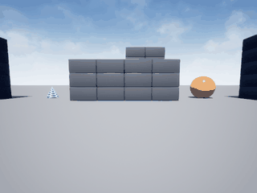

# uav_airsim_imu_velocity_estimator

AirSim 仿真中，用**纯 IMU 时序窗口**经神经网络估计无人机速度大小的模块，对应课程任务 ③「导航与 SLAM」里的状态估计环节。全部数据来自 AirSim `Blocks` 场景实飞，模型是手写 NumPy 实现的三层 MLP，不依赖 PyTorch。

## 演示动图



动图由 `simGetImages(ImageType.Scene)` 逐帧截取真实 AirSim 画面后合成，未经任何绘制或 CGI。

## 任务与指标

| 项 | 值 |
|---|---|
| 输入 | IMU 5 帧时序窗（ax, ay, az, gx, gy, gz）× 5 = 30 维 |
| 输出 | 速度大小 \|v\|（归一化到 [-1, 1]，×4 m/s 还原） |
| 样本 | 6 回合 × 120 步 = 720 条 |
| 验证集 MSE | 0.0156 |
| 验证集 R² | **0.453** |
| 速度 RMSE | **0.499 m/s** |
| 实飞演示 MAE | 1.32 m/s（在线部署存在分布偏移，见「局限」） |

## 快速复现

```bash
# 0. 安装依赖（numpy 算网络，Pillow 在 demo 里合成 gif）
pip3 install -r requirements.txt

# 1. 启动 AirSim Blocks（Windows）
#    C:\AirSim\Blocks\Blocks\WindowsNoEditor\Blocks.exe
#    确认 41451 端口已监听

# 2. 采集样本（约 3 分钟）
python3 main.py --collect --episodes 6 --steps 120

# 3. 训练（约 1 分钟）
python3 main.py --train --epochs 120

# 4. 实飞演示并录 gif
python3 main.py --demo --steps 180 --gif demo.gif

# 5. 误差评估
python3 main.py --eval --steps 150
```

ROS 2 节点：

```bash
colcon build --packages-select uav_airsim_imu_velocity_estimator
source install/setup.bash
ros2 launch uav_airsim_imu_velocity_estimator main.launch.py
```

节点订阅 `/uav/imu`（`sensor_msgs/Imu`），向 `/uav/velocity_est` 发布 `std_msgs/Float32`。

## 目录

```
├── launch/main.launch.py
├── models_trained/
│   ├── imu_vel.npz          训练好的权重
│   └── imu_vel_data.npz     标准化参数 + 720 条样本
├── main.py                  四合一入口
├── package.xml / setup.py / setup.cfg
└── uav_airsim_imu_velocity_estimator/
    ├── env.py               AirSim 连接、IMU 采样、速度真值、飞行控制
    ├── mlp.py               纯 NumPy MLP + Adam
    ├── dataset.py           样本采集
    ├── train.py             训练与验证
    ├── node.py              ROS 2 节点
    └── demo.py              实飞演示、gif 合成、误差统计
```

## 关键实现要点

1. **速度真值必须在指令执行中途读**。`moveByVelocityAsync` 阻塞返回后无人机已开始减速，此时读到的速度接近 0；改为发指令不阻塞、`sleep` 半程再采样，读数才与指令对得上。
2. **输入必须标准化**。IMU 加速度 RMS 约 5.7 m/s²、角速度不足 0.5 rad/s，尺度差一个量级，直接喂 tanh 会饱和，R² 掉到 0.001。标准化后升到 0.453。
3. **回归速度大小而非三轴分量**。三轴分量正负互相抵消，网络容易退化成输出均值；速度大小与 IMU 振动强度单调相关，物理上更可学。
4. **AirSim 的 `kinematics_estimated` 速度不可作真值**（SimpleFlight 下长期为 0），也没有 `kinematics_true` 字段；位置差分噪声达 ±2.5 m/s，同样不可用。

## 文档

完整原理、公式推导、算法流程与逐文件源码解析见 [`docs/air/uav_airsim_imu_velocity_estimator.md`](../../docs/air/uav_airsim_imu_velocity_estimator.md)。
