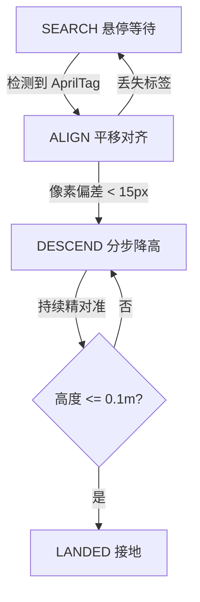

# 基于 AprilTag 的无人机视觉精准降落

用机载下视相机检测地面 AprilTag 标志, 估计其相对位置, 引导无人机飞到标志中心正上方对齐后垂直降落。

与已有 `rooftop_landing`(LiDAR 找屋顶平面)互补: 本模块面向**有明确降落标识**的场景(仓库平台、海上甲板、巡检停机坪)。

## 运行环境

- Ubuntu 20.04 + ROS 2 Humble
- AirSim(或任意提供下视相机图像/高度/位置控制话题的仿真桥接)
- Python 依赖: `rclpy`, `sensor_msgs`, `geometry_msgs`, `std_msgs`, `cv_bridge`, `opencv-python`, `dt-apriltags`(可选, 未安装时回退亮斑演示)

```bash
pip install dt-apriltags opencv-python
```

## 话题接口

| 方向 | 话题 | 类型 | 说明 |
|---|---|---|---|
| 订阅 | `/drone/down_camera/image_raw` | `sensor_msgs/Image` | 下视相机图像(mono8 或 bgr8) |
| 订阅 | `/drone/height` | `std_msgs/Float64` | 相对地面高度(m) |
| 发布 | `/drone/setpoint_position` | `geometry_msgs/PointStamped` | 期望位置(map 系) |
| 发布 | `/drone/landing_state` | `std_msgs/String` | SEARCH/ALIGN/DESCEND/LANDED |

## 运行步骤

```bash
cd src/air/uav_apriltag_landing
# 1. 先启动 AirSim 及无人机桥接(发布图像/高度, 订阅 setpoint)
# 2. 启动降落节点
python3 main.py
# 或
ros2 launch src/air/uav_apriltag_landing/launch/uav_apriltag_landing.launch.py
```

## 降落状态机



像素偏差到地面平移量的近似换算: `dx_m = dx_px * h / fx`, 其中 `h` 为当前高度, `fx` 为相机焦距参数。

## 参数

| 参数 | 默认 | 说明 |
|---|---|---|
| `hover_height` | 5.0 | 搜索/对齐悬停高度(m) |
| `align_pixel_tol` | 15.0 | 像素对齐容差(px) |
| `descend_step` | 0.5 | 每次降高步长(m) |
| `landed_height` | 0.1 | 接地判定高度(m) |
| `cam_fx/fy/cx/cy` | 500/500/320/240 | 相机内参 |

## 验证范围说明

- 节点能正常启动并发布状态机话题
- 相机图像中出现 AprilTag(或亮斑)后, 像素偏差被换算为平移目标
- 完整闭环降落需配合 AirSim 位置控制桥接验证
- 未安装 `dt-apriltags` 时使用亮斑演示模式, 仅用于调试控制逻辑, 不代表真实标签检测精度
