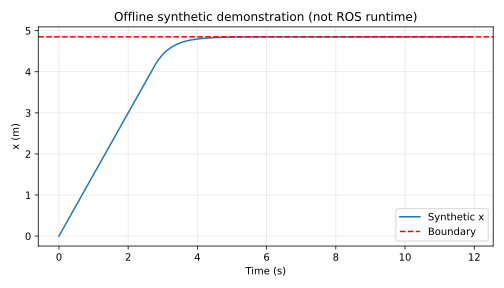

# 无人机空间围栏与速度门控

用保守可达距离约束三维速度指令，处理位姿和指令超时；只是 ROS 安全接口示例，未接入飞控。

**验证状态：离线、独立 catkin 构建、ROS 合成话题功能和退出清理已通过；真实硬件与外部复测未完成。**

## 环境与依赖

本次实测为云端 Ubuntu 24.04、Python 3.12.14，NumPy 2.3.5、matplotlib 3.10.8，未安装 ROS。离线演示使用 matplotlib，神经网络模块另需 NumPy。
目标 ROS 环境为 Ubuntu 20.04 / Python 3.8 / ROS Noetic；该目标环境已由用户此前检查，本模块本次尚未进入其中运行。

## 离线复现

在仓库根目录执行，输出目录应不存在：

```bash
python3 -m unittest discover -s src/air/uav_box_geofence_guard/tests -v
python3 src/air/uav_box_geofence_guard/main.py --output /tmp/uav_box_geofence_guard_demo
```

第二条生成 samples.csv、metrics.json 和 offline_demo.svg；MLP 还会重新训练并输出 model.json。不同 NumPy/BLAS 版本可能产生末位数值差异。

## ROS 构建和运行（下方附本轮实测）

从仓库根目录开始，在独立 catkin 工作空间中只放这个包，不把整个混合 ROS1/ROS2 仓库交给 catkin：

```bash
source /opt/ros/noetic/setup.bash
mkdir -p ~/air_course_ws/src
cp -r src/air/uav_box_geofence_guard ~/air_course_ws/src/
cd ~/air_course_ws
catkin_make
source devel/setup.bash
roslaunch uav_box_geofence_guard main.launch
```

如缺依赖，按 package.xml 使用 ROS 对应发行版安装；不要在系统 ROS 中随意混装 Python 版本。
Ctrl+C 结束本模块。话题演示不要连接实机飞控，先完成受控仿真联调。

## 算法与坐标约定

输入位姿和速度必须属于世界 ENU 坐标系：x/y 水平、z 向上。ROS frame_id 固定为 `world`。本模块不接受 AirSim 原生 NED 或机体系速度；桥接前必须显式转换。
教学围栏 x/y 为 [-5,5] 米，z 为 [0,4] 米，内部再留 0.15 米裕量。
取当前位置到六个围栏面的最小距离 d，用 `min(1.5,d/0.5)` 限制三维速度模长，各轴按同一比例缩放，偏航速度限为 1 rad/s。

这是 0.5 秒内恒速、理想运动学条件下的保守可达球约束，不是含惯性的制动距离模型。
与逐轴限幅相比，不利用某个方向更大的余量，容易在边界附近过早减速，这是安全裕量与机动性的教学取舍。

| 输入/输出 | 类型 | 含义 |
|---|---|---|
| `pose_world` | geometry_msgs/PoseStamped | 世界坐标位姿，使用位置三分量 |
| `velocity_raw` | geometry_msgs/TwistStamped | 同一世界系的速度请求 |
| `velocity_safe` | geometry_msgs/TwistStamped | 门控后的速度，不自动连接到飞控 |
| `~status` | std_msgs/String | WAITING/CLEAR/LIMITED/OUTSIDE/STALE/INVALID |

没有位姿/指令时保持零输出；任一接收间隔超过 0.3 秒则置 STALE 并停车；框架错误等同等待有效输入；非有限数值置 INVALID。
已在围栏外时零输出，须人工复位或由独立恢复流程接管，不自动飞回。

## ROS 联调操作（下方附本轮实测）

启动后先向 `pose_world` 和 `velocity_raw` 持续发布消息。例如：

```bash
rostopic pub -r 20 /pose_world geometry_msgs/PoseStamped "{header: {frame_id: world}, pose: {position: {x: 0, y: 0, z: 2}, orientation: {w: 1}}}"
rostopic pub -r 20 /velocity_raw geometry_msgs/TwistStamped "{header: {frame_id: world}, twist: {linear: {x: 1}}}"
rostopic echo /velocity_safe
```

位姿 x 改为 4.8，输出应明显减小；停止任一发布器超过 0.3 秒，输出应为零。
上面是接口联调，不是实际飞行；固定发布位姿不会让无人机运动。

## 限制

不建模加速度、刹停惯性、风、感知误差或下游通信丢包。不根据源时间戳判断延迟，仅判断接收新鲜度，因此重放旧数据可能被视为新数据；必须在受控实验链路中使用。
不得把本示例直接当成实机唯一安全控制器，未做飞控和模拟器闭环验证。


## 本次实际结果

离线单元测试：**8/8 通过**。原始输出位于本模块 tests_result.txt。

```json
{
  "final_x": 4.8499999975157095,
  "boundary": 4.85,
  "limited_steps": 185,
  "validation_scope": "offline mathematical demo; ROS runtime not tested"
}
```

下面为程序实际生成的**离线合成数据/数学演示图**，不是 ROS 窗口截图或飞行记录：



指标文件：源码模块内 offline_metrics.json。逐点样本可用离线复现命令重新生成。
本轮 ROS 构建与通信验证见下方实测补充；仍无真实硬件和外部复测。

## 大模型使用声明

使用 OpenAI Codex 辅助方案设计、代码、核心测试、合成演示、文档和提交准备。仅报告实际执行结果；作者需理解、复核和补充目标环境验证，并对内容负责。


## ROS Noetic 实测补充（2026-11-04）

本轮使用 VirtualBox Ubuntu 20.04.6、Python 3.8.10、ROS Noetic。工作目录为 `/home/ros/four_assignments_0yekhx11/ws_uav_box_geofence_guard`。

离线测试、独立 catkin 构建、真实 roslaunch/话题功能、退出清理四项分别通过；launch 返回码 0，无节点异常退出。

测试使用真实 ROS 通信发送合成输入，不是无人机飞行、真实传感器或 AirSim/Gazebo 验证。

- fresh world command preserved; yaw clamped
- near boundary x velocity <= 0.101 m/s
- outside box outputs zero
- wrong pose frame rejected
- stale input produces zero
- roslaunch remains running through functional checks

复现构建（将本模块复制到独立工作空间 src 后）：

```bash
source /opt/ros/noetic/setup.bash
catkin_make -C /path/to/workspace
source /path/to/workspace/devel/setup.bash
roslaunch uav_box_geofence_guard main.launch
```

必须检查 `devel/setup.bash` 与 `devel/lib/uav_box_geofence_guard/main.py` 存在。旧脚本曾在错误工作空间构建，旧 BUILD=PASS 无效；以上是修正版的新工作空间证据。

原始证据：[构建](../../../docs/air/uav_box_geofence_guard/validation/build.txt)、[launch](../../../docs/air/uav_box_geofence_guard/validation/launch.log)、[ROS 测试](../../../docs/air/uav_box_geofence_guard/validation/ros_test.txt)、[结构化结果](../../../docs/air/uav_box_geofence_guard/validation/ros_result.json)、[离线测试](../../../docs/air/uav_box_geofence_guard/validation/offline.txt)、[源码 SHA256](../../../docs/air/uav_box_geofence_guard/validation/source_sha256.json)。哈希对应运行包源码，本轮已逐项核对；README 后续文档更新会改变其哈希，程序源码未改变。

仍未验证真实硬件/飞行与另一人另一台机器复测。PR 保持 Draft，外部复测不勾选。使用 OpenAI Codex 辅助日志核验、文档与提交整理。
