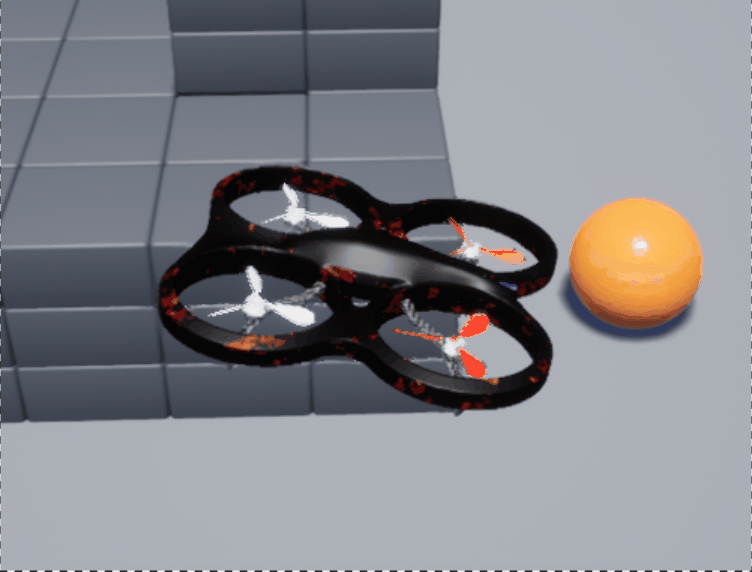

# 任务④：端到端视觉导航

## 演示


## 大概流程
相机拍图 → CNN 提取特征 → PPO 输出速度 → 无人机飞

## 怎么跑
```bash
# 启动 bridge
roslaunch carlair_ros_bridge main.launch

# 训练（跑几千步就行）
rosrun uav_e2e_rl train.py

# 部署
roslaunch uav_e2e_rl e2e_deploy.launch
```

## 大概参数
- 输入：48x64 灰度图
- 输出：前进速度 + 转向速度
- 奖励：前进加分，撞了扣分
- 算法：PPO

## 文件
- `scripts/train.py` — 训练
- `scripts/deploy_node.py` — 部署
- `models/ppo_e2e.zip` — 训好的模型
