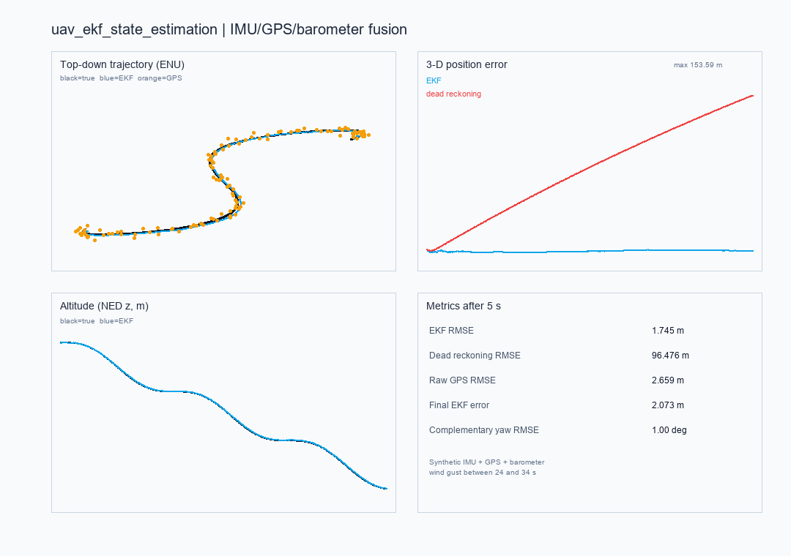

# uav_ekf_state_estimation

面向多旋翼的**IMU + GPS + 气压计**松组合状态估计示例。它估计无人机当前的位置和
速度，与已有的 `state_prediction`（GRU 预测未来状态）是互补关系：前者回答
“我现在在哪”，后者回答“我一秒后可能在哪”。

## 功能

- 6 维状态 EKF：NED 位置、NED 速度。
- IMU 比力预测，GPS 水平位置更新，气压计高度更新。
- 姿态由飞控/VIO 作为输入；附带互补滤波器用于演示陀螺仪、加速度计和磁力计融合。
- 合成轨迹包含 24–34 s 的水平阵风，输出 EKF、纯 GPS、航位推算的对比指标。
- 输出 JSON 指标和 2×2 PNG 诊断图。

## 运行环境

- Python 3.10+
- `numpy`
- `Pillow`

离线演示不需要 ROS 2、AirSim、Unreal 或 GPU。

```bash
python -m pip install -r requirements.txt
```

## 快速开始

```bash
cd src/air/uav_ekf_state_estimation
python main.py demo
```

本机 Windows 11 + Python 3.12 的实际输出：

```text
==> uav_ekf_state_estimation
    ekf_rmse_m=1.7452
    dead_reckoning_rmse_m=96.4764
    gps_rmse_m=2.6594
    ekf_final_error_m=2.0726
    complementary_yaw_rmse_deg=1.0004
    gps_sigma_m=1.8
    baro_sigma_m=0.35
```

运行效果：



在这组合成数据上，EKF 的三维 RMSE 为 **1.75 m**，低于纯 GPS 的 **2.66 m**；
不融合 GPS/气压计的航位推算为 **96.48 m**。这些数字只对应本文件的固定随机种子
和噪声参数，不是对真实飞行的精度承诺。

## 测试

```bash
python -m unittest discover -s tests -v
```

15 个测试覆盖 GPS 更新降低协方差、气压计更新、悬停预测、姿态滤波器、指标有限性
和随机种子可重复性，以及 REP-103(FLU)→FRD 的符号转换和水平静止输入贯穿
`step_imu`（与 `on_imu` 同一条处理链）的回归。GPS 轴序另有三个用例：只增加纬度
时只更新内部 north、只增加经度时只更新内部 east（并核对发布的 ENU 方向），以及
NED→ENU 的换轴与 z 取反。

## 方法说明

状态向量：

$$
\mathbf{x} = [p_x, p_y, p_z, v_x, v_y, v_z]^T
$$

预测使用机体系比力 $\mathbf{f}_b$ 和姿态旋转矩阵 $R_{b}^{n}$：

$$
\mathbf{a}_n = R_b^n \mathbf{f}_b + \mathbf{g}_n
$$

GPS 只更新水平位置，气压计只更新高度。姿态被视为飞控/VIO 的输入；包内互补滤波器
用于展示陀螺仪积分、加速度计倾角修正和磁力计偏航修正，但**不把加速度计倾角估计
直接送入 EKF**，因为无人机自身加速度会污染倾角观测。这个取舍在 README 和文档中
明确写出，避免把“姿态真值”当成 EKF 的估计结果。

机器人端的 IMU 消息遵循 REP-103（FLU，静止时 z 上为 `+g`），而公式里的 $\mathbf{f}_b$
是 FRD（静止时 z 上为 `-g`）。两者只在 `frames.py` 里转换一次：`step_imu()` 让姿态
滤波读原始 REP-103 数据、EKF 读转换后的 FRD 比力和 FRD 姿态，避免同一个加速度按
两套重力符号各算一遍。

GPS 与发布坐标也只在 `frames.py` 换轴。EKF 内部位置/速度都是 NED，`on_gps` 先用
`geodetic_to_ned()` 把经纬度投影成 `[north, east]` 再更新；`publish_odom()` 用
`ned_to_enu()` 把位置和速度换回 ENU（x 东、y 北、z 上）发布到 `/uav/ekf/odom`。
顺序写反时，纯向东的位移会落到内部北向状态，之后的换轴无法纠正。

本版本不估计加速度计零偏。只使用 GPS 位置和气压计高度时，垂直零偏与重力/姿态误差
不可观，强行加入会吸收误差并导致发散。需要零偏估计时，应升级到包含姿态、陀螺零偏
和加速度计零偏的 15 状态 INS/GNSS 滤波器。

## ROS 2 节点

| 方向 | 话题 | 类型 |
| --- | --- | --- |
| 订阅 | `/uav/imu` | `sensor_msgs/Imu` |
| 订阅 | `/uav/gps` | `sensor_msgs/NavSatFix` |
| 订阅 | `/uav/baro` | `std_msgs/Float64` |
| 发布 | `/uav/ekf/odom` | `nav_msgs/Odometry` |
| 发布 | `/uav/ekf/diagnostics` | `std_msgs/String`（JSON） |

```bash
colcon build --packages-select uav_ekf_state_estimation
source install/setup.bash
ros2 launch uav_ekf_state_estimation main.launch.py
```

ROS 2 节点在当前 Windows 开发机上未执行；离线核心和 12 个单元测试已实际运行。
在 Ubuntu + ROS 2 Humble 中运行时，需要把 GPS 经纬度投影到局部 ENU 原点，节点
内部已用一个简单等距圆柱投影做示例，正式使用应替换为地图的 `GeoProjection`。

## 已知限制

- 使用合成 IMU/GPS/气压计数据，尚未接入真实飞控日志；
- 姿态作为输入，不估计姿态和陀螺零偏；
- 不模拟 GPS 丢星、磁干扰、多路径和气压计漂移；
- 风扰是确定性阵风，不是 Dryden/von Karman 连续湍流；
- 尚未在 ROS 2 Humble + RViz2 中做实时曲线显示。

## 大模型使用声明

代码、测试和文档使用 OpenAI Codex 辅助完成；运行指标和截图来自本机实际执行。
提交者需复核代码并对提交内容负责。
