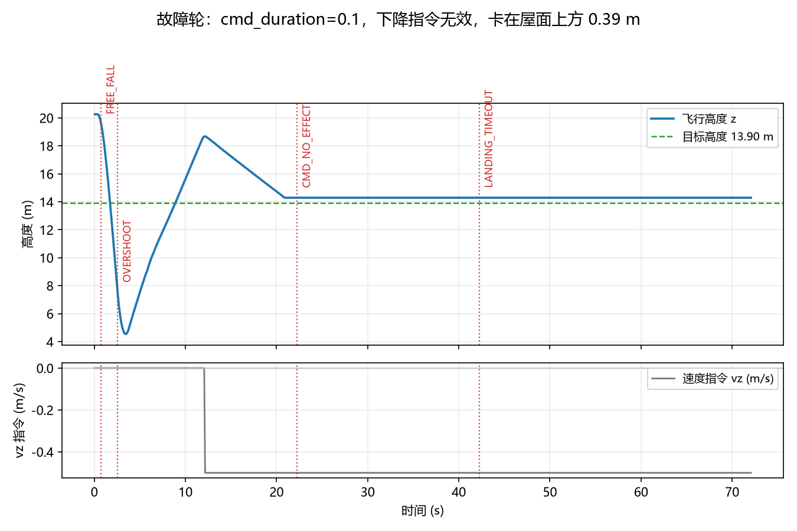

# uav_landing_monitor

无人机降落过程监控：在线校验「速度指令 vs 实际高度变化」，发现"喊了不动 / 掉得没人管 / 超时没落地"
就告警并落 CSV。**只监不听**，不发任何控制指令，可以挂在任何桥接层与降落模块旁边。

## 1. 一眼看懂



上图是真实 UE + AirSim 运行（桥接层 `cmd_duration=0.1`）：飞机卡在屋面上方 0.39 m 下不去，
监控给出 7 次 `CMD_NO_EFFECT` 与 1 次 `LANDING_TIMEOUT`，结论 `fail`。
把桥接层改成 `cmd_duration=0.5` 后同一条链路安静落地，只报一条 `LANDED`（零误报）。

## 2. 告警码

| 代码 | 级别 | 含义 |
| --- | --- | --- |
| `CMD_NO_EFFECT` | error | 有下降指令但高度不动（本次联调抓到的静默故障） |
| `DESCEND_STALL` | warn | 状态是 DESCEND，但没有下降指令（状态机空转） |
| `FREE_FALL` | error | 高度掉得比指令快（失控 / 掉高） |
| `OVERSHOOT` | error | 低于目标高度过多（会砸屋面） |
| `LANDING_TIMEOUT` | error | 下降超时仍未到位 |
| `INPUT_STALE` | error | 里程计断流 |
| `LANDED` | info | 正常落地 |

## 3. 运行

```bash
roslaunch carlair_ros_bridge main.launch host:=192.168.49.1     # 终端 1：桥接层
roslaunch rooftop_landing_nn main.launch                        # 终端 2：被监控的降落模块
roslaunch uav_landing_monitor main.launch csv:=/tmp/landing.csv # 终端 3：本模块
rosrun   uav_landing_monitor main.py                           # 等价的前台运行
```

输出：

* `/uav/landing_monitor/alert`（`std_msgs/String`，一条告警一行 JSON，含数值证据）
* `/uav/landing_monitor/state`（`std_msgs/String`，2 Hz 状态 JSON）
* CSV（`monitor/csv` 参数）：`t,phase,z,target_z,vz_cmd,status,alerts`
* 退出或落地时打印中文报告：结论 / 阶段 / 时长 / 告警统计 / 逐条明细

## 4. 参数

见 `config/uav_landing_monitor.yaml`。最常改的三个：

| 参数 | 默认 | 说明 |
| --- | --- | --- |
| `target/mode` | `auto` | 落地目标高度来源：`landing`（落点话题）→ `goal_offset`（目标点 - 安全高度）→ `fixed` |
| `thresholds/descend_grace_s` | 1.5 | 刚下发下降指令的起动宽限期，飞控加速需要时间 |
| `thresholds/timeout_s` | 90.0 | 从开始下降到放弃的时限 |

## 5. 测试

```bash
# 纯 python 本地回归（不需要 ROS / 仿真器 / GPU），预期结尾 "结果：33/33 通过"
python3 tests/test_uav_landing_monitor_local.py

# 把监控 CSV 画成证据图
python3 tools/plot_report.py landing.csv --out landing.png
```

## 6. 目录

```text
uav_landing_monitor/
├── scripts/
│   ├── main.py                  # 统一入口（roslaunch / rosrun 都走它）
│   ├── landing_monitor_node.py  # ROS 节点：订阅、告警、CSV、报告
│   └── monitor_core.py          # 纯逻辑判据（无 ROS 依赖，可单测）
├── tools/plot_report.py         # CSV -> 证据图
├── tests/test_uav_landing_monitor_local.py
├── launch/main.launch
├── config/uav_landing_monitor.yaml
├── CMakeLists.txt / package.xml
└── README.md
```

## 附：大模型使用声明

代码、测试与文档在编写过程中使用了大模型辅助（判据设计讨论、代码与文档起草、绘图脚本整理）。
结论均来自可复现的真实运行：本地 33 项断言 + UE 5.5 + Cosys-AirSim 上两轮真实降落
（故障轮 / 正常轮，见文档第 4 节）。作者对提交内容的正确性与完整性负全部责任。
