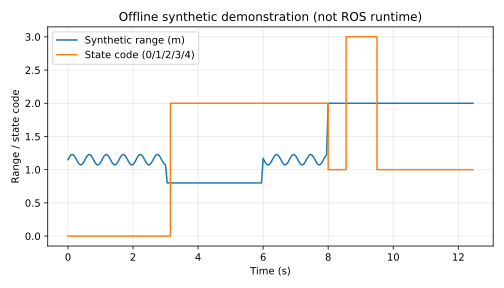

# 无人机近地测距迟滞报警

处理低空近地测距的阈值抖动、连续确认和断流，只输出报警，不宣称自动降落。

**验证状态：离线、独立 catkin 构建、ROS 合成话题功能和退出清理已通过；真实硬件与外部复测未完成。**

## 环境与依赖

本次实测为云端 Ubuntu 24.04、Python 3.12.14，NumPy 2.3.5、matplotlib 3.10.8，未安装 ROS。离线演示使用 matplotlib，神经网络模块另需 NumPy。
目标 ROS 环境为 Ubuntu 20.04 / Python 3.8 / ROS Noetic；该目标环境已由用户此前检查，本模块本次尚未进入其中运行。

## 离线复现

在仓库根目录执行，输出目录应不存在：

```bash
python3 -m unittest discover -s src/air/uav_landing_range_alarm/tests -v
python3 src/air/uav_landing_range_alarm/main.py --output /tmp/uav_landing_range_alarm_demo
```

第二条生成 samples.csv、metrics.json 和 offline_demo.svg；MLP 还会重新训练并输出 model.json。不同 NumPy/BLAS 版本可能产生末位数值差异。

## ROS 构建和运行（下方附本轮实测）

从仓库根目录开始，在独立 catkin 工作空间中只放这个包，不把整个混合 ROS1/ROS2 仓库交给 catkin：

```bash
source /opt/ros/noetic/setup.bash
mkdir -p ~/air_course_ws/src
cp -r src/air/uav_landing_range_alarm ~/air_course_ws/src/
cd ~/air_course_ws
catkin_make
source devel/setup.bash
roslaunch uav_landing_range_alarm main.launch
```

如缺依赖，按 package.xml 使用 ROS 对应发行版安装；不要在系统 ROS 中随意混装 Python 版本。
Ctrl+C 结束本模块。话题演示不要连接实机飞控，先完成受控仿真联调。

## 状态机与故障场景

默认报警阈值 1.0 米，解除阈值 1.3 米，需要连续 3 个低于/等于报警阈值的有效样本才进入 ALARM。
中间区间保留当前 CLEAR/ALARM 状态但打断未完成确认，防止 1.0 米附近抖动导致频繁切换；高于/等于 1.3 米立即恢复 CLEAR。
有效样本间隔超过 0.5 秒则 STALE；重新收到测距后重新累积确认。首次启动没有可信样本同样输出 STALE。

节点检查 `Range` 的 min_range、max_range 和测距值。负值、NaN、正负无穷或量程外数据标为 INVALID。
ROS Range 的正负无穷有传感器特定意义，本教学模块选择保守拒绝，不擅自解释为“已经接地”。

| 接口 | 类型 | 说明 |
|---|---|---|
| `range_input` | sensor_msgs/Range | 向下测距；单位米 |
| `~state` | std_msgs/String | UNKNOWN/CLEAR/ALARM/STALE/INVALID |
| `~demo` 参数 | bool | 默认 true，自动发布可重复合成测距 |

演示在 3–6 秒注入近地段，在 8–9.5 秒停止发布，之后恢复正常距离。

## ROS 联调操作（下方附本轮实测）

```bash
rostopic echo /uav_landing_range_alarm/state
```

默认演示应先 CLEAR，再 ALARM，在断流段变 STALE，随后恢复 CLEAR。
`~demo=false` 可接外部传感器；禁止与默认合成发布器同时输入同一话题，以免混淆数据来源。
若需要外部输入，可直接运行：

```bash
rosrun uav_landing_range_alarm main.py --ros _demo:=false
```

## 限制

它是近地报警，不是自动降落控制器；没有地形识别、着陆状态机、姿态修正、推力或速度输出。
测距沿传感器射线，倾斜时不等于垂直高度。本例不使用神经网络，不声称解决复杂地面反射问题。
时限基于单调接收时间，不验证源端时钟或网络延迟；源码中的阈值需要根据采样率和任务重新设定。


## 本次实际结果

离线单元测试：**8/8 通过**。原始输出位于本模块 tests_result.txt。

```json
{
  "alarm_samples": 97,
  "stale_samples": 19,
  "final_state": "CLEAR",
  "validation_scope": "offline mathematical demo; ROS runtime not tested"
}
```

下面为程序实际生成的**离线合成数据/数学演示图**，不是 ROS 窗口截图或飞行记录：



指标文件：源码模块内 offline_metrics.json。逐点样本可用离线复现命令重新生成。
本轮 ROS 构建与通信验证见下方实测补充；仍无真实硬件和外部复测。

## 大模型使用声明

使用 OpenAI Codex 辅助方案设计、代码、核心测试、合成演示、文档和提交准备。仅报告实际执行结果；作者需理解、复核和补充目标环境验证，并对内容负责。


## ROS Noetic 实测补充（2026-11-04）

本轮使用 VirtualBox Ubuntu 20.04.6、Python 3.8.10、ROS Noetic。工作目录为 `/home/ros/four_assignments_0yekhx11/ws_uav_landing_range_alarm`。

离线测试、独立 catkin 构建、真实 roslaunch/话题功能、退出清理四项分别通过；launch 返回码 0，无节点异常退出。

测试使用真实 ROS 通信发送合成输入，不是无人机飞行、真实传感器或 AirSim/Gazebo 验证。

- range 2.0 -> CLEAR
- range 0.8 -> ALARM
- range 1.15 -> ALARM
- range 1.5 -> CLEAR
- range nan -> INVALID
- missing range -> STALE
- roslaunch remains running through functional checks

复现构建（将本模块复制到独立工作空间 src 后）：

```bash
source /opt/ros/noetic/setup.bash
catkin_make -C /path/to/workspace
source /path/to/workspace/devel/setup.bash
roslaunch uav_landing_range_alarm main.launch
```

必须检查 `devel/setup.bash` 与 `devel/lib/uav_landing_range_alarm/main.py` 存在。旧脚本曾在错误工作空间构建，旧 BUILD=PASS 无效；以上是修正版的新工作空间证据。

原始证据：[构建](../../../docs/air/uav_landing_range_alarm/validation/build.txt)、[launch](../../../docs/air/uav_landing_range_alarm/validation/launch.log)、[ROS 测试](../../../docs/air/uav_landing_range_alarm/validation/ros_test.txt)、[结构化结果](../../../docs/air/uav_landing_range_alarm/validation/ros_result.json)、[离线测试](../../../docs/air/uav_landing_range_alarm/validation/offline.txt)、[源码 SHA256](../../../docs/air/uav_landing_range_alarm/validation/source_sha256.json)。哈希对应运行包源码，本轮已逐项核对；README 后续文档更新会改变其哈希，程序源码未改变。

仍未验证真实硬件/飞行与另一人另一台机器复测。PR 保持 Draft，外部复测不勾选。使用 OpenAI Codex 辅助日志核验、文档与提交整理。
