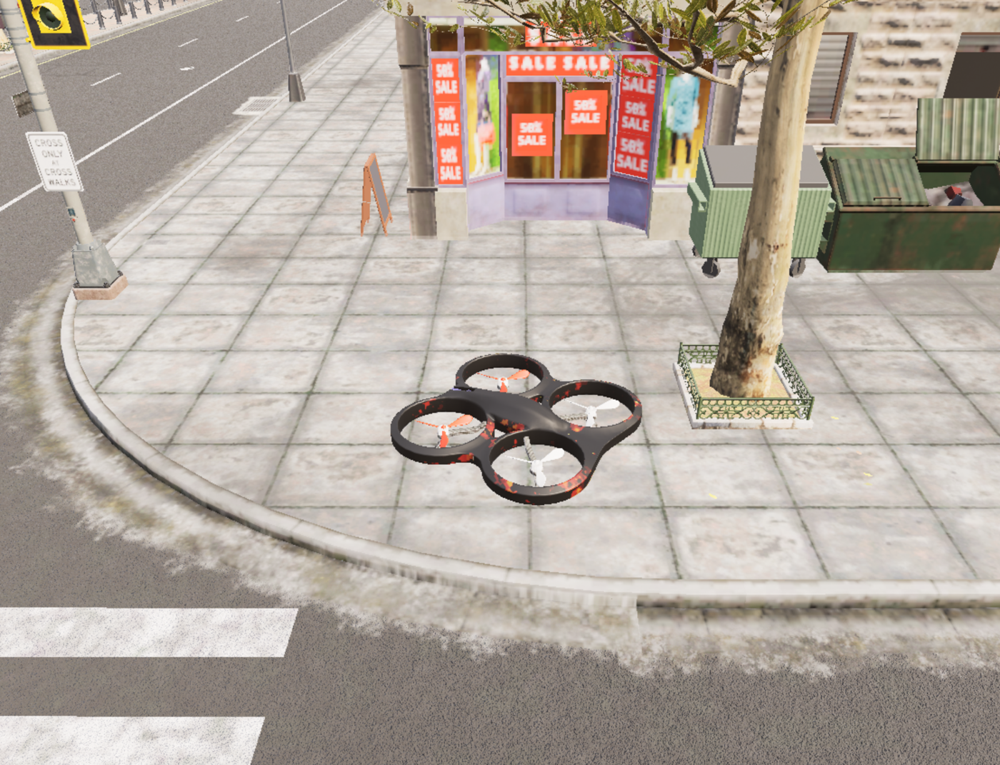

# uav_lidar_safety_corridor

基于 OpenHUTB/CarlaAir 激光雷达点云的无人机三维安全走廊与自适应高度避障实验。

节点订阅桥接层发布的 `/uav/odom` 和 `/lidar/points`，在前方一定宽度的三维
走廊中统计不同候选高度的障碍密度，选择更安全的高度，然后发布世界系 ENU
速度 `/uav/cmd_vel`。算法同时包含前进速度降级、横向斥力、垂向平滑和加速度限幅。
前视 `/camera/depth` 作为近距离保护层；当玻璃墙面、低矮障碍等没有被激光雷达
采样到时，深度图仍会触发减速或停车。

## 运行架构

```text
OpenHUTB / CarlaAir (Windows)
    │ AirSim RPC
    ▼
carlair_ros_bridge (Ubuntu 20.04 + ROS Noetic)
    │ /uav/odom, /lidar/points
    ▼
uav_lidar_safety_corridor
    │ /uav/cmd_vel（世界系 ENU 速度）
    ▼
carlair_ros_bridge ──► AirSim 无人机
```

## 运行环境

- Windows：OpenHUTB/CarlaAir，Town10HD；
- Ubuntu 20.04 + ROS Noetic；
- `carlair_ros_bridge`；
- `python3-numpy`；
- 不需要 Gazebo、PyTorch 或 GPU 推理环境。

## 构建

把本包和 `carlair_ros_bridge` 放进同一个 catkin 工作空间：

```bash
cd ~/catkin_ws
source /opt/ros/noetic/setup.bash
catkin_make
source devel/setup.bash
```

## 启动

先启动 Windows 侧 OpenHUTB/CarlaAir，再在虚拟机中启动桥接：

```bash
roslaunch carlair_ros_bridge main.launch \
  body_frame:=false \
  publish_image:=true
```

`publish_image:=true` 会同时发布 `/camera/depth`，是深度近距离保护的必需输入。
若显式关闭图像，应把 `control/depth_enabled` 参数设为 `false`，并接受没有
深度保护的前向飞行流程。

确认传感器已经发布：

```bash
rostopic hz /uav/odom
rostopic hz /lidar/points
rostopic echo -n1 /uav/odom
```

启动安全走廊节点。目标点使用与桥接一致的 ENU 世界坐标：

```bash
roslaunch uav_lidar_safety_corridor main.launch \
  goal_x:=10.0 \
  goal_y:=0.0 \
  goal_z:=5.0
```

若不确定 Town10 中无人机的初始绝对坐标，可以启动时加
`relative_goal:=true`，此时三个 `goal_*` 参数表示相对初始位置的偏移：

```bash
roslaunch uav_lidar_safety_corridor main.launch \
  relative_goal:=true \
  goal_x:=10.0 goal_y:=0.0 goal_z:=2.0
```

如果当前场景的无人机初始高度或目标点不同，以 `/uav/odom` 输出为准修改
`goal_x/goal_y/goal_z`。

## 一键启动

确认 OpenHUTB 已经按 `Ctrl+V` 切到 AirSim 模式后，也可以只开一个终端，
同时启动桥接和安全走廊节点：

```bash
roslaunch uav_lidar_safety_corridor openhutb_test.launch \
  host:=192.168.94.1 \
  goal_x:=-2.54 goal_y:=1.60 goal_z:=3.0
```

`goal_*` 是相对初始位置的 ENU 偏移。`host` 需替换为本机 VMware VMnet8
宿主机地址。一键 launch 默认目标为上升 3 m、前飞约 3 m。

## 话题

| 方向 | 话题 | 类型 | 说明 |
|---|---|---|---|
| 订阅 | `/uav/odom` | `nav_msgs/Odometry` | 世界 ENU 位姿和速度 |
| 订阅 | `/lidar/points` | `sensor_msgs/PointCloud2` | 世界 ENU XYZ float32 点云 |
| 订阅 | `/camera/depth` | `sensor_msgs/Image` | `32FC1` 前视平面深度，单位米 |
| 发布 | `/uav/cmd_vel` | `geometry_msgs/Twist` | 世界 ENU 速度 |
| 发布 | `/uav_lidar_safety_corridor/status` | `std_msgs/String` | 运行状态和诊断量 |
| 发布 | `/uav_lidar_safety_corridor/markers` | `visualization_msgs/MarkerArray` | RViz 安全高度预览 |

## 核心参数

| 参数 | 默认值 | 说明 |
|---|---:|---|
| `nav/goal` | `[10, 0, 5]` | ENU 目标点 |
| `nav/max_goal_bearing_deg` | `75.0` | 目标方向相对机头的最大允许夹角 |
| `corridor/lookahead_max` | `8.0` | 走廊前视距离 |
| `corridor/half_width` | `1.8` | 走廊半宽 |
| `corridor/vertical_clearance` | `0.7` | 候选高度周围的垂直安全半高 |
| `corridor/min_offset` | `-2.5` | 候选高度相对当前高度的下限 |
| `corridor/max_offset` | `3.5` | 候选高度相对当前高度的上限 |
| `control/max_horizontal_speed` | `2.2` | 最大水平速度 |
| `control/max_vertical_speed` | `1.0` | 最大垂向速度 |
| `control/depth_stop_distance` | `1.2` | 深度图触发完全停车的距离 |
| `control/depth_slow_distance` | `3.5` | 深度图开始减速的距离 |

完整参数见 `config/params.yaml`。

## 算法

1. 把前方点云投影到目标方向坐标系，只保留前进距离内的走廊点；
2. 在当前高度附近生成离散候选高度；
3. 对每个候选高度统计垂直安全带内的障碍密度；
4. 综合障碍风险、目标高度偏差和高度变化代价，选择走廊中心高度；
5. 根据前方最近障碍距离降低水平速度，并加入短距离横向斥力；
6. 用前视深度图中心区域做近距离保护；
7. 使用加速度限幅生成世界系速度。

本实验使用运动学速度闭环，重点验证安全走廊选择与桥接闭环；不声称复现
真实旋翼姿态动力学。

本模块是**前向安全走廊**：目标偏离机头超过 `75°` 时会拒绝目标并悬停。
深度相机只覆盖机头前方，不能保证侧向、后向或大幅横移时的碰撞安全。

## 测试

```bash
cd src/air/uav_lidar_safety_corridor
python3 -m unittest discover -s test -v
```

测试覆盖 PointCloud2 解码、无效点过滤、候选高度选择、目标方向控制、
加速度限幅、近障碍降速、深度图解码和深度保护。

## OpenHUTB 实测结果

在 OpenHUTB/CarlaAir Town10HD Opt 中完成：

- 桥接自检 5/5 通过，`Drone1`、相机、雷达和 ROS 话题均正常；
- 相对目标 `[-2.54, 1.60, 3.00]` m 实际执行成功；
- 无人机上升约 3 m 并前飞约 3 m；
- 深度保护在 1.89 m 时降至 0.30 倍速度，安全后恢复 1.00；
- 目标距离由 3.98 m 收敛到 0.95 m，最终输出 `DONE`；
- 离线测试 20 项通过，实测无碰撞。



最终开放路径中雷达走廊为空；障碍点云驱动的候选高度切换由离线测试覆盖，
实测结果仅声明本次上升/前飞与深度保护链路已验证。

## AI 使用声明

使用 Codex 辅助需求分析、代码编写、测试和文档整理；作者完成 OpenHUTB
环境配置、实际飞行、数据采集与结果复核，并对提交内容负责。
