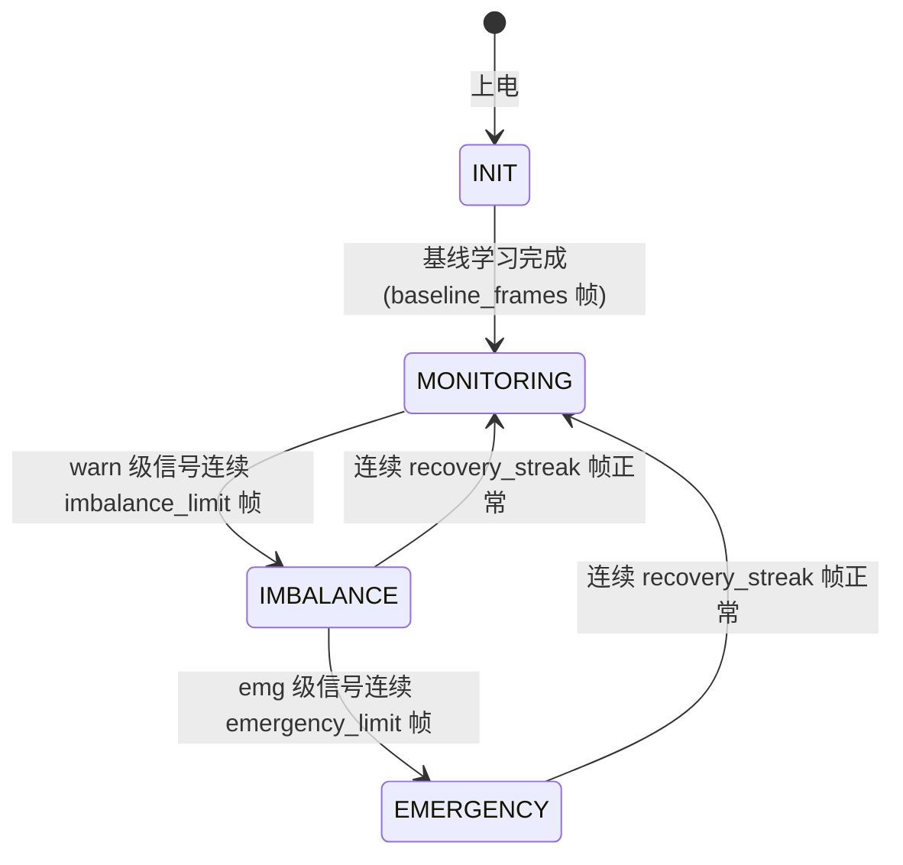

# uav_motor_thrust_imbalance_monitor（电机推力不对称监测）

多旋翼「执行输出侧」的失效保护：从 **mixer 指令 + ESC 转速遥测** 中检测
单电机推力不对称，区分两类典型动力故障，并给出补偿指令与紧急降落触发
建议。与仓库已有的定位输入门控、航向输入门控构成「输入—输入—输出」
三侧安全链。

## 为什么需要它

单电机性能衰减（进沙、轴承磨损、电调过流降额）或螺旋桨损伤（裂纹、
缺口、异物缠绕）在起飞前往往看不出来；起飞后表现为定点悬停缓慢漂移、
姿态持续歪斜、高度掉落，操作者常先怀疑控制参数或 GPS。等到姿态完全
失控时，剩余拉力通常已不足以完成正常返航——**早 10 秒发现，就多一次
可控降落的机会**。

本模块不重写飞控，只做三件事：**检测**、**补偿建议**、**紧急降落触发**。

## 两类故障与两路判据

| 故障类型 | 物理表现 | 判据 | 信号 |
| --- | --- | --- | --- |
| 电机/电调性能衰减 | 同样指令达不到应有转速 | RPM 跟踪误差 `(期望-实测)/期望` | `rpm_tracking_warn/emergency` |
| 螺旋桨损伤 | 转速正常但拉力下降，控制器必须抬高该电机指令 | 指令相对健康基线的持续偏移 | `cmd_deviation_warn/emergency` |

指令偏移判据只在**近悬停窗口**（平均指令在 `hover_cmd±band` 内）生效，
避免大机动时的合法不对称指令被误判；基线在起飞后的健康段学习并冻结，
只在近悬停窗口内更新。

## 状态机



- **INIT**：学习各电机指令基线（此时 RPM 跟踪判据已可用）；
- **MONITORING**：健康，`motor_health=True`；
- **IMBALANCE**：确认不对称但可控。输出逐电机补偿指令（`comp_gain×
  跟踪误差`，封顶 `comp_limit`，叠加后不超过 1.0），建议尽快降落；
- **EMERGENCY**：不对称超出补偿能力，`emergency_land=True`，补偿归零
  （已经没有意义），下游应触发紧急降落。

安全设计：**纯遥测超时封顶在 IMBALANCE，不升级 EMERGENCY**——数据流
丢失无法区分「动力失效」与「链路/监视器自身掉线」，此时触发紧急降落
比保持降级监视更危险。

## 使用

```bash
# 离线回放（不需要 ROS）：健康 → 电机衰减 → 紧急 → 中断恢复 → 桨损
python main.py
python main.py --plot out/          # 另存 CSV + SVG

# ROS 2（Ubuntu + ROS 2 Humble）
colcon build --packages-select uav_motor_thrust_imbalance_monitor
ros2 launch uav_motor_thrust_imbalance_monitor uav_motor_thrust_imbalance_monitor.launch.py

# 测试（不需要 ROS 的机器上自动用内置兼容层）
python -m unittest -v test_motor_imbalance_monitor.py     # 判据单测
python -m unittest -v test_ros_loop_smoke.py              # 话题闭环冒烟

# MuJoCo 台架验证（pip install mujoco）
python mujoco_motor_verification.py --plot out/
```

话题（全部标准消息）：

| 方向 | 话题 | 类型 | 说明 |
| --- | --- | --- | --- |
| 订阅 | `/drone/motor_commands` | `std_msgs/Float32MultiArray` | mixer 归一化指令 [0,1] |
| 订阅 | `/drone/esc_rpm` | `std_msgs/Float32MultiArray` | 各 ESC 实测转速 |
| 发布 | `/drone/motor_health` | `std_msgs/Bool` | False = 检测到不对称 |
| 发布 | `/drone/emergency_land` | `std_msgs/Bool` | True = 建议立即紧急降落 |
| 发布 | `/drone/commands_compensated` | `std_msgs/Float32MultiArray` | 叠加补偿后的指令（封顶 [0,1]） |
| 发布 | `/drone/motor_status` | `std_msgs/String` | JSON：状态与判据明细 |

没有 ESC 转速遥测时（只订阅指令），判据自动退化为指令偏移单路，状态
输出 `rpm_available=False`，不误报。

## 验证情况（如实声明）

| 项目 | 结果 |
| --- | --- |
| 判据单元测试 | 17/17 通过（Windows 11 + Python 3.13，纯标准库） |
| ROS 话题闭环冒烟 | 7/7 通过（内置 rclpy 兼容层，逐拍确定；真实 rclpy 环境下同一份代码同一套断言） |
| MuJoCo 台架验证 | 8/8 通过（MuJoCo 3.17.0：转子摩擦退化经真实动力学传导，中段稳态转速亏 10.9%、深段 28.7% 对应拉力亏 51.8%，检出 IMBALANCE→EMERGENCY→恢复，全程无数值发散） |
| 离线回放 | 326 帧：IMBALANCE 7.8 s、EMERGENCY 13.0 s、恢复 20.6 s、桨损 26.4 s 检出 |

**未验证**：真实 ESC 遥测（不同厂商的指令-转速曲线差异）、ROS 2 在线
闭环（真实 rclpy）、自由飞场景中姿态耦合（MuJoCo 验证为台架/定基座，
自由飞姿态链路由冒烟测试与回放覆盖）、`/drone/commands_compensated`
接入真实飞控后的闭环效果。

## 简化假设

- 指令→转速取线性映射 `rpm = rpm_max × cmd`；判据用相对误差，对映射
  斜率不敏感，但**绝对门限**（`track_err_*`）需要按机型的空载曲线校准；
- 不估计总拉力、不做故障电机隔离（reallocation/mixer 重分配）；
- 不检测多电机同时对称衰减（四路一起缓慢老化在相对判据下不可见）。

## 与相邻模块的分工

| 模块 | 职责 | 本模块不做的 |
| --- | --- | --- |
| `uav_battery_rth_failsafe` | 电量不足触发返航 | 不看电机，只看电量 |
| `telemetry_diagnostics` | 遥测通道异常评分 | 不针对动力系统判故障 |
| `uav_mission_safety_manager` | 任务层安全状态机 | 不做信号级检测 |
| 本模块 | 动力输出侧不对称检测与补偿建议 | 不做电量、链路、任务决策 |
