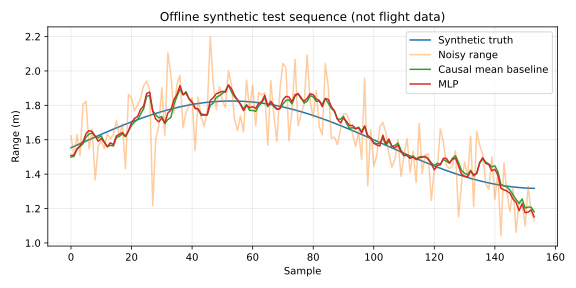

# 无人机测距序列轻量 MLP 去噪

以独立合成序列训练和评估小型 MLP，和原始测距、滑动平均对比；ROS 只发布估计值，不控制飞行。

**开发状态：离线演示和核心测试已运行；ROS Noetic 构建、launch、在线话题和飞行/模拟器闭环尚未验证。** 本文不作为已通过课程验收的声明。

## 环境与依赖

本次实测为云端 Ubuntu 24.04、Python 3.12.14，NumPy 2.3.5、matplotlib 3.10.8，未安装 ROS。离线演示使用 matplotlib，神经网络模块另需 NumPy。
目标 ROS 环境为 Ubuntu 20.04 / Python 3.8 / ROS Noetic；该目标环境已由用户此前检查，本模块本次尚未进入其中运行。

## 离线复现

在仓库根目录执行，输出目录应不存在：

```bash
python3 -m unittest discover -s src/air/uav_range_denoising_mlp/tests -v
python3 src/air/uav_range_denoising_mlp/main.py --output /tmp/uav_range_denoising_mlp_demo
```

第二条生成 samples.csv、metrics.json 和 offline_demo.svg；MLP 还会重新训练并输出 model.json。不同 NumPy/BLAS 版本可能产生末位数值差异。

## ROS 构建和运行（待实际验证）

从仓库根目录开始，在独立 catkin 工作空间中只放这个包，不把整个混合 ROS1/ROS2 仓库交给 catkin：

```bash
source /opt/ros/noetic/setup.bash
mkdir -p ~/air_course_ws/src
cp -r src/air/uav_range_denoising_mlp ~/air_course_ws/src/
cd ~/air_course_ws
catkin_make
source devel/setup.bash
roslaunch uav_range_denoising_mlp main.launch
```

如缺依赖，按 package.xml 使用 ROS 对应发行版安装；不要在系统 ROS 中随意混装 Python 版本。
Ctrl+C 结束本模块。话题演示不要连接实机飞控，先完成受控仿真联调。

## 数据、网络与验证划分

每条合成轨迹是 1.5–2.5 米均值附近的低频正弦距离，叠加标准差 0.15 米高斯噪声。
因果窗口为最近 7 个测距样本，输入/目标除以 4 归一化，预测窗口最后时刻的干净距离；使用历史样本会带来滤波延迟。
网络为 7→16 tanh→1，共 145 个参数，使用标准 NumPy 实现 Adam 训练 800 步；所有权重均参与训练。

训练数据由随机种子 101 的 20 条独立序列产生；测试数据为种子 909 的另外 5 条序列，共 770 个窗口。
不随机打散同一时间序列后再拆训练测试，避免窗口重叠造成的数据泄漏。
基线包括原始带噪测距和相同 7 点因果滑动平均，必须同时报告。

**本次结果 MLP 与滑动平均接近且略差，没有证据表明比简单滤波更好。** 这是合成平滑信号下的教学结果，不能解释为真实测高性能。
额外单元测试用种子 808 检查它相对原始带噪数据是否改善，不把种子 909 的表现当成所有数据的保证。

| 接口 | 类型 | 说明 |
|---|---|---|
| `range_input` | sensor_msgs/Range | 有限且量程内的测距 |
| `range_denoised` | sensor_msgs/Range | 估计距离，保留来源时间戳和传感器元数据 |
| `~status` | std_msgs/String | WARMUP/INVALID/STALE/ESTIMATE_OUT_OF_RANGE/ESTIMATED_SYNTHETIC_MODEL |
| `~model_path` 参数 | string | 可配置模型 JSON 路径，默认包内 model.json |

断流超过 0.5 秒或非法输入时清空窗口；再次收齐 7 帧才输出估计，避免跨断流拼接历史数据。
节点不输出运动指令。没有真实数据的域适配或不确定度评估。

## ROS 联调操作（待实际验证）

```bash
rostopic pub -r 20 /range_input sensor_msgs/Range "{header: {frame_id: downward_sensor}, radiation_type: 0, field_of_view: 0.1, min_range: 0.1, max_range: 5.0, range: 2.0}"
rostopic echo /range_denoised
rostopic echo /uav_range_denoising_mlp/status
```

停止输入后应见 STALE；重新输入前 6 帧为 WARMUP。它只检查消息到达时间，不据源时间戳检查陈旧重放。

## 限制

样本时距按 20 Hz 假定，在线没有重采样；不同采样率会改变有效窗口时长。只有平滑正弦+高斯噪声，未覆盖突然落地、阶跃障碍、强反射、多径和传感器饱和。
不把估计距离直接用来判断着陆，不声称真实飞行安全性或实机精度。


## 本次实际结果

离线单元测试：**8/8 通过**。原始输出位于本模块 tests_result.txt。

```json
{
  "raw_rmse_m": 0.15241890668596864,
  "mean_rmse_m": 0.06562865320720264,
  "mlp_rmse_m": 0.06564836860394337,
  "train_seed": 101,
  "test_seed": 909,
  "test_samples": 770,
  "scope": "synthetic independent sequences; no ROS or real flight validation"
}
```

下面为程序实际生成的**离线合成数据/数学演示图**，不是 ROS 窗口截图或飞行记录：



指标文件：源码模块内 offline_metrics.json。逐点样本可用离线复现命令重新生成。
没有本次 ROS 在线截图、catkin 构建结果、真实数据验证、文档浏览器预览和另一人另一台机器复测，需后续补齐。

## 大模型使用声明

使用 OpenAI Codex 辅助方案设计、代码、核心测试、合成演示、文档和提交准备。仅报告实际执行结果；作者需理解、复核和补充目标环境验证，并对内容负责。
