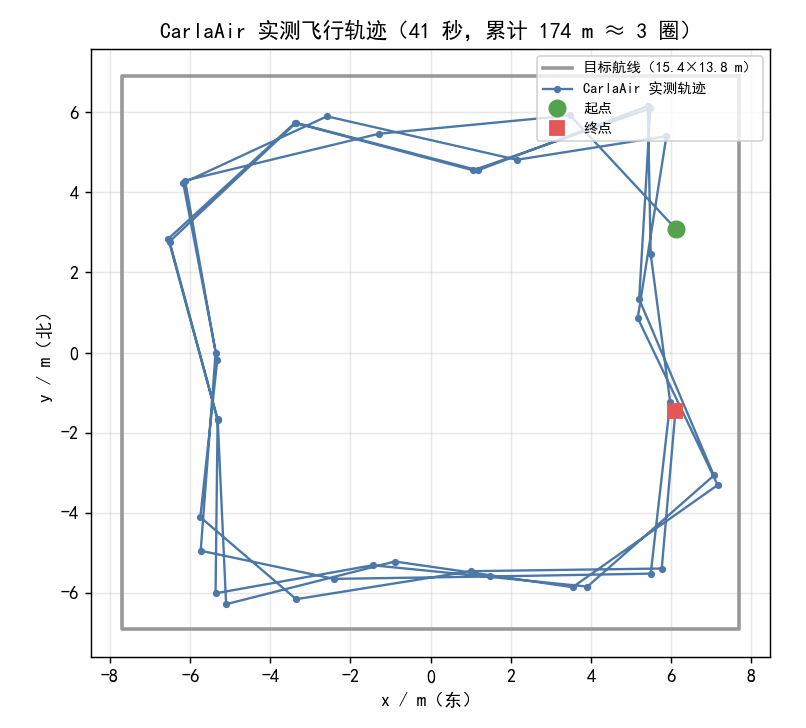

# uav_route_cruise —— 基于 PPO 的无人机固定路线巡航

给无人机一条**固定的闭合航线**，让它沿航线巡航一整圈；途中障碍物随机摆放，
其中一部分**直接压在航线上**——贴着航线中线飞必撞，必须临时偏离绕行再回到线上。

与同仓库 `uav_ppo_nav` 互补：

| | `uav_ppo_nav` | **`uav_route_cruise`（本模块）** |
|---|---|---|
| 任务 | 随机生成目标点，飞到即结束 | **固定闭合航线**，巡航一整圈 |
| 观测 | 16 扇形激光 + 目标相对位置 + 速度 | 24 扇形激光 + **航线几何**（横向偏差 / 航向偏差 / 前方航点）+ 高度偏差 |
| 指标 | 成功率 / 超时 / 碰撞 | **完成一圈率 / 平均横向偏差 / 平均完成度** |
| 需要的能力 | 点对点规划 | 循迹 + **遇压线障碍时临时绕避** |

## 为什么这个课题有意义

如果障碍都摆在航线旁边，那么「贴着中线飞」的经典纯跟踪控制器（pure pursuit）
就能 100% 走完——**神经网络没有存在必要**。

本模块把 35% 的障碍放在航线上，于是：

| 策略 | 完成一圈率 | 碰撞率 |
|---|---|---|
| **PPO（本模块）** | 见下方「实测结果」 | |
| 纯跟踪（不看障碍） | **0%** | **100%** |

也就是说，任务真正考的是「**会不会为了绕开障碍而临时偏离航线**」，
而不只是「会不会跟着线飞」。

## 快速开始

### 1. 只跑训练与评估（不需要 ROS / CARLA）

```bash
pip install numpy gymnasium matplotlib

# 训练（需要 stable-baselines3 + torch）
pip install stable-baselines3 torch
python3 scripts/train.py --steps 600000 --seed 0 --out models/route_ppo_s0.npz

# 评估（导出轨迹对比图到 results/）
python3 scripts/eval.py --model models/route_ppo_s0.npz --episodes 30 --seed 1000

# 与「纯跟踪」基线对照
python3 scripts/compare.py --model models/route_ppo_s0.npz --seeds 0,1,2 --episodes 30
```

### 2. 在 CarlaAir / AirSim 里部署

```bash
# ① 先起桥接 —— 必须加 body_frame:=false
#    本节点输出的是【世界系 ENU】速度，桥接默认按机体系解释会导致乱飞
roslaunch carlair_ros_bridge main.launch host:=192.168.94.1 vehicle_name:=Drone1 \
    body_frame:=false publish_image:=false publish_lidar:=true auto_takeoff:=true

# ② 先干跑检查观测（只算不发指令）
python3 scripts/route_node.py _dry_run:=true

# ③ 再正式飞
python3 scripts/route_node.py _dry_run:=false
```

统一入口是 `main.py`（作业要求入口为 `main.*`）：

```bash
python3 scripts/main.py               # 直接跑节点
python3 scripts/main.py --train ...   # 训练
python3 scripts/main.py --eval ...    # 评估
python3 scripts/main.py --compare ... # 对照
```

#### CarlaAir 实飞验证结果

已在 **CarlaAir v0.1.7（Town10HD）+ ROS Noetic + AirSim `Drone1`** 上实飞过。

> ⚠️ **这次实飞用的不是默认航线**：通过 `route_points` 传了一条 **15.4 × 13.8 m 直角矩形**
> （周长 **58.4 m**），`speed_scale = 0.7`（命令上限 2.1 m/s）。
> 默认航线是 20 × 14 m 圆角矩形（62.80 m），两者不能混用。

| 项 | 实测 | 说明 |
| --- | --- | --- |
| `/uav/odom` 频率 | **20.005 Hz** | 可靠 |
| `/lidar/points` 频率 | 9.996 Hz | 可靠（但内容为空点云，见下）|
| x / y 跨度 | 13.71 m / 12.43 m | 为该航线的 **89% / 90%** |
| 高度 | −28.22 ~ −27.48 m（波动 **0.74 m**）| 可靠 |
| 累计路程 | **174.3 m**（≈ 58.4 m × 3 圈）| 1 Hz 弦长求和，是**下界** |
| 实际时长 | **未记录**（推算 ≥ 83 s）| 上一版误标「41 秒」，已更正 |
| 平均速度 | **不作结论** | 缺可靠时长 |



**已验证**：节点能起、能订阅真实 odom、能算航线几何、能发 `/uav/cmd_vel`、
无人机沿矩形航线绕圈（轨迹形状与该 15.4×13.8 m 航线吻合），高度稳定。

**未验证 / 待重做**（如实说明）：

* **避障** —— 桥接发出的 `/lidar/points` 是空点云（AirSim 侧 `getLidarData('lidar1')`
  有 1785 个点，但桥接的坐标转换返回空），这次飞的是「全程无障碍」的纯循迹。
* **时长与平均速度** —— 采样用的是 shell 里阻塞的 `rostopic echo -n1`，**不是 1 Hz**，
  所以「41 秒」这个标注是错的，由它算出的平均速度不成立。
  待用**默认航线 + `speed_scale=1.0` + rclpy 按真实时间戳记录**重做。
* **转弯过冲** —— 四个角都甩出去 1~2 m，观测里只有一个 4 m 前视点，看不到弯道走向。

## 话题

| 方向 | 话题 | 类型 | 说明 |
|---|---|---|---|
| 订阅 | `/uav/odom` | `nav_msgs/Odometry` | 世界系 ENU 位姿与速度 |
| 订阅 | `/lidar/points` | `sensor_msgs/PointCloud2` | 世界系点云 |
| 发布 | `/uav/cmd_vel` | `geometry_msgs/Twist` | **世界系**速度：`linear.x`=东、`linear.y`=北、`linear.z`=天 |
| 发布 | `/uav_route_cruise/lap_done` | `std_msgs/Bool` | 完成一整圈时锁存为 true |

## 观测与动作

**观测（30 维，全部世界系）**

| 维度 | 内容 |
|---|---|
| 0–23 | 24 个扇形激光距离 / 12 m，1 = 无遮挡 |
| 24 | 横向偏差 / 4 m（正 = 偏航线左侧） |
| 25 | 航向偏差 / π（速度方向与航线切向的夹角） |
| 26–27 | 前方 4 m 处航点的相对位置 (x, y)，除 6 m |
| 28 | 水平速度 / 3 m/s |
| 29 | 高度偏差 / 2 m |


**动作（4 维，∈[-1,1]）** → 世界系速度 `[vx, vy, vz, yaw_rate]`，
映射到 `±3 m/s`（水平）、`±1.5 m/s`（垂直）、`±1 rad/s`（偏航角速度）。

## 训练设计里三个踩过的坑

1. **撞机惩罚太轻 → 学会"撞了也无所谓"**
   初版完成一圈奖励约 600、撞机只扣 30，结果 100% 碰撞。
   把撞机惩罚提到 **-200** 后碰撞率直接降到 0。

2. **障碍不压线 → 任务变得没有意义**
   障碍离航线 ≥2.4 m 时，纯跟踪控制器也能 100% 完成、零碰撞。
   加 `on_route_frac=0.35`（35% 障碍压在航线上）后，纯跟踪基线掉到 0% 完成。

3. **横向偏差惩罚过强 → 宁可撞也不绕**
   绕行必然带来横向偏差，`w_cross` 太大时策略选择硬撞。
   降到 **0.2** 后它才愿意绕。

另外用了**课程学习**：压线障碍比例从 5% 逐步升到 35%，
让策略先学会稳定循迹，再学避障。

## 测试

```bash
pytest tests/test_uav_route_cruise_local.py -v
```

覆盖：航线几何、环境行为、策略权重维度一致性、**打包正确性**
（入口走 `catkin_install_python`、被 import 的模块以普通文件安装——
这两个配错会表现为「能 build、一 launch 就报 ModuleNotFound / AttributeError」）、
配置与代码参数一致性、文件无 BOM。

## 实测结果

> 下面的数字由 `scripts/eval.py` / `scripts/multiseed_eval.py` 生成，命令与种子见下。

**训练**：PPO，1.2M 步，4 个并行环境，策略网络 `[128,128]`，两个独立种子（s0 / s1）。
**评估**：每个 eval seed 跑 30 个回合，随机 14 个障碍（其中 25% 压在航线上）。
**回合种子约定**：第 k 个回合用 `seed + k`（与 `eval.py` 一致）。

### 主表（eval seed = 1000，默认权重 `models/route_ppo_s0.npz`）

| 指标 | **PPO 策略** | 纯跟踪（不看障碍） |
| --- | --- | --- |
| **完成一圈率** | **73.3%** | **0.0%** |
| 碰撞率 | 26.7% | 100.0% |
| 超时率 | 0.0% | 0.0% |
| 平均完成度 | **81.3%** | 7.8% |
| 平均横向偏差 | 0.975 m | 0.429 m |
| 最大横向偏差 | 1.283 m | 0.618 m |
| 平均高度偏差 | 0.232 m | 0.959 m |
| 平均步数 | 151.1 | 16.9 |

复现命令：

```bash
python3 scripts/eval.py --model models/route_ppo_s0.npz --episodes 30 --seed 1000
```

纯跟踪控制器**平均只活 16.9 步（约 1.7 秒）**就撞上第一个压线障碍，
所以它的「平均横向偏差」看起来更小 —— 那是因为它根本没飞多远。


左图：灰色是目标航线，红色圆是压在航线上的障碍（必须绕行），灰圆是旁侧障碍；
蓝线是 30 个回合的 PPO 轨迹，红色虚线是纯跟踪的轨迹，红叉是它的碰撞点。
右图是两者完成一圈率的对比。

### 多评估种子稳健性（同一权重换 eval seed）

**单个 eval seed 的数字波动很大**，只看一个数会误导。下表是两份权重在 8 个 eval seed
上的结果（每个 seed 30 回合）：

| eval seed | s0 完成率 | s1 完成率 |
| --- | --- | --- |
| 0 | 73.3% | 63.3% |
| 1 | 76.7% | 63.3% |
| 2 | 80.0% | 66.7% |
| 3 | 80.0% | 70.0% |
| 4 | 76.7% | 70.0% |
| 5 | 76.7% | 70.0% |
| 1000 | 73.3% | 76.7% |
| 1001 | 76.7% | 80.0% |
| **均值 ± 标准差** | **76.7% ± 2.5%** | **70.0% ± 5.9%** |

* `models/route_ppo_s0.npz`（**默认使用**）：**76.7% ± 2.5%**，碰撞率 23.3% ± 2.5%
* `models/route_ppo_s1.npz`：70.0% ± 5.9%，碰撞率 23.3% ± 5.9%

所以对外只能说「完成一圈率约 **77% ± 3%**（s0）、区间 **73~80%**」，
不能说「80.0%」—— 那是 s1 在 eval seed=1001（恰好是训练期评估用的种子）下的结果。

```bash
python3 scripts/multiseed_eval.py --models models/route_ppo_s0.npz models/route_ppo_s1.npz \
    --seeds 0,1,2,3,4,5,1000,1001 --episodes 30
```

## 目录

```
uav_route_cruise/
├── CMakeLists.txt
├── package.xml
├── README.md
├── config/route_cruise.yaml      # 节点参数（与 route_node.py 的 get_param 一一对应）
├── launch/main.launch            # 入口（type="main.py"）
├── models/
│   ├── route_ppo_s0.npz          # 默认权重（多评估种子 76.7% ± 2.5%，纯 numpy 可读）
│   └── route_ppo_s1.npz          # 另一个种子（70.0% ± 5.9%）
├── results/route_cruise_eval.png # 实测轨迹对比图
└── scripts/
    ├── main.py                   # 统一入口（作业要求 main.*）
    ├── route.py                  # 航线几何：投影 / 横向偏差 / 前方航点 / 完成度
    ├── route_env.py              # 固定航线环境（gymnasium）
    ├── policy.py                 # 观测拼接 + 纯 numpy MLP 推理 + sb3 权重导出
    ├── train.py                  # PPO 训练（含课程学习回调与多并行环境）
    ├── eval.py                   # 评估 + 轨迹图
    ├── multiseed_eval.py         # 多评估种子稳健性测量
    ├── compare.py                # PPO vs 纯跟踪对照
    └── route_node.py             # ROS 节点
```
