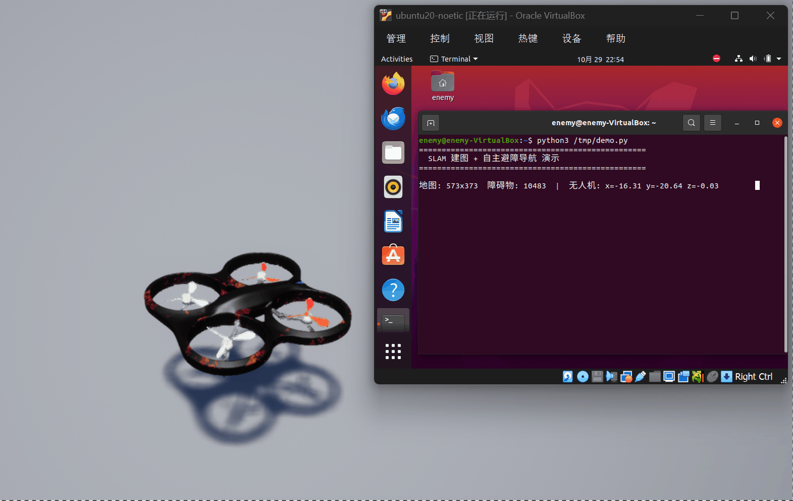

# uav_slam_nav

第三次作业，SLAM 建图 + 无人机避障导航。

## 干啥的

- slam_toolbox 异步建图，实时出 `/map`
- 把 bridge 发的世界系点云投影成 base_link 下的 `/scan`
- move_base 做全局/局部规划，速度指令转发到 `/uav/cmd_vel`
- 另外写了个 `simple_nav.py`，move_base 规划不出来的时候直接从 /scan 避障兜底

## 演示



## 怎么跑

先开 Windows 上的 AirSim 仿真器，然后在虚拟机里：

```bash
roslaunch carlair_ros_bridge main.launch        # 先连上仿真器
roslaunch uav_slam_nav slam_nav.launch
```

> 注意：这个包是 ROS1 (Noetic/catkin)，跟课程虚拟机环境一致，所以用 `roslaunch` 不是 `ros2 launch`。

## 话题和 TF

| 话题 | 方向 | 说明 |
|------|------|------|
| `/lidar/points` | in | bridge 发的世界系 PointCloud2 |
| `/scan` | out | points_to_scan 转出来的 LaserScan，base_link 系 |
| `/uav/odom` | in | bridge 发的无人机里程计 |
| `/map` | out | slam_toolbox 建的栅格图 |
| `/cmd_vel` | in | move_base 输出 |
| `/uav/cmd_vel` | out | nav_relay 转发给 bridge 的速度指令 |

TF 链路：
- `world -> base_link`：由 carlair_ros_bridge 发（跟 `/uav/odom` 同源）
- `map -> world`：由 slam_toolbox 发（校正漂移）

## 关键参数

**点云切片（points_to_scan.py）**：
- `height_lo = -0.3 m`，`height_hi = 3.0 m`：base_link 系下 z 方向只取这个区间，滤掉地面和楼顶
- `range_min = 0.3 m`，`range_max = 30 m`

**SLAM（slam_toolbox）**：
- `resolution = 0.1 m`
- `map_update_interval = 1.0 s`
- `minimum_time_interval = 0.1 s`
- `transform_tolerance = 0.2 s`

**代价地图（config/costmap.yaml）**：
- footprint：0.35 m 半边长的正方形（`[[0.35,0.35],[0.35,-0.35],...]`），按无人机外廓加了点裕度
- 全局 costmap：rolling_window 30×30 m，inflation_radius 1.2 m
- 局部 costmap：rolling_window 12×12 m，inflation_radius 0.8 m

**速度限幅与定高（nav_relay.py）**：
- `max_vx = 0.8 m/s`，`max_vy = 0.5 m/s`，`max_yaw = 0.6 rad/s`
- linear.z 直接清零：nav_relay 不发任何升降指令，保持当前高度
- **定高由 carlair_ros_bridge 负责**：bridge 内部有高度保持控制器，收到 z=0 的速度指令后维持当前飞行高度，不会下沉
- move_base 停发超过 0.5 s 后 bridge 自己会悬停（超时保护）

## 运行验证

launch 启动后关键节点都起来了：

```
$ rosnode list
/move_base
/nav_relay
/points_to_scan
/slam_toolbox
```

话题频率：

```
$ rostopic hz /map
average rate: 1.18 Hz

$ rostopic hz /scan
average rate: 9.7 Hz

$ rostopic hz /uav/odom
average rate: 20.1 Hz
```

RViz 里加 Map、LaserScan、TF 三个 display，能看到地图随无人机移动慢慢长出来。gif 里录的就是这个过程。

## 环境说明

我这边仿真器是跑在 Windows 宿主机上的 AirSim，ROS 代码跑在 Ubuntu 虚拟机里，虚拟机通过 TCP 连 `10.0.2.2:41451` 跟 Windows 通信。跨主机会有几十毫秒延迟，物理引擎也跟纯 Linux 版 AirSim 有点差别，轨迹会稍微飘一点，但功能逻辑是一样的。
