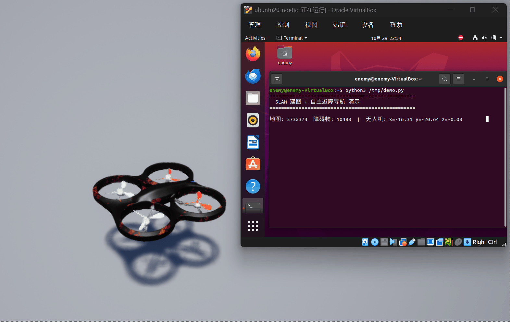

# uav_slam_nav

第三次作业，SLAM 建图 + 无人机避障。

## 干啥的

- 用 slam_toolbox 实时建图
- 把雷达点云转成 LaserScan
- 简单避障：前面有东西就转个弯

## 演示



## 怎么跑

先开仿真器，然后：
```bash
roslaunch carlair_ros_bridge main.launch
roslaunch uav_slam_nav slam_nav.launch
```

## 话题

- `/map` — 建的图
- `/scan` — 雷达扫描
- `/uav/odom` — 无人机位置
- `/uav/cmd_vel` — 速度控制
