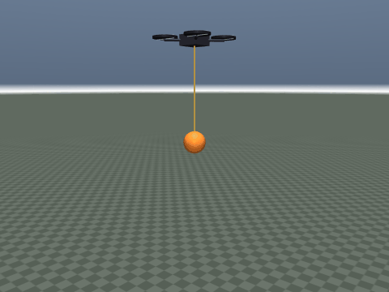
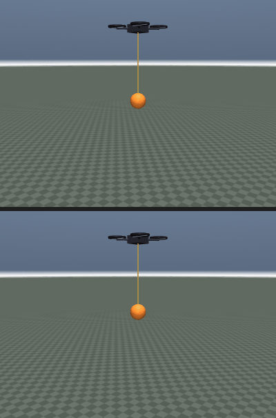

# uav_slung_load：四旋翼吊挂负载防摆控制

四旋翼用一根 0.5 m 绳缆吊着负载做点到点搬运。负载相当于一个欠阻尼摆，机体的位置环会不断“激励”它，
导致搬运结束后摆动长时间不衰减、定位精度下降。本模块在同一个 MuJoCo 台架上对比三种控制律：

| 控制律 | 用到的负载信息 | 思路 |
| --- | --- | --- |
| `pd` | 无 | 纯位置 PD（不含积分项），基线 |
| `zv` | 无（只改参考） | ZV 输入整形：把阶跃拆成相隔半个摆动周期的两段 |
| `swing` | 摆角/摆速 | 位置环叠加“朝负载水平投影加速”的阻尼项 |

位置环刻意不加积分项：吊挂摆的等效干扰是持续低频耦合，积分项会在摆的周期附近累积相位滞后，
容易把基线推向极限环；代价是基线存在厘米级稳态误差（见评测表的位置 RMS）。

三种控制律共用同一个姿态环与旋翼混控，唯一区别是“怎么用负载状态”，因此对比是可解释的。

## 效果

0.1 kg 负载、`+x` 方向 3.5 m 平移（镜头跟随机体）：

| 摆角反馈控制器 | PD（上） vs 摆角反馈（下），同帧对比 |
| --- | --- |
|  |  |

## 1 目录结构

```
uav_slung_load/
├── CMakeLists.txt
├── package.xml
├── requirements.txt
├── README.md
├── models/
│   └── slung_quadrotor.xml     # 四旋翼 + 刚性连杆绳缆 + 球形负载
├── scripts/
│   ├── sim_core.py             # 仿真核心、指标统计（无 ROS 依赖）
│   ├── controllers.py          # pd / zv / swing 三种控制律
│   ├── evaluate.py             # 3 种负载 × 3 种控制器，输出 CSV
│   ├── make_gif.py             # 离屏渲染效果动图
│   └── main.py                 # 演示 / 键盘模式
├── test/
│   └── test_offline.py         # 离线自检（模型结构、指标对比、可重复性）
└── results/
    └── eval_*.csv              # 评测留档
```

## 2 依赖

| 依赖 | 版本 | 说明 |
| --- | --- | --- |
| Python | 3.8+ | 仅用标准库 + numpy + mujoco |
| NumPy | >= 1.20 | 数组运算 |
| MuJoCo | `>= 3.2, < 4` | 使用了 `model.joint("...").qposadr`、`body_subtreemass` 等 3.x 接口 |

```
cd src/air/uav_slung_load
pip3 install -r requirements.txt
```

`mujoco` 在 rosdep 中没有对应 apt 包（因此 `package.xml` 只声明了 `python3-numpy`），必须 pip 安装。

## 3 快速开始

```bash
# 离线自检（不需要 ROS、不需要显示器）
python3 test/test_offline.py -v

# 复现下表（12 s/段 × 3 种负载 × 3 种控制器）
python3 scripts/evaluate.py
python3 scripts/evaluate.py --with-gust      # 额外跑阵风扰动

# 演示：悬停 1 s 后向 +x 平移 2 m
python3 scripts/main.py --mode demo --controller swing
python3 scripts/main.py --mode demo --controller swing --no-viewer   # 无窗口

# 键盘：W/S 前后、A/D 左右、R 复位、Q 退出
python3 scripts/main.py --mode keyboard

# 重新生成效果动图（离屏渲染，默认 0.1 kg，写到 docs/img/air/uav_slung_load/）
python3 scripts/make_gif.py
```

catkin 工作空间里也可以 `catkin_make --only-pkg-with-deps uav_slung_load`，入口脚本会装到
`lib/uav_slung_load/`，模型装到 `share/uav_slung_load/models/`。

## 4 模型说明

- 机体 0.85 kg + 4 个旋翼各 0.025 kg，X 型布局；四个 `general` 执行器直接给推力（0～6 N）。
- 绳缆用“一个刚性连杆 + 两个同点正交铰”等效球摆（MuJoCo 没有原生绳索），摆长 0.5 m，
  自然周期 `2π√(L/g) ≈ 1.42 s`（由模型质量矩阵与重力刚度反算为 1.416 s，误差 0.2%），
  ZV 整形的时滞就取半个周期（0.71 s）。
- 关节：`freejoint`（6 自由度）+ `swing_x`/`swing_y`（各 1 自由度）= 3 个关节、8 个自由度。
- 负载质量可在运行时改（`sim.reset(payload_mass=...)` 同步按实心球 `0.4·m·r²` 重算
  转动惯量，并调用 `mj_setConst` 刷新子树质量）。
- 混控沿用 `air/uav_mujoco_sim` 的约定：`a = 0.106 m`，`k_m = 0.005`；桨只产生 z 向力，
  偏航力矩在 Python 侧用 `xfrc_applied` 施加。

## 5 评测结果（2 m 阶跃，12 s，阶跃发生在第 1 s）

摆角 RMS/峰值/残余（残余取最后 2 s）、稳态位置误差（最后 2 s）、进入 ±5 cm 的调节时间：

| 负载 | 控制 | 摆角 RMS | 摆角峰值 | 残余摆角 | 位置 RMS | 末端误差 | 调节时间 |
| --- | --- | --- | --- | --- | --- | --- | --- |
| 0.1 kg | pd | 6.23° | 10.13° | 6.99° | 0.052 m | 0.026 m | 10.90 s |
| 0.1 kg | zv | 2.64° | 4.64° | 2.81° | 0.032 m | 0.041 m | 9.27 s |
| 0.1 kg | swing | **1.75°** | 6.58° | **0.09°** | **0.013 m** | **0.007 m** | **7.54 s** |
| 0.3 kg | pd | 3.04° | 7.69° | 0.99° | 0.024 m | 0.005 m | 7.98 s |
| 0.3 kg | zv | 1.79° | 4.44° | 0.50° | 0.024 m | 0.006 m | 8.37 s |
| 0.3 kg | swing | **1.59°** | 6.28° | **0.03°** | **0.013 m** | 0.007 m | **7.54 s** |
| 0.5 kg | pd | 2.64° | 7.12° | 0.64° | 0.018 m | 0.009 m | 8.41 s |
| 0.5 kg | zv | 1.73° | 4.29° | 0.41° | 0.021 m | 0.017 m | 8.70 s |
| 0.5 kg | swing | **1.55°** | 5.81° | **0.03°** | **0.013 m** | **0.007 m** | **7.54 s** |

结论：

- 摆角反馈把残余摆角降低 **95%～99%**（6.99°→0.09°、0.99°→0.03°、0.64°→0.03°），调节时间缩短 5%～31%；
  注意 `swing` 三档之间（0.1/0.3/0.5 kg）的调节时间与稳态位置 RMS 几乎不变（7.54 s 附近、
  0.013 m），说明防摆控制对负载质量不敏感；但相对 PD 它在 0.1 kg 时把位置 RMS 从 0.052 m
  降到 0.013 m，位置精度同样受益；
- ZV 输入整形把残余摆角降低 **35%～60%**，但它是开环的，效果不如摆角反馈；且 0.3/0.5 kg 时
  ZV 的调节时间反而比 PD 长（8.37 对比 7.98、8.70 对比 8.41），提升只体现在残余摆角；
- 负载越轻，基线 PD 的残余摆动越大（0.1 kg 时 6.99°）——轻负载对机体的反作用小，
  摆动更“自由”，这也是最需要防摆的场景；
- 摆角峰值在 0.3/0.5 kg 时约降 18%，因为反馈项首先保证“收敛”，峰值主要由阶跃幅度决定。

阵风扰动（第 8 s 给负载 1.5 N × 0.1 s 的横向冲量）下残余摆角：

| 负载 | pd | zv | swing |
| --- | --- | --- | --- |
| 0.1 kg | 29.67° | 25.84° | **9.39°** |
| 0.3 kg | 4.90° | 5.73° | **0.42°** |
| 0.5 kg | 3.08° | 3.33° | **0.38°** |

阵风场景更能体现差别：摆角反馈能在一次冲量后把残余摆角压到 1° 以下（0.1 kg 轻负载下也能压到 10° 内，
而 PD 接近 30°），而 ZV 是开环整形，对“计划外”的扰动没有抑制作用（0.3 kg 时甚至比 PD 略差，属正常现象）。

原始数据见 `results/eval_20261107_184238.csv`；重新运行 `evaluate.py` 会生成新的带时间戳 CSV。

## 6 局限

- 绳缆是刚性连杆近似（一个连杆 + 两个同点正交铰等效球摆），不能折叠、没有绳索松弛，摆长固定；
- 没有风场/地面效应模型，阵风用短时外力冲量近似；
- 没有视觉/激光，目标点为世界系给定；
- 控制律只用到负载相对位置和速度，未做 MPC 或学习类方法。

## 7 测试

`test/test_offline.py` 断言：

1. 模型结构：3 关节、8 自由度、4 执行器、负载质量 0.3 kg；
2. `reset(payload_mass=0.5)` 后子树质量正确增加 0.2 kg（验证 `mj_setConst` 生效）；
3. 三种控制律都有界：末端误差 < 0.10 m、推力不超 6 N；
4. 摆角反馈的 RMS/残余摆角小于 PD，且残余 < 0.5°；ZV 的残余小于 PD；
5. 两次运行的指标一致（可重复）。
