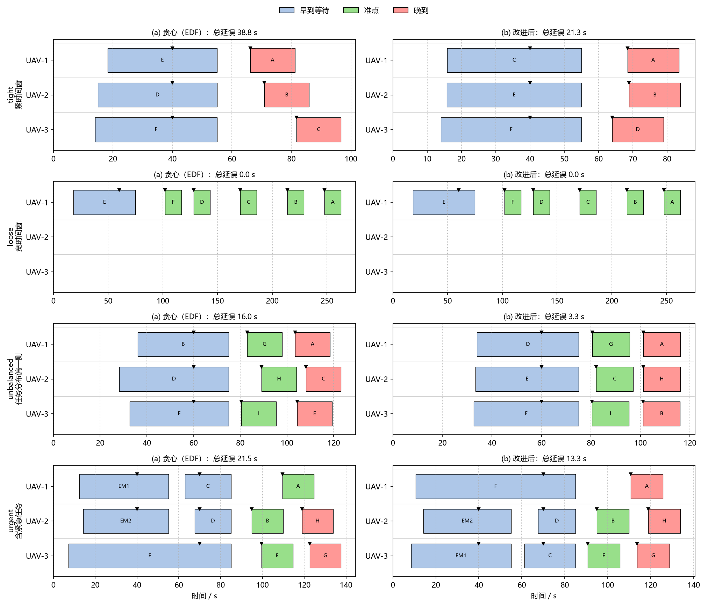
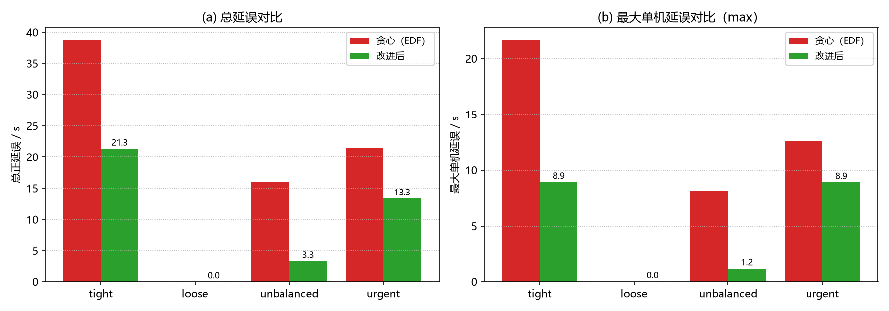

# uav_time_window

多机任务 **4D 时间窗分配与延误均衡**：N 架无人机为 M 个带时间窗
`[earliest, latest]` 与服务时长的任务点服务，先按最早截止优先（EDF）
生成贪心初始解，再做**两任务互换 / 机间迁移**的局部搜索改进；目标函数为

```
Σ正延误 + λ × (最大单机延误 − 最小单机延误)
```

在总延误最小化的同时追求机间 **max-min 公平**。窗口不可达的任务
（距离过远 / 窗口过窄）标记并报告原因，不硬塞。任务序列进一步展开为
4D 航迹，用课程既有的 `uav_mujoco_sim`（MuJoCo 刚体模型 + 几何控制器）
**闭环真飞**，统计每个任务点的实际到达时刻与窗口偏差。

> 仿真器为 MuJoCo 3.x（`uav_mujoco_sim` 底座），纯 CPU 运行，不需要
> Gazebo / Unreal / 独立显卡。2 架同时仿真约 7 倍实时，全部 4 个场景
> 闭环总墙钟约 42 s。

---

## 1. 题目与解决的实际问题

外卖/投送类任务都有"**什么时间之前送到**"的约束：每个任务点带时间窗，
早到要悬停等待（耗能），晚到算延误。多架机分一批任务时还有第二个矛盾：
把活都派给一架机总延误最小，但机间苦乐不均。仓库里已有的模块解决的是
别的层面的问题：

| 已有模块 | 解决的问题 | 与本模块的区别 |
| --- | --- | --- |
| [`uav_mujoco_sim`](https://github.com/OpenHUTB/ros2/tree/master/src/air/uav_mujoco_sim) | 单机物理仿真底座 | 本模块在其上做多机任务分配层 |
| [`uav_deconflict`](https://github.com/OpenHUTB/ros2/tree/master/src/air/uav_deconflict) | 航迹间**时空冲突**检测与解脱 | 假设航迹已给定；本模块决定"谁在何时服务哪个点" |
| [`uav_formation_flight`](https://github.com/OpenHUTB/ros2/tree/master/src/air/uav_formation_flight) | 编队**保持**（队形误差） | 不涉及任务分配与时间窗 |
| 航点巡航类模块 | 单机沿航路飞行 | 单机视角，无多机任务竞争 |

本模块补的是**任务-时间窗分配**这一层：给定机队与带窗任务集，产出
一份"谁、按什么顺序、何时到达每个点"的执行计划，目标是总延误小且
机间均衡，并用真物理仿真证明计划真的可飞。

## 2. 方法

### 2.1 时间窗检验（core/window.py）

到达时刻 = 起飞时刻 + 航段飞行时间（欧氏距离 / 巡航速度）+ 前序任务
服务时长，逐段前推、全解析：

- 早到（`arrival < earliest`）：悬停等待到 `earliest` 再开始服务，
  等待按 `hover_weight`（0.2 s/s）折算进单机成本；
- 准点：服务开始落在窗内；
- 晚到：正延误 = 服务开始 − `latest`。

### 2.2 分配算法（core/assign.py）

1. **EDF 贪心初始解**：任务按紧急度（priority 降序）+ 截止时刻
   （latest 升序）排序，逐个枚举"分配给哪架机、插在序列哪个位置"，
   取目标函数增量最小且航程不超续航的方案；
2. **局部交换改进**：反复尝试两任务互换（同机换位 / 跨机对调）与
   机间迁移（摘下插入），**接受条件 = 目标函数严格下降**，直到无改进
   动作或达到轮数上限——结果不会比初始解差，且每一步可复现。

### 2.3 可行性预检（core/mission.py）

- **距离过远**：任务点直线航程 > 无人机续航折算航程；
- **窗口过窄**：窗口宽度 < 服务时长。

不可达任务标记原因后**不参与分配**，诊断行随结果 JSON 落盘。

### 2.4 4D 航迹与闭环（core/track.py + core/sim.py）

任务序列 → 航路点串（起点 + 逐任务点）→ 4D 航迹：第一段沿斜线爬升
转场（水平分量恒等于巡航速度，因此到达时刻与解析时刻表严格一致），
任务点上空悬停（早到等待 + 服务），任务间平飞，终点垂直下降。抽
**2 架机**的任务序列用 MuJoCo 真飞（参考速度前馈经 τ=0.5 s 一阶低通、
姿态阻尼 kw≈−0.18，模式与 `uav_deconflict.core.sim` 相同），按
"首次水平进入任务点半径 5 m 且高度接近巡航高度"判定实际到达时刻。

## 3. 安装

```bash
# pip 依赖（已装可跳过）
pip install numpy mujoco matplotlib pytest

# ROS 2 下编译（源码目录直接运行则不需要）
colcon build --packages-select uav_time_window
```

## 4. 运行（三种模式）

```bash
# 模式一：仅算法层（秒级，不需要 mujoco）
python main.py --no-sim

# 模式二：单场景算法层（--scenario 与 --case 等价）
python main.py --scenario tight --no-sim

# 模式三：全部场景 + MuJoCo 闭环真飞（总墙钟约 42 s）
python main.py
```

结果自动落盘 `results/<场景>_result.json`（逐场景）与
`results/all_results.json`（汇总）；甘特图与对比图由
`python tools/make_figures.py` 从 JSON 生成到 `images/`。
在线调度节点：`ros2 launch uav_time_window main.launch.py`（订阅
`/uavN/odom`，周期发布 `/uav_time_window/schedule` JSON 分配表与
预计到达时刻）。

## 5. 测试

```bash
python -m pytest test/ -q          # 33 项全过，其中 4 项为 MuJoCo 闭环冒烟
```

纯算法层用例（时间窗检验 / 分配 / 航迹 / 流水线，29 项）不需要 MuJoCo；
冒烟测试用 1 架机 2 个任务点的小规模场景（墙钟 < 10 s）。

## 6. 结果

`python main.py` 真实运行（3 架机 / 6–10 任务 / 场景，λ=0.5），
数字与 `results/all_results.json` 一致：

| 场景 | 任务数 | 总延误（贪心） | 总延误（改进后） | 最大单机（贪心） | 最大单机（改进后） | 目标函数（前→后） |
| --- | --- | --- | --- | --- | --- | --- |
| tight（紧窗口） | 6 | 38.8 s | **21.3 s** | 21.7 s | **8.9 s** | 46.5 → 23.8 |
| loose（宽窗口） | 6 | 0.0 s | 0.0 s | 0.0 s | 0.0 s | 0.0 → 0.0 |
| unbalanced（偏一侧） | 9 | 16.0 s | **3.3 s** | 8.2 s | **1.2 s** | 18.3 → 3.4 |
| urgent（含紧急任务） | 10 | 21.5 s | **13.3 s** | 12.6 s | **8.9 s** | 27.8 → 17.4 |

- 机间延误极差（max−min）：tight 15.5 → 5.0 s，unbalanced 4.7 → 0.1 s，
  urgent 12.6 → 8.2 s——均衡项切实把活摊平了；
- urgent 场景 2 个 priority=10 的紧急任务在贪心与改进后均**零延误**，
  局部搜索没有为均衡牺牲紧急窗口；
- 改进动作：tight 互换 2 次、unbalanced 互换 3 次、urgent 互换 1 次 +
  机间迁移 1 次。

**MuJoCo 闭环真飞**（每场景抽 2 架任务最多的机）：

| 场景 | 真飞机 | 任务点 | 实际−计划到达偏差（均值/最大） | 未检出 | 全程最大跟踪误差 |
| --- | --- | --- | --- | --- | --- |
| tight | UAV-1, UAV-2 | 4 | 0.94 / 0.96 s | 0 | 3.63 / 4.07 m |
| loose | UAV-1 | 6 | 0.99 / 1.00 s | 0 | 3.62 m |
| unbalanced | UAV-1, UAV-2 | 6 | 0.96 / 1.00 s | 0 | 3.54 / 4.01 m |
| urgent | UAV-2, UAV-3 | 8 | 0.89 / 0.94 s | 0 | 4.08 / 4.79 m |

闭环 4 场景总墙钟约 42 s（约 7 倍实时），实际到达普遍比计划早约 1 s
（到达判定半径 5 m 内提前进入），全部任务点均在窗口附近，无失联任务点。




## 7. 与已有模块的区分

见第 1 节表格：`uav_mujoco_sim` 是物理底座，`uav_deconflict` 解决
"给定航迹不相撞"，本模块解决"**任务怎么分、每点何时到**"——输入是
带时间窗的任务集，输出是机-任务-时刻三元组，并闭环验证到达时刻与
窗口的偏差。两层正交，可叠加使用（先分配 → 再对产生的航迹做冲突解脱）。
