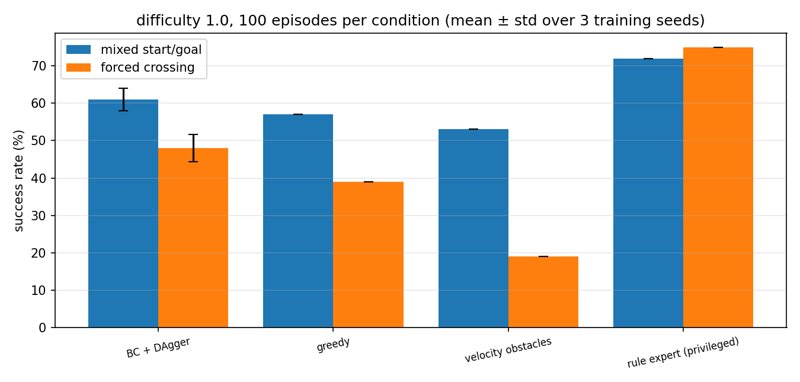

# uav_traffic_nav — 城市动态交通下的无人机避障

在 [uav_ppo_nav](../uav_ppo_nav/README.md) 的「随机静态障碍」之外，补上**会动的车**：
无人机要从起点穿过两条车道的车流飞到目标点。观测在激光直方图之外，
还给出**最近 3 辆车的相对位置与相对速度**，让策略能预判车辆 1 秒后的位置，
而不只是对当前距离做反应。

```
观测(34) = 16 扇区激光直方图 + 目标相对位置(3) + 世界系速度(3) + 最近 3 车 ×(相对位置 2 + 相对速度 2)
动作(4)  = [vx, vy, vz, yaw_rate]，世界系 ENU 速度 + 偏航角速度（归一化 [-1,1]）
```

## 与 uav_ppo_nav 的区别

| | uav_ppo_nav | uav_traffic_nav |
| --- | --- | --- |
| 障碍 | 16 个随机静态圆柱 | 2 条车道上**行驶的车辆**（3–6 m/s） |
| 观测 | 22 维 | 34 维（多 12 维车辆相对状态），可关掉做消融 |
| 对照 | 无 | `greedy`、速度障碍法、规则专家（上界） |
| 奖励 | 进度 + 平滑 + 碰撞 | 以上再加 **TTC（碰撞时间）惩罚** |
| 训练 | PPO 从零 | 规则专家示范 + 行为克隆 + **DAgger**（可选 PPO 微调） |

## 目录

```
uav_traffic_nav/
├── scripts/
│   ├── policy.py            观测/动作/车辆特征/TTC/纯 numpy 推理（训练与部署共用）
│   ├── traffic_env.py       gymnasium 环境：质点 + 速度环滞后 + 车道车流
│   ├── baselines.py         greedy / 速度障碍法 / 规则专家（示范来源）
│   ├── bc_train.py          专家示范采集 + 行为克隆 + DAgger
│   ├── train.py             PPO 训练（支持 --init-from 用 BC 权重初始化）
│   ├── eval.py              单模型评估：成功率/碰撞/间距/TTC/路径
│   ├── eval_multiseed.py    多种子评估（均值±标准差）
│   ├── final_report.py      全方法统一协议对比
│   ├── traffic_nav_node.py  部署节点（rospy）
│   ├── traffic_feed_node.py CARLA live.json -> /traffic/vehicles
│   ├── feed_utils.py        车辆流转换纯函数（可单测）
│   └── main.py              统一入口：--train / --eval / 部署
├── config/traffic_nav.yaml
├── launch/main.launch
├── models/                  部署权重（bc_policy_*.npz / ppo_scratch.npz / pol_bc_ppo.npz）
├── requirements.txt         离线训练与评测的 Python 依赖
├── PROGRESS.md              迭代记录（含失败的实验）
└── tests/test_traffic_nav_local.py   28 项纯 Python 测试
```

## 环境依赖

```bash
python3 -m pip install -r requirements.txt
```

`requirements.txt` 包含 numpy、gymnasium、stable-baselines3、torch、matplotlib、pytest。
只做部署推理时仅需 numpy；`gymnasium` 是 `traffic_env.py` 的顶层依赖，训练、评测和单元测试都会用到。
部署侧还需要 ROS Noetic 与 `rospy`、`geometry_msgs`、`nav_msgs`、`sensor_msgs`、`std_msgs`。

## 方法：为什么用示范引导

直接从零 PPO 训练学不到"在车道前等一个安全窗口再穿过去"这种时机决策：
在强制跨路分布下 3 个种子全部退化（0%），混合分布下也只有 44%。

改为三段式：

1. **规则专家**：在车道前 3 m 悬停，检查是否有车会在 1.2 s 内经过穿越走廊；
   安全则全速穿过（`baselines.expert_action`），强制跨路成功率 75%；
2. **行为克隆 + DAgger**（`bc_train.py`）：先按 6:4 采集约 9k 条专家示范，
   再让学生自己飞、在每个到达状态上贴专家标签，迭代 3 轮；
3. **可选 PPO 微调**（`train.py --init-from`）：提升同分布表现，
   但会损害跨路泛化，因此默认导出 DAgger 策略。

## 实验结果（难度 1.0，100 回合/条件，评测 seed 11）

| 策略 | 混合起终点 | 强制跨路 |
| --- | --- | --- |
| 规则专家（读真值，上界参照） | 72% | 75% |
| **行为克隆 + DAgger（3 个训练种子）** | **61.0% ± 3.0%** | **48.0% ± 3.6%** |
| greedy（无视车辆） | 57% | 39% |
| 速度障碍法 | 53% | 19% |

"强制跨路"= 起点固定在路一侧、终点在另一侧，必须横穿两条车道。



结论：DAgger 策略在强制跨路分布上 **48.0% ± 3.6%**，比贪心高 9 个百分点、
比速度障碍法高 29 个百分点；规则专家 75% 说明任务本身仍有空间。
（PPO 从零 44%、PPO 微调 41%、纯 BC 13%，方法对比见 `docs/air/uav_traffic_nav.md`。）

## 快速开始

```bash
# 0) 装依赖
python3 -m pip install -r requirements.txt

# 1) 专家示范 + 行为克隆 + DAgger（Windows 可并行跑 3 个种子）
powershell -File scripts/run_dagger_seeds.ps1
# 或单次：
python3 scripts/bc_train.py --episodes 200 --dagger-rounds 3 --out models/bc_policy_s42.npz

# 2) 可选：PPO 微调（默认不用，跨路泛化会掉）
python3 scripts/train.py --total 300000 --difficulty 1.0 \
        --init-from models/bc_policy_s42.npz --lr 1e-4 --ent 0.003 --name pol_bc_ppo

# 3) 评测
python3 scripts/eval_multiseed.py     # 3 个种子 -> 均值±标准差
python3 scripts/final_report.py       # 所有方法统一协议对比

# 4) 部署（需先起桥接，body_frame:=false）
roslaunch uav_traffic_nav main.launch live_json:=/path/to/live.json \
         calibration_json:=/path/to/calibration.json goal_x:=8.0 goal_y:=0.0
```

## 部署链路

```
CARLA Traffic Manager ──record──> live.json
                                     │  traffic_feed_node（坐标 offset 对齐、过期过滤）
                                     ▼
                            /traffic/vehicles (JSON)
                                     │
/uav/odom + /lidar/points ───────────┼──> traffic_nav_node（纯 numpy 推理）
                                     ▼
                              /uav/cmd_vel（世界系 ENU 速度）
```

`traffic_nav_node` 还带一层**几何安全兜底**：任何车辆进入 `safety_stop_m`
（默认 1.6 m）立即发布零速度，不依赖策略输出。

## 已知限制

- 训练环境是**质点 + 一阶速度滞后**，不是完整六自由度动力学；加减速限制、风扰未建模。
- 车辆按**圆形**近似（半径 1.0 m，碰撞圆合计 1.3 m），不是矩形车身。
- 高度固定（`init_z`），本模块只做**水平面**动态避障；三维绕行是另一个课题。
- 部署侧需要 `/lidar/points` 提供**世界系**点云；若桥接发布机体系点云，
  需要先做一次坐标变换（与 `uav_ppo_nav` 相同的要求）。
- **尚未做在线闭环飞行验证**：本仓库提供训练、离线评估与单元测试；
  CarlaAir 的 `ready=false`（速度接口不可用）与评测机无 ROS 环境，
  在线验证需要另做位姿执行器或换到速度可用的 HUTB 环境。
