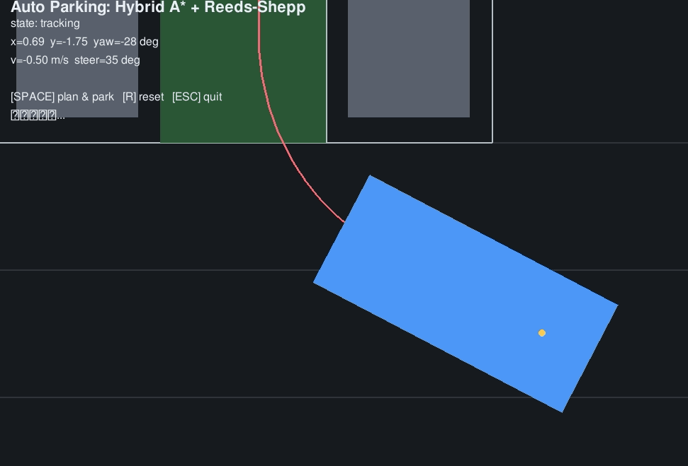

# auto_park_hybrid_a_star

基于 **Hybrid A\* + Reeds-Shepp 曲线**的地面载具垂直自动泊车（APA）仿真。

在 Pygame 内置的二维停车场场景中：给定一辆车和两侧已停好的障碍车，
小车从道路出发，按一下空格就自动规划出一条"倒车甩尾 + 前进入库"的揉库路径，
并通过 Pure Pursuit 控制器跟踪入位。

## 场景

```
  ↑ y
  │  ┌──────┐ ┌──────┐ ┌──────┐
  │  │ 障碍车│ │ 目标位│ │ 障碍车│  车位区 (y>0)
  │  └──────┘ └──────┘ └──────┘
──┼──────────────────────────────→ x
  │        🚗(起点)                道路 (y<0)
```

- 起点：`(2.5, -2.2, yaw=0)`，车头朝右；
- 目标：`(-1.6, 2.6, yaw=90°)`，车位中央，车头朝上；
- 两侧障碍车为 OBB 碰撞检测对象。

## 演示效果



> 录制于 VMware Ubuntu 20.04 虚拟机（Pygame 仿真窗口）：小车从道路起点出发，
> 自动规划出揉库路径并跟踪倒车入库，最终完全停入垂直车位。

## 算法栈

| 模块 | 文件 | 作用 |
|---|---|---|
| Reeds-Shepp 曲线 | `reeds_shepp.py` | 前进/后退切换的最短曲线族，作启发式 |
| Hybrid A* | `hybrid_a_star.py` | 状态空间 (x,y,θ)，6 个运动学原语搜索 |
| 碰撞检测 | `collision_check.py` | 车辆 OBB vs 障碍 AABB |
| Pure Pursuit | `tracker.py` | 几何跟踪，自动处理前进/倒车换挡 |
| 可视化 | `auto_park_sim.py` | Pygame 二维仿真（无 ROS 也能跑） |

## 运行环境

- Windows 11 / Ubuntu 20.04
- Python 3.8+
- 依赖：`pygame`（纯演示）；ROS Noetic + geometry_msgs（roslaunch 版）

## 快速开始

### 1. 纯 Pygame 演示（Windows 双击即可）

```bash
pip install pygame
cd scripts
python auto_park_sim.py
```

按 **空格** 开始规划并自动泊车，**R** 重置，**ESC** 退出。

### 2. ROS Noetic 版

```bash
# 把本目录拷到 catkin_ws/src/auto_park_hybrid_a_star
cd ~/catkin_ws
catkin_make
source devel/setup.bash
roslaunch auto_park_hybrid_a_star main.launch
```

节点会发布 `/cmd_vel`（geometry_msgs/Twist），可在另一个终端 `rostopic echo /cmd_vel` 查看。

## 验证

```bash
cd scripts
python headless_test.py
```

无界面跑完规划+跟踪全流程，输出最终位姿与误差。
