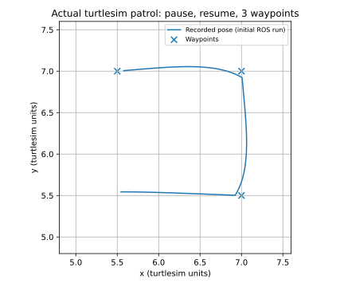

# ROS Noetic 小海龟多航点巡航与暂停恢复

本实验订阅 turtlesim 的真实位姿，以闭环速度控制依次到达航点，演示任务状态与服务通信。
当前修订已完成下述真实 Noetic 回归验证；测试范围和原始证据见验证记录。

## 环境

已检查的环境：Ubuntu 20.04.6、Python 3.8.10、ROS Noetic、catkin 0.8.12、turtlesim 0.10.3。
源码只使用 ROS 1 的 rospy、catkin 和 roslaunch。

## 构建和运行

在单独的 catkin 工作空间 src 下放置本功能包，不要将整个混合 ROS 1/ROS 2 仓库直接交给 catkin。

```bash
source /opt/ros/noetic/setup.bash
cd ~/course_patrol_ws
catkin_make
source devel/setup.bash
roslaunch turtle_waypoint_patrol main.launch
```

另开终端并加载相同环境后，可执行：

```bash
rosservice call /waypoint_patrol/pause
rosservice call /waypoint_patrol/resume
rosservice call /waypoint_patrol/cancel
rostopic echo /waypoint_patrol/status
```

取消、完成、超时均为终态；恢复服务只接受 PAUSED。重新启动节点才能开启新任务。
Ctrl+C 停止 launch。不要同时运行其他 cmd_vel 控制器。

## 控制原理

以目标与实际位姿的欧氏距离作为距离误差，将目标方向和实际朝向之差归一化至 [-pi, pi]。
角速度按方向误差比例控制并限幅至 2 rad/s。方向误差大于 0.6 rad 时原地转向；否则
线速度随距离减小，并限制至 1.5 turtlesim 单位/s。距离不超过 0.08 时切换下一航点。

控制循环使用单调墙钟检测位姿接收超时（0.5 s）、初始等待超时（3 s）和任务超时（120 s，包含暂停）。
暂停保留目标索引。服务与控制循环通过可重入锁串行访问状态。
正常退出时尽力发布零速度，但无法保证强杀或通信断开时消息送达。

## 退出诊断与验证状态

启动日志输出实际源码路径、PID 与 SHA256。Ctrl+C 和 SIGTERM 仅设置退出标志；主循环统一发送零速度、注销订阅、关闭 CSV 并调用 ROS 清理。不要用 kill -9 测试正常退出。
如进程未结束，`kill -USR1 <本节点PID>` 可在其 stderr 输出线程栈，不会结束节点。

2026-11-04 已在 Ubuntu 20.04.6 / Python 3.8.10 / ROS Noetic / turtlesim 上运行真实集成检查。
初次完整日志为 5/7；11 月 4 日显式释放资源版本的终端结果为 **6/7**，取消后的进程退出仍超时。
普通停车与进程完全退出是不同检查，不能将 6/7 记作全部通过。

11 月 4 日版本在关闭时显式注销订阅、服务及发布器，并输出单调时钟阶段时间。
测试超过 8 秒后会收集线程栈，再观察最多 22 秒；即使随后自然退出，仍判为失败。
11 月 4 日取消日志显示应用清理约 0.108 秒，ROS 关闭阶段约 23.709 秒，根因未定。
8 秒为本项目自设回归门槛，未确认是课程要求。

### 2026-11-12 审核修订与真实 ROS 复测

本次把全局 `rospy.signal_shutdown` 放到 daemon 线程，并在应用完成停车、CSV 关闭与句柄释放后最多等待 1 秒。
正常完成返回 0；如果全局清理超时或抛出异常，输出诊断、刷新 stdout/stderr 后用 `os._exit(2)` 结束，避免解释器 atexit 再次卡住。
**退出码 2 表示失败，不表示优雅清理成功；真实集成测试仍要求退出码 0，并保留原 8 秒门槛。**
这只给全局清理增加失败退出保障，不能说明 ROS 内部延迟根因已修复，也不保证强杀或链路断开时零速度送达。

从生产循环抽出 `control_step(now)`，控制规则与原阈值保持一致，新增确定性的边界测试。
离线测试共 22 项：13 项导航/超时测试和 9 项生命周期测试。
覆盖 0.08 到达边界、下一航点、角速度比例与限幅、方向跨 ±pi、转向时停车、线速度限幅、
0.5 秒位姿超时、3 秒初始等待、120 秒任务超时（包括暂停），以及 ROS 清理阻塞/异常时返回非零码。
后续已在官方 Noetic desktop 镜像的 Ubuntu 20.04.6 / Python 3.8.10 中执行：**22/22 离线测试通过，三轮真实 turtlesim 集成各 7/7 通过**。
18 次正常退出测量为 0.766–0.867 秒，退出码均为 0，未触发失败强退。catkin 编译、安装和安装后的正式 `main.launch` 暂停/恢复/取消及停止验证均通过。
测试采用 Qt offscreen；受宿主机网络接口枚举限制，仅为 ROS 缓存本机 loopback 地址，未替换 ROS 通信或仿真。原 Windows 虚拟机未复测，旧版内部延迟根因仍未确定。

在没有 Noetic 的环境也可执行离线检查（从仓库根目录）：

```bash
bash src/chap1/turtle_waypoint_patrol/run_checks.sh --offline
```

需要真实 Noetic + turtlesim 才能执行不带 `--offline` 的集成检查。
上述结果已具备重新请求审核的验证依据；是否合入由维护者决定。

[当前修订的原始日志、环境边界和复现步骤](https://github.com/tanyongkang0618-spec/ros2/blob/feat/turtle-waypoint-patrol/src/chap1/turtle_waypoint_patrol/validation/NOETIC_RUN.md)

### 真实轨迹（初次版本）



该图由初次完整日志的 707 行真实位姿 CSV 绘制，含暂停、恢复及三个航点完成。
最后记录的目标误差为 0.07852，小于 0.08 阈值。图中坐标为 turtlesim 单位，非实际飞行数据。
此图保留为历史记录。当前修订的三轮真实位姿 CSV 已归档于上述 Noetic 验证记录，各轮完成与误差检查均通过。

[验证细节与证据](https://github.com/tanyongkang0618-spec/ros2/blob/feat/turtle-waypoint-patrol/src/chap1/turtle_waypoint_patrol/validation/REAL_RUN.md) 可在仓库源码中查看。

真实集成检查：先退出其他控制器，按包内 `run_checks.sh` 自动启动独立 Master 与 turtlesim：

```bash
bash run_checks.sh
```

脚本输出结果压缩包路径。其七个用例验证暂停恢复/完成、取消、非法航点、初始无位姿、SIGTERM 停车、运动中位姿中断、SIGINT 停车。测试失败仍保存日志，超时采集 Python 栈后仅强制清理该测试创建的控制进程，并标记失败。

正式 launch 可配置绝对 `trace_path`，路径必须尚不存在：

```bash
roslaunch turtle_waypoint_patrol main.launch trace_path:=/tmp/my_patrol_trace.csv
```

绘图需 matplotlib，输入真实记录 CSV，不生成模拟数据：

```bash
python3 plot_trace.py /tmp/my_patrol_trace.csv /tmp/my_patrol_trace.png
```

状态完成数为已到达点数；CSV 中 target_error 为当时当前目标距离，不应将多航点切换时的误差峰值当作跟踪失败。位姿回调记录与控制周期不同，最终误差应结合完成状态附近样本及 0.08 阈值解释。

MkDocs 页面构建已验证。仍欢迎审核者在另一台机器复测；当前证据不涉及真实机器人或无人机飞行。

## 大模型使用声明

使用 OpenAI Codex 辅助开发与文档整理。仅报告实际执行的验证；提交者需复核内容并对其负责。

