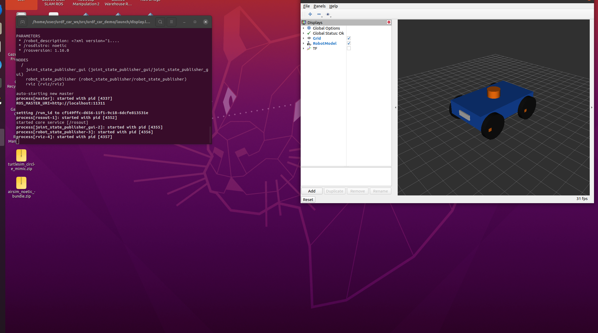

# ROS Noetic：四轮小车 URDF 建模作业

本作业对应教材第 6.2–6.3 节（URDF/xacro）。目标为建立四轮小车，在 RViz 显示模型、检查 TF 树，并通过关节滑块观察车轮旋转。

## 1. 文件与环境

Ubuntu 20.04 + ROS Noetic，使用系统 ROS 环境。不要激活 AirSim Python 虚拟环境。

```text
urdf_car_demo/
  package.xml
  CMakeLists.txt
  urdf/car.urdf.xacro
  launch/display.launch
  rviz/car.rviz
```

本包是模型显示实验：雷达只是外形，没有激光数据；车轮滑块只改变关节角度，小车不会沿地面行驶。Gazebo 动力学、底盘驱动及导航不在本次范围。

## 2. 安装与编译（Ubuntu 终端）

```bash
source /opt/ros/noetic/setup.bash
sudo apt update
sudo apt install ros-noetic-xacro ros-noetic-robot-state-publisher ros-noetic-joint-state-publisher-gui ros-noetic-rviz liburdfdom-tools
mkdir -p ~/urdf_car_ws/src
```

将解压后的 **urdf_car_demo** 整个文件夹复制到 `~/urdf_car_ws/src/`，使 package.xml 位于 `~/urdf_car_ws/src/urdf_car_demo/package.xml`。

```bash
cd ~/urdf_car_ws
catkin_make
source devel/setup.bash
roslaunch urdf_car_demo display.launch
```

launch 会启动 ROS master（如果还没有）、关节滑块、TF 发布节点和 RViz，无需另开 roscore。

## 3. 观察效果

应看到蓝色车体、四个黑色车轮、橙色雷达和白色车头标记。车轮带橙色标记，拖动滑块后能看出转动。勾选 RViz 左侧 TF 可查看坐标系。

RViz 的 Fixed Frame 应为 `base_footprint`。若不显示模型，确认 RobotModel 已勾选且 robot_description 参数存在。

## 4. 实验检查

另开终端：

```bash
source /opt/ros/noetic/setup.bash
source ~/urdf_car_ws/devel/setup.bash
rosrun xacro xacro "$(rospack find urdf_car_demo)/urdf/car.urdf.xacro" > /tmp/car.urdf
check_urdf /tmp/car.urdf
rostopic echo -n 1 /joint_states
rosrun tf tf_echo base_link front_left_wheel_link
```

### check_urdf 用户实测记录

用户在 Ubuntu ROS Noetic 虚拟机中执行了以下命令，并提供了完整终端输出：

```bash
source /opt/ros/noetic/setup.bash
source ~/urdf_car_ws/devel/setup.bash
rosrun xacro xacro "$(rospack find urdf_car_demo)/urdf/car.urdf.xacro" > /tmp/car.urdf
check_urdf /tmp/car.urdf
```

```text
robot name is: student_car
---------- Successfully Parsed XML ---------------
root Link: base_footprint has 1 child(ren)
    child(1):  base_link
        child(1):  front_left_wheel_link
        child(2):  front_marker_link
        child(3):  front_right_wheel_link
        child(4):  lidar_link
        child(5):  rear_left_wheel_link
        child(6):  rear_right_wheel_link
```

结果：展开后的 URDF 已由 `check_urdf` 成功解析；根链接是 `base_footprint`，其子链接为 `base_link`，四个车轮、前标记与雷达链接均出现在解析树中，共 8 个链接。该记录来自用户实际运行，不是结构检查生成的示例输出；它验证 URDF 解析与树结构，不代表关节滑块交互或动力学仿真已验收。原始输出另存于包内 `validation/check_urdf_output.txt`。

## 5. 模型原理与修改

- 单位为米、弧度，坐标 x 向前、y 向左、z 向上。
- `link` 表示刚体，`joint` 表示刚体连接。
- 根为 base_footprint，base_link 中心位于地面上方 0.15m。
- 车体长 0.60m、宽 0.36m、高 0.12m；车轮半径 0.10m、宽 0.04m。
- 轮心相对车体中心 z=-0.05m，所以轮底高度为零。
- 圆柱默认沿 z 轴，绕 x 旋转 π/2 后成为横向轮轴；关节轴为 y。
- 四个轮子用 xacro 宏重复生成，轮关节为 continuous；雷达和车头用 fixed 连接。
- 修改 car.urdf.xacro 的颜色或尺寸后，关闭 launch 并重新运行。
- 修改轮半径时也要重新计算轮心位置与车体离地高度，避免轮子悬空或穿地。

可作为个人扩展：改变车体配色、增加摄像头 link，或增加可转动雷达关节，并解释 TF 树变化。不要将单纯改变颜色描述成新的导航算法。

## 6. 报告与截图（实际运行后填写）

1. 实验目的、操作系统和 ROS 版本。
2. 包结构及 URDF/xacro 关键代码说明。
3. 整车 RViz 截图。
4. 关节滑块与车轮旋转前后对比截图。
5. TF 坐标系或 check_urdf 输出截图。
6. 自己修改的一个模型结构及前后对比。
7. 遇到的问题与解决办法。

本材料由 OpenAI Codex 辅助编写。用户已在 Ubuntu ROS Noetic 环境启动模型显示，实测截图见下方；check_urdf 实测输出已记录于第 4 节；车轮滑块交互和 TF 显示仍需分别记录。

## 7. 实测运行截图



用户提供的运行截图显示，joint_state_publisher_gui、robot_state_publisher 与 RViz 已启动，RViz 的 Global Status 为 Ok，蓝色车体、黑色车轮、橙色雷达外形和白色车头标记正常显示。

本截图证明模型显示已运行；未展示滑块操作或勾选 TF 的效果，不作为车轮交互和 TF 专项验证的完成记录。
