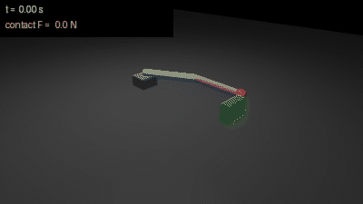
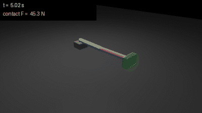
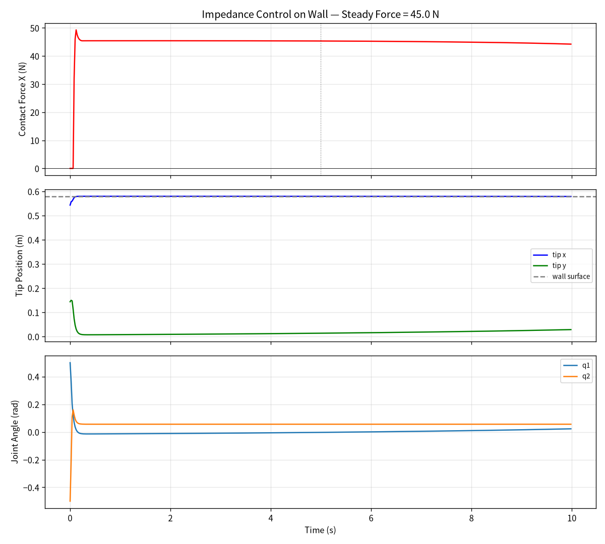

# mujoco_2link_impedance_control

MuJoCo 二连杆机械臂笛卡尔阻抗力控仿真（标称环境 Ubuntu 20.04 + ROS Noetic + Python 3.8）。

## 项目简介

二连杆平面机械臂从弯曲姿态伸直，末端顶到墙面后维持稳定接触力。
采用笛卡尔空间阻抗控制：`F = Kp*(x_des - x) + Bd*(xdot_des - xdot)`，
通过雅可比转置 `tau = J^T * F` 映射到关节力矩。

区别于常规位置控制，本项目展示**柔顺力控**：末端不会硬撞墙，
而是像弹簧一样贴合墙面，接触力由 Kp 和目标位置决定。

## 效果演示

10 s 无头仿真回放（`scripts/main.py --render` 离屏渲染，400×225，16 fps / 160 帧，左上角实时显示仿真时间与接触力）：



接触稳态时的一帧（左上角标注当帧接触力）：



同一次运行的三联曲线（接触力 / 末端位置 / 关节角）：



## 实测指标（无头 10 s，稳态窗口 t ∈ [5, 10] s 均值）

| 指标 | 数值 |
|---|---|
| 初始 tip 位置（t=0） | (0.5433, 0.1438) m |
| 稳态 tip 位置 | (0.5794, 0.0202) m |
| 稳态接触力 | **44.96 N** |
| 峰值接触力 | 49.29 N |
| 接触点数 | 2（末步 ncon=2，窗口内最大 2，496/500 采样帧有接触） |
| 稳态关节角 | q1 = 0.0079 rad, q2 = 0.0557 rad（末值 q1 = 0.0227） |

上表与上面的动图、曲线图来自同一次运行（`python3 scripts/main.py`，10 s / 5000 步 / 每 20 ms 采样 1 点）。该次运行在 Ubuntu 22.04 + Python 3.12.11 + **MuJoCo 3.1.6** + numpy 1.26.4 上完成，同机重复运行逐位相同。

`metrics.json` 与曲线图都是程序能重新生成的产物，按仓库规范不入库：每次运行 `scripts/main.py` 都会在输出目录写出 `metrics.json`，字段与上表逐项对应，可直接核对。

数字对不上时先看版本：`requirements.txt` 锁 `mujoco==3.1.6`。MuJoCo 从 3.3 起改过接触求解，4.0.0 上同一模型会得到 46.96 N / 6 个接触点 / q1 -0.0025（本机实测），属版本差异，不是参数被改过。

## 运行环境

- 标称目标环境：Ubuntu 20.04 + ROS Noetic + Python 3.8
- 本次实测环境：Ubuntu 22.04 + Python 3.12.11 + MuJoCo 3.1.6（numpy 1.26.4）
- 依赖与版本见 `requirements.txt`（mujoco 锁 3.1.6 以保证上面表格可复现），ROS 侧 rospy 由 Noetic 提供
- 节点 + viewer 已在 Ubuntu 20.04 + ROS Noetic + Python 3.8 的虚拟机上 `catkin_make` → `roslaunch` 跑通（见文档 8.3 与 PR 截图）；上表的无头数值仍来自上面的 22.04 环境，**没有在 20.04 + Noetic 上复跑**

## 快速开始

```bash
# 1. 安装 Python 依赖（在包目录执行；pillow 仅在重新渲染动图时需要，已含在 requirements.txt）
pip3 install --user -r requirements.txt
pip3 install --user rospkg

# 2. 编译工作空间（包目录名必须是 mujoco_2link_impedance_control）
mkdir -p ~/catkin_ws/src
cp -r <本仓库>/src/chap8/mujoco_2link_impedance_control ~/catkin_ws/src/
cd ~/catkin_ws && catkin_make && source devel/setup.bash

# 3. 离线单测（不弹窗，0.3 s 跑完）
cd ~/catkin_ws/src/mujoco_2link_impedance_control
python3 -m pytest test -q

# 4. 运行
# 方式一：带 3D viewer 的 ROS 节点（需要图形界面）
roslaunch mujoco_2link_impedance_control impedance_arm.launch

# 方式二：无头跑 10 s，打印指标并出三联曲线图（不需要 GPU）
python3 scripts/main.py
# 产物默认写仓库 docs/img/chap8/（impedance_curves.png + metrics.json）；
# 装到 devel/install 布局后自动退到 ~/.cache/mujoco_2link_impedance_control/output，也可用 --out 指定

# 可选：重新生成演示动图（Linux 无图形界面时加 MUJOCO_GL=egl）
MUJOCO_GL=egl python3 scripts/main.py --render --out /tmp/impedance_img
```

## 代码结构

```
├── models/two_link_soft_arm.xml          # 二连杆 + 墙面模型
├── scripts/main.py                       # 统一入口：默认无头，--gui 起节点，--render 出图
├── scripts/impedance_controller.py       # 阻抗控制器（FK + Jacobian + tau）
├── scripts/output_paths.py               # 路径解析：产物目录 + 模型文件（源码树 / devel / install 均适用）
├── scripts/mujoco_arm_impedance_node.py  # ROS 节点（带 viewer）
├── scripts/headless_test.py              # 无头测试 + 出曲线图与 metrics.json
├── scripts/render_demo.py                # 离屏渲染演示动图与稳态截图（默认 25 fps）
├── test/test_impedance_controller.py     # 离线单测：FK / 雅可比 / 力矩映射 / 产物目录
├── test/conftest.py                      # pytest 配置：把 scripts/ 加入 sys.path
├── requirements.txt                      # Python 依赖（mujoco 锁 3.1.6）
├── launch/impedance_arm.launch
├── package.xml
├── CMakeLists.txt
└── LICENSE
```

## 测试

```bash
python3 -m pytest test -q        # 18 项：正解 / 雅可比与差分对账 / tau=J^T F / 零力零矩 / 产物目录 / 模型路径解析
```

模型一致性用例需要 `pip3 install mujoco`，未安装时该类用例自动跳过，数学用例照常跑。

## 调参说明

| 参数 | 默认值 | 作用 |
|---|---|---|
| Kp[0] | 80 N/m | x 方向位置刚度 |
| Kp[1] | 50 N/m | y 方向位置刚度 |
| Bd[0] | 8 N·s/m | x 方向阻尼 |
| x_des | (0.62, 0) | 目标位置（设在墙内产生推力） |

增大 Kp → 接触力增大；减小 Kp → 接触力减小。

## 大模型使用说明

本作业的代码与文档在编写过程中使用了 AI 大模型辅助（豆包），本人已核对并确认提交内容，对提交内容负责。
