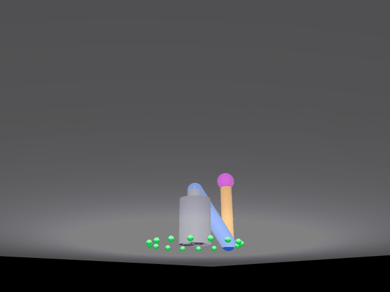

# mujoco_arm_3d：三自由度机械臂空间螺旋线仿真

基于 MuJoCo 的三自由度机械臂（肩方位 yaw + 肩俯仰 shoulder + 肘俯仰 elbow）仿真：
末端在 3D 空间中沿**圆柱螺旋线**运动（水平画圆 + 垂直匀速上升），
解析空间 IK 实时解算三个关节角，运动学驱动（IK 解直接写入 `qpos` 再 `mj_forward`）
保证末端严格落在轨迹上；`gui` 模式在 viewer 里实时播放（含三维轨迹），
`main.py` 另有离屏渲染路径，逐帧出图并**直接写出文档站配图** `docs/img/mujoco_arm_3d_demo.gif`
（包里不再另存一份 `demo_arm3d.gif`）。

## 演示效果



仓库里这张由 `main.py` 离屏渲染逐帧写出：640×480 / 216 帧 / 每帧 40 ms / 8.64 s / 约 1.64 MB，
就是 `python3 main.py` 在各机器上的真实产出。`gui` 模式只用于本地实时查看，不另存静态图。

## 算法

- **空间逆运动学（ik3）**：由末端位置 (x, y, z) 先求水平方位角 q0 = atan2(y, x)，
  再在臂平面（r-z）内用两连杆解析解求肩角 q1、肘角 q2；
  yaw 角做解缠处理保证多圈连续旋转（1.5 圈 / 540°）。
- **正运动学（fk3）**：q0、q1、q2 -> 末端世界坐标，用于与仿真器互查验证。
- **运动学驱动**：把 IK 解直接写入 `qpos`（`qvel` 清零）后 `mj_forward`。
  末端与目标的差值恒为 **0.0 mm**，但这是**构造性自检**（`qpos` 取自 IK 解、`mj_forward` 只做正解，
  与 IK 输入同源），只用于确认 216 帧全部可解、关节角没有写丢，不算独立精度证据。
  同时保留 PD 位置控制路径（`ARM3D_PD=1`）作对照：
  **这条路径是反面示例，不要照抄它的增益**：五组 KP/KD 都没能让末端跟上螺旋线，
  保留它只是为了说明「为什么不走力矩控制这条路」，正常运行请用默认的运动学驱动。
  2 ms 步长下 PD 带宽不足，实测各增益（KP/KD = 40/12、120/25、200/40、300/60、400/80）
  末端误差仍有 100~540 mm、肘关节来回震荡，因此演示默认走运动学驱动。
  默认路径**不调用 `mj_step`**，那句「每帧 21 个 2 ms 子步」只属于 PD 对照路径。
- **相机标定（DLT）**：手算 lookAt + 透视投影与 MuJoCo 实际相机的像素约定有偏差
  （黄线与末端明显错位），改用 DLT 标定：渲染多组标定姿态（z 覆盖 0.14–0.54 m，盖住整条螺旋），
  按末端品红球的像素质心反解 3×4 投影矩阵（平均重投影误差 **1.56 px**、216 帧全帧末帧偏差 **2.71 px**），
  再把末端世界坐标投影成像素叠加黄色轨迹线。

## 文件

| 文件 | 说明 |
|---|---|
| `main.py` | 入口脚本（XML 内嵌，单文件可直接运行）；`catkin_install_python` 会把它装到 `devel/lib/mujoco_arm_3d/` |
| `verify_arm3d.py` | 验证脚本：`ik`（IK 精度）与 `gui`（glfw 实时播放）；开发期工具，不装进运行时目录 |
| `package.xml` | catkin 包清单（`<name>mujoco_arm_3d</name>`，依赖 `python3-numpy` / `python3-pil`） |
| `CMakeLists.txt` | 纯 Python 包构建：`catkin_install_python(main.py)` + 安装 `launch/` |
| `launch/mujoco_arm_3d.launch` | 一键启动 `main.py`，`MUJOCO_GL` 默认 `glfw`，可传 `gl:=egl` |
| `requirements.txt` | pip 依赖（`mujoco==3.17.0` / `numpy` / `pillow`），与包目实测版本一致 |
| `../../../docs/img/mujoco_arm_3d_demo.gif` | 文档站配图（`main.py` 离屏渲染产物）：640×480 / 216 帧 / 每帧 40 ms / 8.64 s / 约 1.64 MB；`main.py` 离屏渲染版默认也写到这里（仓库外退当前目录、`--out` 可指定），仓库里只有这一份，不再另存 `demo_arm3d.gif` |
| 文档站页面 | [`docs/chapter/mujoco_arm_3d.md`](../../../docs/chapter/mujoco_arm_3d.md)（仓库文档站「机械臂」分类，含算法 / 参数 / 验证说明） |

> 相对路径按本文件所在目录 `src/chap8/mujoco_arm_3d/` 起算：`../` → `src/chap8/`，`../../` → `src/`，
> `../../../` 才回到仓库根，所以引用仓库根的 `docs/img/`、`docs/chapter/` 要写三层（与已合并的
> `src/air/fire_detection_drone/README.md` 写法一致）。

## 运行

**以下命令都在本仓库根目录（clone 下来的 `ros2/`）下执行**，不是自己的工作空间 `~/catkin_ws`。
`src/chap8/mujoco_arm_3d` 是仓库内部的相对路径，不是 catkin 工作空间的 `src/`。

```bash
pip install mujoco pillow numpy        # 0) 装依赖（只需一次）
cd src/chap8/mujoco_arm_3d             # 1) 进入本功能包目录
python3 main.py                        # 2) 渲染并写出 GIF（位置见下）
python3 verify_arm3d.py ik             # IK 数值精度验证
python3 verify_arm3d.py gui            # glfw 实时渲染：按 24 fps 播放 216 帧（约 9 秒），按 Enter 关闭
```

**ROS 封装（catkin / roslaunch）**：`package.xml`、`CMakeLists.txt`、`launch/mujoco_arm_3d.launch` 这三件就对应这条入口。把整个 `ros2` 仓库放进工作空间（例如 `~/catkin_ws/src/ros2`）后：

```bash
cd ~/catkin_ws
catkin_make
source devel/setup.bash
roslaunch mujoco_arm_3d mujoco_arm_3d.launch            # 默认 MUJOCO_GL=glfw
roslaunch mujoco_arm_3d mujoco_arm_3d.launch gl:=egl    # 有 EGL 时换后端
```

`launch` 只是把 `main.py` 拉起来（`type="main.py"`，由 `catkin_install_python` 装到 `devel/lib/mujoco_arm_3d/` 并保留可执行位）。本包**不发布/订阅任何话题**，没有 service、action，也没有自定义消息 —— 所以除 `catkin_make` 编译和 `roslaunch` 启动外，ROS 侧没有别的要配的。`roslaunch` 启动时 node 的工作目录是 `~/.ros`，GIF 会写到 `~/.ros/mujoco_arm_3d_demo.gif`；要写到别处就在包目录里直接跑 `python3 main.py --out <路径>`。`verify_arm3d.py` 属于开发期工具，不装进运行时目录，在包目录下直接执行即可。

GIF 输出位置不写死，渲染完成后打印一行 `输出位置：...`：

1. 传了 `--out` → 写到指定路径，如 `python3 main.py --out ./mujoco_arm_3d_demo.gif`；
2. 脚本位置能解析出仓库根（有 `mkdocs.yml`、`docs/img` 可写）→ 写 `docs/img/mujoco_arm_3d_demo.gif`，即文档站配图，只此一份；
3. 都不满足（被 catkin 装到 `lib/` 下、或只拷了 `mujoco_arm_3d/` 单跑）→ 写当前工作目录。

所以换到别人的 `catkin_ws` 里跑不会再报 `PermissionError: /home/docs`。

`gui` 模式窗口里会画出整条 **3D 螺旋线轨迹**（黄色胶囊段，215 段，来自 `user_scn`）——
GIF 里的黄线是 PIL 在 2D 图上叠画的像素折线，viewer 里没有，这里补的是真实三维几何体——
上面「演示效果」那张图由 `main.py` 离屏渲染写出，不是这条路径的截图。

无显示器的虚拟机**推荐用 EGL 后端**：

```bash
MUJOCO_GL=egl python3 main.py
```

`osmesa` 在部分 VMware 无显卡环境会因 PyOpenGL 拿不到 GL 上下文而崩，
报 `AttributeError: 'NoneType' object has no attribute 'glGetError'`，所以不作为默认推荐；
若 `egl` 也不可用（容器里没有 EGL 库），再用 `glfw` + Xvfb：

```bash
DISPLAY=:99 MUJOCO_GL=glfw python3 main.py
```

PD 控制对照路径（可选）：

```bash
ARM3D_PD=1 ARM3D_KP=40 ARM3D_KD=12 python3 main.py
```

## 验证结果（本机实测，MuJoCo 3.17.0）

| 项 | 结果 |
|---|---|
| IK 数值精度 | 螺旋线 8 个空间点 逆解→**引擎**正解读数互查（`data.xpos[tip]`，非手写正解），最大误差 **0.0000 mm** |
| 末端跟随误差 | 运动学驱动下 216 帧逐帧对比，首帧 / 末帧 / 最大 **0.0 mm**；**构造性自检**——`qpos` 取自 IK 解、`mj_forward` 只做正解，与上一行同源恒为 0，只用来确认 216 帧全部可解、关节角没写丢，不算独立精度证据 |
| 相机标定 | 10 个标定点（z 覆盖 0.14–0.54 m），平均重投影误差 **1.56 px**；216 帧全帧残差 x 平均 0.94 / 最大 2.57 px、y 平均 0.44 / 最大 2.44 px，末帧偏差 **2.71 px**（针对离屏渲染版） |
| 效果图（仓库里这张） | `docs/img/mujoco_arm_3d_demo.gif`：`main.py` 离屏渲染 / **216 帧 / 640×480 / 每帧 40 ms / 8.64 s / 约 1.64 MB** |
| 效果图（`gui` 实时预览） | 不存静态图；`python3 verify_arm3d.py gui` 现场播放 216 帧（约 9 s） |

参数：半径 0.20 m，螺旋高度 0.32 → 0.56 m，1.5 圈。
采样 24 fps；每帧 21 个 2 ms 物理子步**只属于 PD 对照路径**（1/24 s = 41.7 ms ≈ 21 × 2 ms），
默认的运动学驱动每帧只有一次 `mj_forward`，不调用 `mj_step`、不积分。

脚本版 GIF 的时长口径：轨迹按 **24 fps** 采样（216 帧 × 41.7 ms ≈ 名义 9.0 s），但 GIF 时间轴精度只有
10 ms，41.7 ms 会被写成 **40 ms**，所以文件实际播放 216 × 40 ms = **8.64 s**；帧数、尺寸、
轨迹内容都不受影响，程序结束时会打印这两个数。
仓库里那张就是这套 24 fps 口径的产物：216 帧 × 40 ms = 8.64 s。
