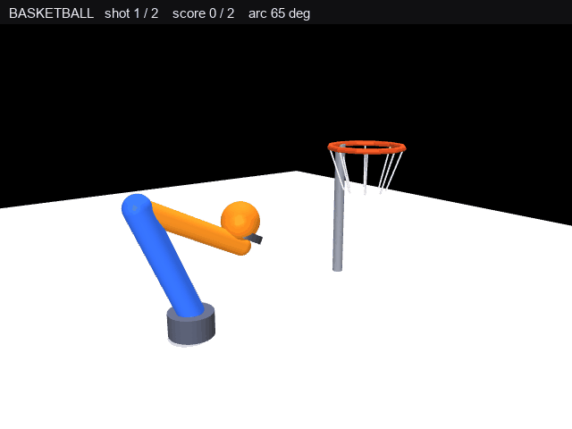

# 机械臂投篮入筐（MuJoCo 仿真）

三自由度空间机械臂（肩方位 + 肩俯仰 + 肘俯仰）末端托球，每球先举到
**预备点蓄力**，再在释放前 **12 帧快速上摆**到出手点，把球按 **65° 仰角**
抛向篮筐，球沿抛物线飞入筐中计分（共 2 球）。
3/4 视角相机渲染，画面上方实时显示「投篮序号 / 命中数 / 仰角」状态条，
叠加橙色球抛物线轨迹，输出 GIF 效果图（默认写文档站配图 `docs/img/mujoco_arm_ball_demo.gif`）。

## 文件

| 文件 | 说明 |
|---|---|
| `main.py` | 主程序（单文件，模型 XML 内嵌） |
| `test/verify_armball.py` | 验证脚本（IK 精度 / 上摆动作 / 全流程命中） |
| `package.xml` / `CMakeLists.txt` / `launch/mujoco_arm_ball.launch` | ROS 标准描述与启动（只把脚本装进 `lib/<pkg>`，模块本身不发布任何话题） |
| `requirements.txt` | Python 依赖（mujoco / numpy / Pillow） |
| `README.md` | 本项目说明 |
| 文档站页面 | [docs/chapter/mujoco_arm_ball.md](../../../docs/chapter/mujoco_arm_ball.md) |
| `../../../docs/img/mujoco_arm_ball_demo.gif` | 效果图（文档站配图，仓库里只有这一份，包里不再另存） |

## 效果图



机械臂先压到低位托球蓄力，随后快速上摆把球送出，球沿 65° 橙色抛物线飞入筐中，
顶部状态条实时显示投篮序号与命中数（0/2 → 1/2 → 2/2，单调递增）。

## 运行

**以下命令都在本仓库根目录（clone 下来的 `ros2/`）下执行**，不是自己的工作空间 `~/catkin_ws`。
`src/chap8/mujoco_arm_ball` 是仓库内部的相对路径，不是 catkin 工作空间的 `src/`。

```bash
pip install mujoco pillow numpy        # 0) 装依赖（只需一次；不需要显卡）
cd src/chap8/mujoco_arm_ball           # 1) 进入本功能包目录
python3 main.py                        # 2) 渲染并写出 GIF（位置见下）
```

GIF 输出位置不写死，开始渲染前先打印一行 `输出位置：...`（目录不可写会立刻报错退出，不用等渲染完）：

1. 传了 `--out` → 写到指定路径，如 `python3 main.py --out ./mujoco_arm_ball_demo.gif`；
2. 脚本位置能解析出仓库根（有 `mkdocs.yml`、`docs/img` 可写）→ 写 `docs/img/mujoco_arm_ball_demo.gif`，即文档站配图，只此一份；
3. 都不满足（被 catkin 装到 `lib/` 下、或只拷了 `mujoco_arm_ball/` 单跑）→ 写当前工作目录。

无显示器的虚拟机**推荐 EGL 后端**：

```bash
MUJOCO_GL=egl python3 main.py                  # 推荐
DISPLAY=:99 MUJOCO_GL=glfw python3 main.py     # egl 不可用时（Xvfb）
```

`osmesa` 不建议做无 GPU 虚拟机的默认后端：部分 VMware 环境下 PyOpenGL 取不到 GL 上下文，
报 `AttributeError: 'NoneType' object has no attribute 'glGetError'`。

## 效果图规格

| 项 | 值 |
|---|---|
| 尺寸 | 640×480（`WIDTH, HEIGHT`） |
| 采样 | 450 个时间片，每片 **30 ms**（30 fps） |
| 文件内帧数 | **368**：Pillow 写 GIF 时会把 82 个"与前一帧像素完全相同"的画面合并，延迟累加到前一帧 |
| 总播放时长 | **13.50 s**（450 × 30 ms）；名义 15.0 s，差值是 GIF 时间轴 10 ms 精度把 33.3 ms 记成 30 ms |
| 体积 | **2.64 MB**（< 3 MB 的图与 5 MB 的 GIF 两项上限都满足） |

## 验证

```bash
python3 test/verify_armball.py ik      # IK 精度：5 个目标点逆解 -> 正解互查
python3 test/verify_armball.py swing   # 上摆动作：出手前手部抬升量与释放衔接
python3 test/verify_armball.py clear   # 全流程：出手速度 / 入筐偏差 / 命中数
```

本机验证结果：

- IK 互查最大误差 **0.00 mm**（待机点 + 两球蓄力点 + 两球出手点，共 5 点全部 PASS）
- 每球释放前 12 帧手部抬升 **150.0 mm**（逐帧单调上升，12.5 mm/帧，快于球 7.5 mm/帧）
- 释放瞬间手托球心与起飞点偏差 **0.0 mm**（不会出现球"凭空起飞"的跳变）
- 两球穿筐平面水平偏差 **0.003 m / 0.002 m**（容差 0.060 m）
- 命中数 **2 / 2**
- 结果：**PASS**

## 设计要点

- 三自由度空间臂：肩方位 yaw + 肩俯仰 pitch1 + 肘俯仰 pitch2，
  杆长 L1 = L2 = 0.30 m，肩俯仰中心高度 0.06 m
- **肘关节位置（建模关键）**：`pitch2` 必须建在 `l2` body 内
  （`l1` 末端 pos="0.30 0 0" 处），而不是 `l1` body 内。写在 `l1` 内会让
  关节绕偏移点旋转**大臂本身**——画面里大臂躺平、与基座之间留一道缝像断开，
  但末端世界坐标仍精确命中目标（IK 误差 0.00 mm），纯看数值完全查不出来
- 空间 IK：方位角 `yaw = atan2(y, x)`（带跨 ±π 解缠）+ 臂平面内二连杆闭合解，
  取 **负解（q2 < 0）**；目标贴近底座时必须如此，正解会把肘压到地面以下
- **出手速度反解**：仰角固定 65°，方向由出手点指向筐心，由竖直位移关系解出

  ```
  v = sqrt(g d² / (2 cos²α (d tanα − h)))     # d 水平距离，h 高度差
  ```

  第 1 球 2.06 m/s，第 2 球 2.12 m/s。注意这两个数是**解析弹道 `ball_pos()` 的构造参数**，
  用来保证抛物线穿过筐心；球不进物理引擎，所以它们不代表任何动力学初速度，也不受重力积分影响
- **上摆动作（视觉关键）**：球用解析抛物线驱动，若出手瞬间手臂静止，
  球会在静止的手上突然获得初速度，看起来像自己飞出去。因此每球都先在
  预备点（比出手点低 150 mm）托球蓄力，再在释放前 12 帧快速上摆到出手点，
  让手"把球送出去"；上摆手速 12.5 mm/帧 > 球首帧 7.5 mm/帧
- 入筐判定：球心穿过筐平面 `z = HOOP[2]` 的那一帧，水平偏差
  `r < R_HOOP − R_BALL`（0.060 m）即计一分
- 球落地后停在真实落点（不做位置跳变），落地后不再往轨迹里追加点
- 臂运动学插值驱动：每帧 qpos 向 IK 目标角逼近（最大 0.09 rad/帧），
  用 `mj_forward` 渲染而不积分动力学（臂轻、重力角加速度大，动态 PD 无法收敛）
- 第 2 球在未上场时（`show_from = 300` 之前）藏到地面以下（z = −2.0），
  避免两球叠在一起
- 相机：lookat (0.32, 0.03, 0.25)、distance 1.44、azimuth 52°、elevation −14°，
  橙色球轨迹用手算 lookAt 透视投影叠加（fovy = 45°）；
  投影中屏幕右方向取 `right = cross(up, fwd)`、`upv = cross(fwd, right)`，
  反过来写会让轨迹线整体镜像到物体反方向
- 光照用 `directional="true"` 平行光，避免地面放大（1.8 m）后出现中心亮、
  四周暗的光斑

## 验证记录

- 2026-11-08：`MUJOCO_GL=disable python3 test/verify_armball.py clear` 通过，2 / 2 命中，穿筐水平偏差 0.003 m / 0.002 m（容差 0.060 m）。
- 2026-11-10：`python3 main.py` 重跑生成 `docs/img/mujoco_arm_ball_demo.gif`（450 时间片 / 文件内 368 帧 / 640×480 / 13.50 s / 2.64 MB），命中 2 / 2。
- 2026-11-11：MuJoCo **3.2.3**（Ubuntu 22.04 / Python 3.12、numpy 2.5.4、Pillow 13.0.0）复跑三种模式，结果与 3.17.0 逐项一致（5 点 0.00 mm / 抬升 150.0 mm / 命中 2/2），据此把 `requirements.txt` 放宽为 `mujoco>=3.2,<4.0`。
- 关节限位实测 ±180.00° / ±120.00° / ±150.00°，`jnt_limited = True`；球 joint 仍 `limited = False`。
