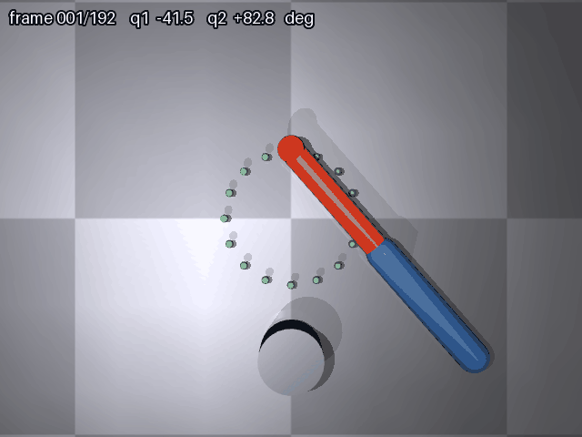

# mujoco_arm_ik

基于 **MuJoCo** 的二连杆机械臂逆运动学（IK）画圆轨迹仿真。

在 MuJoCo 3D 场景中：一个两连杆平面机械臂的末端沿半径为 0.15 m 的圆形轨迹匀速运动，
程序用**解析 2 连杆逆运动学**实时解算两个关节角，关节 PD 位置控制驱动，
并把**末端实际位置**（引擎读数 `data.site_xpos`）逐帧投影成黄色轨迹线，
与地面上的 16 个绿色参考圆点对照。

## 场景

```
  俯视图（相机正上方）
        ● ● ● ● ●         ← 绿色参考圆点（半径 0.15 m，圆心 (0.3, 0)）
       ●           ●
      ●    🟦🟧     ●       ← 蓝色第一段杆 + 橙色第二段杆（末端红色小球）
      ●     🟨      ●       ← 黄色轨迹线：末端实际走过的路径
       ●           ●
        ● ● ● ● ●
```

- 连杆长度：`L1 = L2 = 0.30 m`（水平面内运动，Z = 0.05 m）；
- 轨迹：圆心 `(0.30, 0)`、半径 `0.15 m`，6 秒一圈，总时长 8 秒；
- 目标圆完全位于机械臂工作空间内（半径 0.15 ≤ L1 + L2 = 0.60 m）；
- 画面左上角有 HUD，逐帧显示帧号与 `q1` / `q2` 关节角，可直接确认机械臂在动。

## 演示效果



> `main.py` 逐帧离屏渲染并合成：192 帧 / 640×480 / 每帧 40 ms / 播放 7.68 s / 4.57 MB
> （Pillow ≥ 9.0 下的实测值；Pillow 版本偏低时体积会显著变大，脚本超 5 MB 会打印警告）。
> 黄色轨迹线是末端**实际位置**画出的，不是把目标点投影上去；它与绿色参考圆之间
> 有毫米级偏差，那正是下面「跟踪误差」一节给出的真实数据。

## 算法栈

| 模块 | 文件 | 作用 |
|---|---|---|
| 逆运动学 | `main.py` | 解析 2 连杆 IK（`ik2`），实时解算 (q1, q2)，q1 归一化到 (-π, π] |
| 关节控制 | `main.py` | 关节 PD 位置控制，每个物理子步闭环重算力矩（肩 KP=600/KD=15，肘 KP2=1400/KD2=18） |
| 模型定义 | `arm_2link.xml` | 两连杆机械臂、地面、16 个绿色参考圆点；两个 hinge 均带 `range` |
| 轨迹绘制 | `main.py` | 用画面里 16 个绿点自动标定投影矩阵，把**末端实际位置**逐帧画成黄色轨迹 |
| 验证 | `verify_ik.py` | `ik`：逆解 → 引擎前向运动学回代；`gui`：glfw 查看器实时播放并叠加轨迹 |

## 两个精度口径（不要混用）

| 口径 | 谁来测 | 含义 | 实测值 |
|---|---|---|---|
| IK 解算精度 | `verify_ik.py ik` | 解析逆解算得对不对，用 MuJoCo 自己的前向运动学回代，不含控制与物理 | 8 个等分点最大 **0.0000 mm** |
| 仿真侧跟踪误差 | `main.py` 运行时打印 | 末端实际位置与目标点的偏差，含 PD 控制、有限增益、物理步进 | 全帧平均 **2.785 mm** / 最大 **17.748 mm** |

跟踪误差在 90°~135° 段偏大（最大 17.7 mm），因为该段肩关节角速度最高（约 1 rad/s），
PD 的稳态速度误差约为 `角速度 × KD / KP`。这是控制带宽的真实限度，不是画图误差。

## 运行环境

- Ubuntu 20.04 / Windows 11
- Python 3.8+
- 依赖：`mujoco`、`pillow`、`numpy`；无显卡环境需 `libosmesa6-dev`（osmesa 软渲染）

## 渲染后端怎么选

`main.py` 与 `verify_ik.py` 都遵循同一条规则：

| 情况 | 默认后端 |
|---|---|
| Windows，或 Linux 上存在 `DISPLAY` | `glfw` |
| Linux 上无 `DISPLAY`（无头服务器 / 纯终端） | `osmesa` |
| 显式设置了 `MUJOCO_GL` | 以环境变量为准（覆盖自动选择） |

`launch` 里默认传 `osmesa`（ROS 场景多为无头虚拟机）；有显卡想用窗口渲染时传 `gl:=glfw`。

## 快速开始

```bash
# 1. 安装依赖
pip3 install --user mujoco pillow numpy
sudo apt install -y libosmesa6-dev        # 无显卡虚拟机需要

# 2. 运行（自动选后端；仓库内运行会直接写到 docs/img/mujoco_arm_ik_demo.gif）
python3 main.py

# 3. 无显示器环境显式指定软渲染
MUJOCO_GL=osmesa python3 main.py

# 4. 输出到指定路径
python3 main.py --out ./demo.gif

# 5. 可选验证：IK 解算精度 / 实时渲染
python3 verify_ik.py ik
python3 verify_ik.py gui
```

`main.py` 默认的 GIF 输出位置按三级回退决定：`--out` 参数 > `MUJOCO_ARM_IK_OUT` 环境变量 >
仓库内 `docs/img/`（存在 `mkdocs.yml` 且可写）> 当前目录。

详细说明见 [文档站页面](../../../docs/chapter/mujoco_arm_ik.md)。

## 通过 launch 启动（ROS Noetic）

包内提供 `package.xml`、`CMakeLists.txt`、`launch/mujoco_arm_ik.launch`，可像仓库其它 chap8 模块一样用 roslaunch 一键启动：

```bash
# 编译并生效
cd ~/catkin_ws && catkin_make && source devel/setup.bash

# 默认 osmesa 软渲染（无显卡 / 虚拟机）
roslaunch mujoco_arm_ik mujoco_arm_ik.launch

# 有显卡时切换窗口渲染
roslaunch mujoco_arm_ik mujoco_arm_ik.launch gl:=glfw
```

launch 通过 `MUJOCO_ARM_IK_MODEL` 把 `share/mujoco_arm_ik/arm_2link.xml` 的绝对路径传给脚本，
因此从 `devel/lib/mujoco_arm_ik/` 启动也能正确加载模型；生成的 GIF 按上面的三级回退决定位置，
`devel/lib/` 下运行时默认落到当前目录，也可用 `MUJOCO_ARM_IK_OUT` 指定。

## 目录约定

| 内容 | 位置 |
|---|---|
| 源码 | `src/chap8/mujoco_arm_ik/` |
| 文档 | `docs/chapter/mujoco_arm_ik.md` |
| 配图 | `docs/img/mujoco_arm_ik_demo.gif` |
| 导航 | `mkdocs.yml` 机器人分组下 + `docs/index.md` 第 8 章列表 |

机械臂类模块在仓库中沿用 `src/chap8/` 与 `docs/chapter/`：已合并的 `src/chap8/ros_mujoco_arm_pickplace`（UR5e 抓放）与
`src/chap8/moveit_arm_planning` 都在这一层；`src/ground/` 存放的是 CARLA / MuJoCo 小车、激光雷达等地面载具模块。

## AI 辅助声明

本项目的代码、文档与演示动图在编写过程中使用了大模型（豆包）辅助。作者已逐行核对全部提交内容，并对内容的正确性与可复现性负责。
