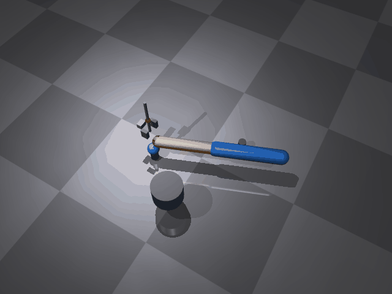

# mujoco_arm_pick

基于 **MuJoCo** 的机械臂抓取搬运（Pick & Place）仿真。

在 MuJoCo 3D 场景中：一个两连杆平面机械臂的末端带**垂直升降关节 + 夹爪**，
自动完成「移动到球上方 → 下降 → 夹取 → 抬升 → 移动到目标点 → 下降 → 释放」
的全流程，把蓝色小球从 A 点托盘搬运到 B 点托盘，
末端走过的路径以黄色轨迹线画出。

## 场景

```
  侧视图（示意）
                          A 点托盘柱           B 点托盘柱
                             ╭──╮                ╭──╮
                             │ ● │  ← 蓝色小球    │   │
      🟦🟧 机械臂两段杆        │   │                │ ● │  ← 球被放到 B
      (水平面 Z=0.15)         ╰───╯                ╰───╯
      ├── 垂直升降关节 + 夹爪 ──┤
      夹爪下降 → 夹起球 → 抬升 → 移到 B → 下降 → 张开释放
```

- 连杆长度：`L1 = L2 = 0.30 m`（水平面内运动，Z = 0.15 m）；
- 任务：球从 `A(0.18, 0.20, 0.08)` 夹起，运到 `B(0.45, -0.15, 0.08)` 放下；
- 末端带垂直升降关节（lift）+ 旋转夹爪（grip），夹爪逻辑吸附小球（无物理接触）。

## 演示效果



> 由 `main.py` 逐帧离屏渲染后合成 GIF（不是录屏）：
> 机械臂移动到 A 点上方 → 下降 → 夹爪闭合把球夹起 → 抬升 → 移动到 B 点 →
> 下降 → 张开夹爪把球放到 B 点托盘上，全程黄色轨迹线跟随末端。

## 算法栈

| 模块 | 文件 | 作用 |
|---|---|---|
| 逆运动学 | `main.py` | 解析 2 连杆 IK（`ik2`），解算水平目标 (q1, q2) |
| 关节驱动 | `main.py` | 肩/肘/升降/夹爪四个关节都用一阶插值逼近目标（运动学驱动，不做物理积分） |
| 任务调度 | `main.py` | 9 段时间轴：下降/夹取/抬升/移动/放下/收回 |
| 抓取逻辑 | `main.py` | 逻辑吸附：升降到位 + 夹爪闭合两个确定性条件同时成立才锁定球 |
| 模型定义 | `arm_gripper.xml` | 两连杆臂 + 升降关节 + 夹爪 + 球 + A/B 托盘柱 |
| 轨迹绘制 | `main.py` | DLT 相机标定把末端 3D 位置投影到像素，逐帧画黄色轨迹 |

## 运行环境

- Windows 11 + Python 3.11 + mujoco 3.17.0 / numpy 2.4.6 / Pillow 13.0.0：**本机实测通过**；
- Linux（Ubuntu）上的 MuJoCo 依赖与后端可选 `egl`，本仓库尚未在 Ubuntu 实机跑过，
  第一次在 Linux 上运行请留意 §常见问题 里的后端说明；
- 有显卡：默认 `MUJOCO_GL=glfw`；无显卡服务器/虚拟机：推荐 `MUJOCO_GL=egl`。

## 快速开始

```bash
# 1. 安装依赖
pip3 install --user mujoco pillow numpy

# 2. 运行（在包目录下，脚本会自己找同目录的 arm_gripper.xml）
python3 main.py

# 3. 指定输出路径（默认写到仓库 docs/img；不在仓库内时退到系统临时目录）
python3 main.py --out ./demo_pick.gif
```

启动时先打印一行 `输出位置：...`（`--out` 指定的目录不可写会立刻报错退出，
不用等渲染完），随后打印相机标定误差与渲染进度。

## 验证

脚本结束会打印三项互相独立的搬运结果，而不是拿「代码刚赋进去的球坐标」跟同一个
目标点做减法（那种比较恒为 0，搬运失败也不会报错）：

```
搬运结果核对：
  1) 吸附触发：1 次（要求 1 次）PASS
     发生在第 29 帧（t=1.21 s），夹爪中心 z=0.0813 m
  2) 释放瞬间夹爪中心到 B 点：0.0000 m（要求 < 0.0500 m）PASS
  3) 吸附期间球从 A 到 B 的位移：0.4420 m（要求 > 0.3000 m）PASS
搬运判定：PASS（球被夹起、送到 B 点、并在 B 点释放）
```

三项分别对应「夹取有没有真的发生」「有没有走到 B 才松手」「球有没有跟着走完」，
任一项不满足都会 `AssertionError` 并以非 0 退出码退出，不看 GIF 也能判读。

## 效果图体积

`main.py` 生成 640×480 的 GIF：渲染 201 帧（每帧 40 ms），Pillow 会把完全静止的
相邻帧合并，实际写入约 190 帧，**总时长恒为 8.04 秒**。128 色量化后本地产物体积
约 1.9 MB。

仓库规范要求动图小于 5 MB，脚本结束时也会打印体积并在超限时给出提示。

> **生成的文件仅本地查看，不要直接提交。** 如需更新仓库里的演示图，请先压缩到
> 5 MB 以内再提交。

详细说明见 [文档站页面](../../../docs/chapter/mujoco_arm_pick.md)。
