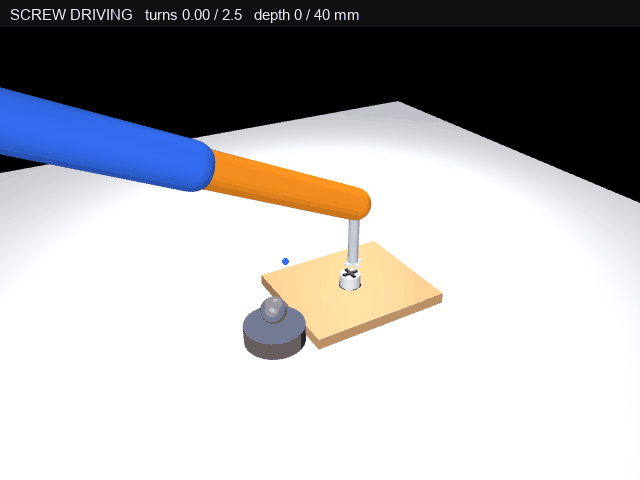

# 机械臂拧螺丝仿真

三自由度空间机械臂（肩方位 + 肩俯仰 + 肘俯仰）末端夹持竖直螺丝刀，
对准桌面木板上的螺丝后连续旋转 2.5 圈（900°），把螺丝按螺距拧入
桌面螺孔（下沉 40 mm，螺丝顶面拧到板面以下 17 mm）。
3/4 视角相机渲染，画面上方实时显示「旋转圈数 / 拧入深度」状态条，
叠加黄色末端轨迹与青色刀头螺旋轨迹。

> **这是运动学回放，不是动力学仿真。** 每帧直接把关节角写进 `qpos`（单步最大 0.07 rad，沿 IK 解逼近），
> 用 `mj_forward` 求正运动学与几何位置后渲染；全程没有 `mj_step`、不积分动力学，也不经过执行器或 PD 控制器。
> 文档 `docs/chapter/chap8/mujoco_arm_screw.md` 第 6 节写明了原因：改用动态 PD / position 执行器时实测动态末端误差达 353 mm，
> 所以这里只做运动学回放，画面上看到的是逐帧摆好的关节角。

## 演示效果



上图就是本包 `main.py` 真实运行生成的文件（不是另外录屏）：脚本渲染 450 帧，
导出 GIF 实测 **640×480、421 帧、3.63 MB**——前 420 帧各 30 ms、末帧 990 ms（尾部停留帧被合并成一帧、
时长累加），合计 **13.59 s**。所以总时长不等于 421×30 ms，这一点由脚本运行结束时打印的实际参数给出。

## 功能包结构

| 文件 | 说明 |
|---|---|
| `main.py` | 入口（单文件，模型 XML 内嵌，运动学插值驱动 + 离屏渲染 + 轨迹叠加） |
| `test/verify_mujoco_arm_screw.py` | 验证脚本（mjcfk / ik / clear / gui 四种模式） |
| `package.xml`、`CMakeLists.txt` | catkin 包描述与构建脚本（纯 Python，无编译目标） |
| `launch/mujoco_arm_screw.launch` | 一键启动 `main.py`，参数 `gl` 选择 MuJoCo 渲染后端（默认 glfw；osmesa 在 PyOpenGL 下会崩，不建议） |
| `requirements.txt` | Python 依赖（mujoco / numpy / pillow） |
| `README.md` | 本项目说明 |
| `LICENSE` | Apache-2.0 全文，与 `package.xml` 的 `<license>Apache-2.0</license>` 对应 |
| `../../../docs/chapter/chap8/mujoco_arm_screw.md` | 文档站页面（模型、IK 构型选择、时间线、下沉公式、验证结果） |
| `../../../docs/img/mujoco_arm_screw_demo.gif` | 文档站效果图（mkdocs 只构建 `docs/`，页面配图必须放在 `docs/img` 内） |

> 相对路径按 `src/chap8/mujoco_arm_screw/` 起算：一层到 `src/chap8/`，两层到 `src/`，
> 三层才回到仓库根，所以引用仓库根的 `docs/img/` 要写 `../../../docs/img/...`。

## 运行环境（实际验证）

| 项 | 版本 |
|---|---|
| 操作系统 | Windows 11（本机）；Ubuntu 22.04.5 LTS（云主机，无独立显卡） |
| Python | Windows 3.11；Ubuntu 的**系统解释器** `/opt/python3.12/bin/python3` = 3.12.11；同一台 Ubuntu 上**另建**的 conda ROS 环境 = 3.12.16 |
| 模拟器 | MuJoCo 3.17.0（三套环境相同） |
| 关键依赖 | 每个解释器各装一套，互不影响：Windows **numpy 2.4.6 / Pillow 13.0.0**；Ubuntu 系统解释器 **numpy 1.26.4 / Pillow 10.4.0**；Ubuntu conda ROS 环境 **numpy 2.5.4 / Pillow 13.0.0**。后两者在同一台机器上，是两个解释器各装各的，不是同一份环境里有两个版本 |
| 渲染后端 | `MUJOCO_GL=glfw`；Ubuntu 端另配 Xvfb（`DISPLAY=:99`）。`osmesa` 在 PyOpenGL 下取不到 GL 上下文会崩，不用 |
| ROS | **ROS Noetic，已端到端实测**：在 Ubuntu 22.04.5 上用 conda 装了 ROS Noetic（roslaunch 1.17.4 / catkin 0.8.12 / cmake 3.31 / Python 3.12.16），`catkin_make` 与 `catkin_make install` 均成功，`roslaunch` 在 devel、install 两个空间各起过一次，node 跑完 450 帧后 cleanly 退出（详见「ROS 侧实测」一节）。注意两台验证机本身都没有 apt 版 ROS，Ubuntu 22.04 的官方发行版是 ROS 2 Humble，与 ROS 1 结构不同 |

依赖有两条路径，按运行方式选**一条**，不要同时用（否则 numpy / pillow 会装上两套）：

| 运行方式 | 装什么 | 命令 |
|---|---|---|
| 独立运行（不装 ROS） | 全部走 pip | `pip install -r requirements.txt` |
| 作为 ROS 1 包运行 | apt 侧 `rosdep` 装 `python3-numpy`、`python3-pil`；**`mujoco` 不在 apt 仓库，仍要 pip 装** | `rosdep install --from-paths src --ignore-src -y`，再 `pip install -r requirements.txt` |

`package.xml` 的 `<exec_depend>python3-numpy</exec_depend>`、`python3-pil` 是给 `rosdep` 用的 apt 包名
（系统仓库给的版本随发行版走，不一定等于下表实测版本）；`requirements.txt` **按实测版本锁定**：
`mujoco==3.17.0`（只在这个版本上验证过）、`numpy>=1.26.4,<3.0`、`pillow>=10.4.0,<14.0`（覆盖上表三套环境
的 1.26.4 / 2.5.4 与 10.4.0 / 13.0.0）。更高版本未做验证——换版本后 GIF 字节数与每帧延迟可能变，
帧数（421）与总时长（13.59 s）不变。两条路径混用会出现「apt 的 numpy 和 pip 的 numpy
同时存在、谁先生效取决于 PYTHONPATH」的问题，所以只选一条。

## 复跑（供他人验证）

评审或其他人换一台机器验证时，按下面四条走一遍即可，括号里是应该看到的数值。
四条都在**包目录**（`src/chap8/mujoco_arm_screw/`）下执行：

```bash
pip install -r requirements.txt
python3 test/verify_mujoco_arm_screw.py mjcfk   # 三个目标点 tip 误差 0.0000 mm；刀头最低点 0.0430 m vs 0.0430 m
python3 test/verify_mujoco_arm_screw.py clear   # 最大悬空 0.0000 m、最大压入 0.0000 m、900.0°、下沉 40.0 mm、结果 PASS
python3 main.py                                 # 生成 mujoco_arm_screw_demo.gif（640×480、421 帧、13.59 s、约 3.5–3.6 MB）
```

无显卡的机器把 `main.py` 那条换成 `DISPLAY=:99 MUJOCO_GL=glfw python3 main.py`（需要先起 Xvfb）。

`main.py` 把 GIF 写在**脚本同目录**（`src/chap8/mujoco_arm_screw/mujoco_arm_screw_demo.gif`），
这是运行产物、不用提交；文档站用的图是固定在 `docs/img/mujoco_arm_screw_demo.gif` 的那一份，
要更新效果图时把它复制过去即可。

## ROS 侧实测（catkin_make + roslaunch）

ROS 侧不是只做 XML 校验，实际跑完整过一遍。环境：Ubuntu 22.04.5（2 核 / 3 GB，无独显，Xvfb `:99`）
+ conda 装的 ROS Noetic。

```bash
# 1) 准备一个 ROS Noetic 环境（conda 方式，任何能装上 ros-noetic-catkin + ros-noetic-roslaunch 的方式均可）
conda create -n ros -c conda-forge -c robostack-staging ros-noetic-catkin ros-noetic-roslaunch
conda activate ros
conda install -n ros "cmake<4"           # 见下：robostack 默认给 cmake 4.x，catkin 包声明 3.0.2 会被 CMake 4 直接拒绝
pip install mujoco numpy pillow          # mujoco 不在 apt 仓库，pip 装

# 2) 放进 catkin workspace 并编译
mkdir -p ~/ws/src && cp -r <本包目录> ~/ws/src/mujoco_arm_screw && cd ~/ws
catkin_make
catkin_make install

# 3) 启动（devel 空间一次、install 空间一次，两次都跑过）
source devel/setup.bash
roslaunch mujoco_arm_screw mujoco_arm_screw.launch
```

两次 `roslaunch` 的实际输出要点：

- 自动起了 master（`ROS_MASTER_URI=http://localhost:11311`），node `mujoco_arm_screw` 启动
- 渲染 450 帧耗时 12.2 秒；数值与本机一致：最大悬空 0.0000 m / 最大压入 0.0000 m、转角 900.0°、下沉 40.0 mm
- 生成 `mujoco_arm_screw_demo.gif`：640×480、421 帧、13.59 s
- 最后 `process has finished cleanly`，`roslaunch` 退出码 0

`catkin_make` 的安装结果（`install` 空间）：`install/lib/mujoco_arm_screw/main.py`（16,456 B）、
`install/share/mujoco_arm_screw/launch/mujoco_arm_screw.launch`、`install/share/mujoco_arm_screw/package.xml`；
`install/lib` 里没有验证脚本 —— `CMakeLists.txt` 只 `catkin_install_python(main.py)`，`test/` 是开发期工具，不装。

两点如实说明：

- devel 空间的 `devel/lib/mujoco_arm_screw/main.py` 只有 589 B，是 catkin 自动生成的 relay 脚本
  （内容是 `exec(compile(...))` 转发到源码里的 `main.py`），不是文件被截断；install 空间里放的是 16,456 B 原始文件
- 生成 GIF 的字节数随 Pillow 版本略有差异：Windows 本机生成 3,802,366 B（3.63 MB，仓库里提交的是这份），
  ROS 环境生成 3,704,119 B（3.53 MB）；帧数、尺寸、13.59 s 完全一致

关于上面那条 `cmake<4`：robostack 的 ROS Noetic 环境默认装 cmake 4.2，而 catkin 生成的包普遍写
`cmake_minimum_required(VERSION 3.0.2)`，CMake 4 已经移除了对 < 3.5 的兼容，`catkin_make` 会直接报错退出；
降到 3.31 后正常。这与本包无关——是 catkin 模板的默认版本声明与 CMake 4 的冲突，apt 装 ROS Noetic
（Ubuntu 20.04，cmake 3.16）不会遇到。

这一条仍然需要「其他人 + 另一台机器」复跑确认：以上两次 `roslaunch` 都是作者本人执行的，换的是软件环境和空间，
不是换人。

## 运行

```bash
pip install mujoco numpy pillow

# 有显卡 / 桌面环境（glfw 后端）
python3 main.py

# 无显卡的虚拟机（glfw + Xvfb）
DISPLAY=:99 MUJOCO_GL=glfw python3 main.py

# 以 ROS 包方式启动（已 catkin_make 并 source 之后）
roslaunch mujoco_arm_screw mujoco_arm_screw.launch          # 默认 gl=glfw
```

运行结束在同目录生成 `mujoco_arm_screw_demo.gif`，并打印该文件的真实参数
（渲染帧数、GIF 实际帧数、总时长、体积）。

## 验证

```bash
python3 test/verify_mujoco_arm_screw.py mjcfk   # 独立几何校验：MuJoCo 读 tip / 刀头底面 vs 目标
python3 test/verify_mujoco_arm_screw.py ik      # IK 精度：三个目标点逆解 -> 正解互查
python3 test/verify_mujoco_arm_screw.py clear   # 全流程：刀头贴合、转角 900°、下沉 40 mm
python3 test/verify_mujoco_arm_screw.py gui     # glfw 实时渲染：完整播放拧螺丝
```

实测结果：

- 独立几何校验（读数全部来自 MuJoCo，不经手写 `fk3`）：三个目标点 tip 误差 **0.0000 mm**；
  刀头最低点 **0.0430 m** 与螺丝顶面 **0.0430 m** 误差 **0.0000 mm**（证明的是"刀头贴住螺丝顶"，
  不只是"tip 对准某个点"）
- IK 逆解 → 手写正解互查：最大误差 **0.00 mm**（只说明求解与几何定义自洽，不能单独证明绝对正确）
- 对位+拧入段（frame 110–350，与 `main.py` 同一统计窗口）刀头最低点 vs 螺丝顶面：最大悬空 **0.0000 m**、最大压入 **0.0000 m**。
  这里的刀头最低点同样取 `bladeA` 的 `geom_xpos − geom_size`（MuJoCo 实算），`main.py` 的打印也是同一读数方式，不是用常量推算
- 最终转角 **900.0°（2.50 圈）**，螺丝中心下沉 **40.0 mm**（0.020 → −0.020 m）
- 螺丝终了顶面 **0.003 m**，比板面 0.020 m 低 **17 mm**（拧入板内，未与板面齐平）
- 结果：**PASS**

## 设计要点

- 三自由度空间臂：肩方位 yaw + 肩俯仰 pitch1 + 肘俯仰 pitch2，
  杆长 L1 = L2 = 0.30 m，肩俯仰中心高度 0.06 m
- **构型选择**：目标靠近桌面（d ≈ 0.21 m < 臂长 0.6 m）时二连杆必须大幅
  折叠，IK 取 **负解（q2 < 0，肘抬到肩上方）**，让 L2 从上往下伸到螺丝，
  形成"臂从上方伸下来拧螺丝"的构型；正解会让肘沉到地面以下，杆件整段
  被地面遮住
- 空间 IK：方位角 `yaw = atan2(y, x)`（带跨 ±π 解缠）+ 臂平面内二连杆闭合解
- 螺丝：十字槽圆柱，绕 z 轴旋转 theta，同时按螺距匀速下沉
  `sz = 0.020 − 0.040 × (theta / 900°)`（单位 m）
- 螺丝刀几何：driver 原点在 tip 下方 0.11 m，十字刀头最低点再低 0.006 m
  （`bladeA/B` 盒体半高 0.003 + pos z −0.003），所以"刀头贴螺丝顶"时
  tip 高度是 `sz + 0.023 + 0.006 + 0.11`
- 时间线：0–70 帧抬到螺丝上方待机位 → 70–110 帧下压对位 → 110–350 帧旋转拧入
  （2.5 圈）→ 350–420 帧抬起 → 420–450 帧停留展示
- 臂运动学插值驱动：每帧 qpos 向 IK 目标角逼近（最大 0.07 rad/帧），
  用 `mj_forward` 渲染而不积分动力学（臂模型轻、重力角加速度大，
  动态 PD 无法收敛；运动学驱动保证刀头精确贴合螺丝顶）
- 相机：lookat (0.11, 0.04, 0.14)、distance 0.98、azimuth 60°、elevation −30°，
  黄色末端轨迹与青色刀头轨迹用手算 lookAt 透视投影叠加（fovy = 45°）
