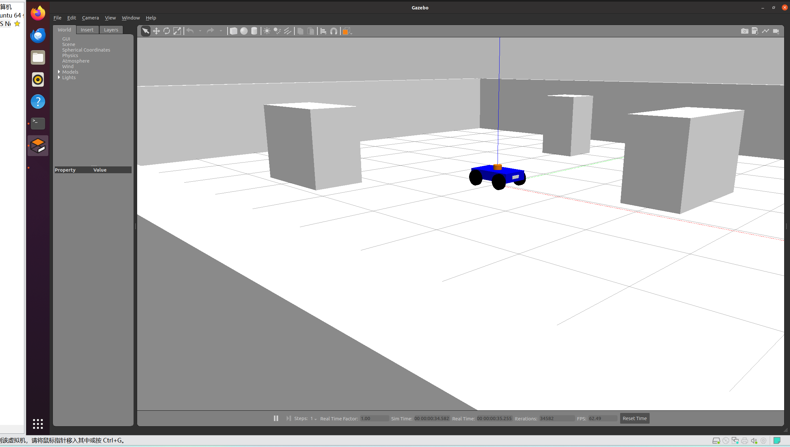
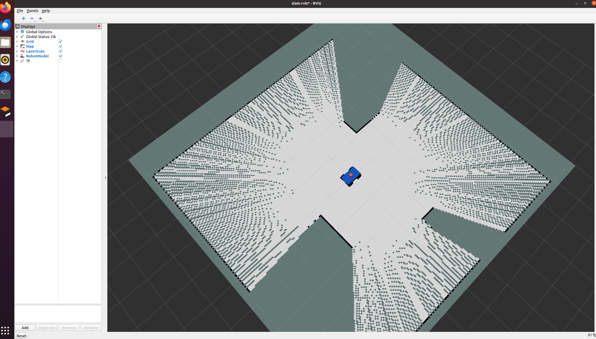
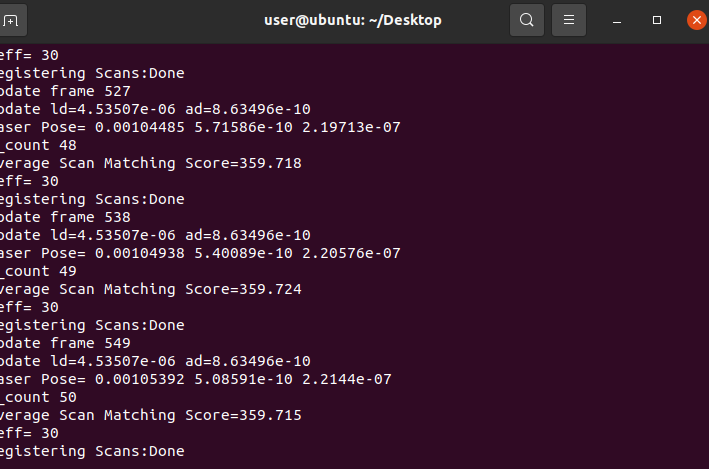

# 自建四轮小车 Gazebo GMapping 建图实验（ROS Noetic）

本页归入本站第 6 章“机器人 SLAM 与自主导航”，使用 ROS 1 Noetic。旧作业编号与本站章节不同，源码保留在 `src/chap9/urdf_car_slam`；目录名 `chap9` 不代表本实验使用 ROS 2。

本包承接已在 RViz 显示成功的四轮小车，新增 Gazebo Classic 物理驱动、二维激光、里程计和 GMapping。本实验仅覆盖二维仿真建图，不包含自动导航。包名为 urdf_car_slam，与原 urdf_car_demo 分开。

## 一、环境与复制位置

Ubuntu 20.04 + ROS Noetic + Gazebo Classic（通常为 11）。打开普通 Ubuntu 终端，不要激活 AirSim 的 .venv，不要加载 ROS 2 环境。退出之前的 display.launch，避免 robot_description 与 TF 发布器冲突。

```bash
source /opt/ros/noetic/setup.bash
sudo apt update
sudo apt install git ros-noetic-catkin ros-noetic-tf ros-noetic-gazebo-ros-pkgs ros-noetic-gazebo-plugins ros-noetic-xacro ros-noetic-robot-state-publisher ros-noetic-gmapping ros-noetic-map-server ros-noetic-rviz ros-noetic-teleop-twist-keyboard liburdfdom-tools
mkdir -p ~/urdf_car_ws/src
```

源码位于本仓库 `src/chap9/urdf_car_slam`。首次获取仓库可执行：

```bash
git clone --depth 1 https://github.com/OpenHUTB/ros2.git ~/ros2-course-source
```

已有仓库时跳过克隆，将 `REPO_DIR` 改成实际仓库根目录；从上一节建模实验继续时可复用同一份仓库。仅复制本包，不要复制整个仓库的 `src`。目标位置已有同名包时先保留原文件，避免直接覆盖自己的修改。

```bash
REPO_DIR="$HOME/ros2-course-source"
test -f "$REPO_DIR/src/chap9/urdf_car_slam/package.xml" && \
  cp -a "$REPO_DIR/src/chap9/urdf_car_slam" "$HOME/urdf_car_ws/src/"
```

确认 `~/urdf_car_ws/src/urdf_car_slam/package.xml` 存在。也可将作业压缩包中的 `urdf_car_slam` 文件夹解压到该位置。本包可以与 `urdf_car_demo` 同处工作空间，但不要同时启动两套模型；无需预先启动建模实验。

```bash
cd ~/urdf_car_ws
catkin_make
source devel/setup.bash
roslaunch urdf_car_slam slam.launch
```

将打开 Gazebo 和 RViz。启动初期等机器人生成、激光与第一张地图出现后再移动；Gazebo 必须处于播放状态。虚拟机性能不足时先关闭其他仿真，或使用 `roslaunch urdf_car_slam slam.launch gui:=false` 保留 Gazebo 后台和 RViz。

### 启动参数

| 参数 | 默认值 | 用途 |
| --- | --- | --- |
| `gui` | `true` | 是否显示 Gazebo 窗口；`false` 时物理仿真仍运行 |
| `rviz` | `true` | 是否显示 RViz；`false` 不会关闭建图节点 |
| `spawn_z` | `0.01` 米 | 机器人生成时的高度，不是导航目标高度 |

上述默认值直接对应包内 `launch/slam.launch`。启动后等待模型、激光与第一帧地图出现，再进行遥控。

## 二、键盘遥控建图

另开 Ubuntu 终端：

```bash
source /opt/ros/noetic/setup.bash
source ~/urdf_car_ws/devel/setup.bash
rosrun teleop_twist_keyboard teleop_twist_keyboard.py _speed:=0.15 _turn:=0.4 _repeat_rate:=10.0 _key_timeout:=0.6
```

键盘窗口要保持焦点：`i` 前进，`,` 后退，`j` 左转，`l` 右转，`k` 停止。按键超时后发送零速度；长按或重复按键保持移动。退出遥控前先按 k。

先慢速走直线，再转弯。绕房间探索，经过障碍物的不同侧面，最后回到起点附近。不要贴墙或持续撞障碍。RViz 中白色为已探索可通行区，黑色为障碍，灰色为未知区域。没有自动避障，地图不会代替遥控驾驶。

## 三、保存地图

保持 slam.launch 运行，另开终端：

```bash
source /opt/ros/noetic/setup.bash
source ~/urdf_car_ws/devel/setup.bash
RUN_DIR="$HOME/urdf_car_maps/$(date +%Y%m%d_%H%M%S)"
mkdir -p "$RUN_DIR"
rosrun map_server map_saver -f "$RUN_DIR/car_gmapping"
rostopic echo -n 1 /map/info > "$RUN_DIR/map_info.yaml"
ls -lh "$RUN_DIR/car_gmapping.pgm" "$RUN_DIR/car_gmapping.yaml" "$RUN_DIR/map_info.yaml"
echo "$RUN_DIR"
```

保存前先在遥控终端按 `k` 停车。应生成 `car_gmapping.pgm` 和 `car_gmapping.yaml`；`map_info.yaml` 保存实时话题元数据。前两个文件须保持同目录，检查 YAML 中 `image` 指向正确的 PGM，不能只交图片。截图不能代替地图文件。

`map_saver` 会等待 `/map`；此时不要关闭仿真，先按第五节检查地图发布者。后续命令等待它完成后再执行。查看图片可在同一终端运行 `xdg-open "$RUN_DIR/car_gmapping.pgm"`；换终端后需重新设置 `RUN_DIR` 为实际保存目录。

保存的数据来自实时 `/map`，不能以 Gazebo world 平面图替代。即使已生成 PGM，也要通过探索后的截图或录屏说明覆盖范围；文件生成本身不证明整个房间已完成建图。

## 四、系统结构与坐标系

```text
键盘 → /cmd_vel → Gazebo 四轮差速驱动 → /odom、odom→base_footprint
Gazebo 激光 → /scan
Gazebo 关节状态 → /joint_states → robot_state_publisher → 各部件 TF
/scan + odom TF → slam_gmapping → /map、map→odom
```

完整 TF 主链为 `map → odom → base_footprint → base_link → lidar_link`。原车的雷达只有外形，现在增加 ray 传感器，发布 sensor_msgs/LaserScan。RViz 当前配置默认开启 TF 显示。启动初期第一帧地图尚未出现时，map 相关变换可能暂时缺失。不要给 map→odom 或 odom→base_footprint 添加静态 TF，否则会与 SLAM/驱动冲突。

四轮滑移转向由 gazebo_ros_skid_steer_drive 驱动。此插件使用 Gazebo 世界位姿生成仿真里程计，是便于入门的理想化里程计实验；不是实机编码器里程计性能验证。GMapping 从激光和里程计 TF 建图，没有预先加载 world 的栅格地图。

模型加入了质量、惯量、碰撞几何和轮地接触参数。雷达为 360 个采样、10 Hz、最远 8m，地图分辨率为 0.05m。场景由地面、四面墙和三个障碍物构成，不依赖在线下载模型。

## 五、分层检查与排错

另开终端，先加载 ROS 环境，再检查节点、话题及坐标变换：

```bash
source /opt/ros/noetic/setup.bash
source ~/urdf_car_ws/devel/setup.bash
rosnode list
rostopic info /map
rostopic hz /clock
rostopic hz /scan
rostopic hz /odom
rostopic hz /joint_states
rostopic echo -n 1 /map/info
rosrun tf tf_echo odom base_footprint
rosrun tf tf_echo map lidar_link
```

每个 `hz` 和 `tf_echo` 命令都会持续输出，观察几秒后按 `Ctrl+C` 再执行下一条。`rostopic list` 中有 `/map` 名称并不证明已有地图发布；还要检查 `rostopic info /map` 的 Publishers、`rosnode list` 中的 `/slam_gmapping` 以及 `/map/info` 是否收到数据。

| 现象 | 检查 |
| --- | --- |
| xacro 或包找不到 | 检查复制层级、catkin_make 和 source devel/setup.bash |
| Failed to load plugin | 检查 gazebo-plugins 是否安装；需 Classic，不能用 ROS2/Gazebo Sim 替代 |
| /clock 无更新 | Gazebo 是否启动且未暂停 |
| 只有小车没有地图 | 检查 /scan、odom TF、gmapping 日志；等第一帧地图 |
| 车轮缺失或 TF 报错 | 检查 /joint_states；本实验不用 joint_state_publisher_gui 伪造轮子状态 |
| 键盘不响应 | 点击键盘终端；查看 /cmd_vel；同时检查 Gazebo 是否暂停 |
| 持续打滑、地图歪斜 | 降低速度，避免急转和碰撞；记录现象再调摩擦和驱动参数 |
| 缺 map→odom | GMapping 是否收到扫描，扫描时间戳能否找到对应 TF |

## 六、已有实验记录

用户已提供 Gazebo 场景、RViz 初始地图和 GMapping 日志截图：场景及模型已加载，RViz Global Status 为 Ok，GMapping 持续输出 `Registering Scans: Done`。

后续保存地图终端截图显示：收到 `224 × 224`、`0.050 m/pix` 的地图，PGM/YAML 写入后显示 `Done`；随后执行了 `/map/info` 导出命令。该次栅格宽高为 `224 × 0.05 = 11.2` 米，尺寸包含未知区域，不等同于已探索面积，不同运行的地图尺寸可能不同。

本页实测结果记录范围为：场景加载、初始地图生成、扫描匹配运行与地图保存日志。

一次联调中 rosnode list 未显示 slam_gmapping；随后手动启动 GMapping 后获得正常截图。若复现时只有激光和里程计没有地图，先检查是否安装 ros-noetic-gmapping 及 launch 终端报错，再在另一个已加载 Noetic 环境的终端执行：

```bash
rosrun gmapping slam_gmapping _base_frame:=base_footprint _odom_frame:=odom _map_frame:=map _maxUrange:=7.5 _maxRange:=8.0 _delta:=0.05 scan:=/scan
```

已有 GMapping 节点时不要重复启动。

## 七、来源与辅助声明

基于此前小车建模作业扩展，由 OpenAI Codex 辅助编写。

- ROS Noetic 驱动插件源码：https://github.com/ros-simulation/gazebo_ros_pkgs/blob/noetic-devel/gazebo_plugins/src/gazebo_ros_skid_steer_drive.cpp
- 前置说明：[四轮小车 URDF 建模与 RViz 显示](../../../docs/chapter/urdf_car_modeling.md)。
- 内容范围：自建小车的 GMapping 仿真建图；本站入口位于第 6 章。


## 八、用户实测截图







## 九、停止实验

先在遥控终端按 `k` 停车，再按 `Ctrl+C` 退出遥控；确认地图已保存后，在运行 `slam.launch` 的终端按 `Ctrl+C` 关闭仿真、建图及 RViz。
