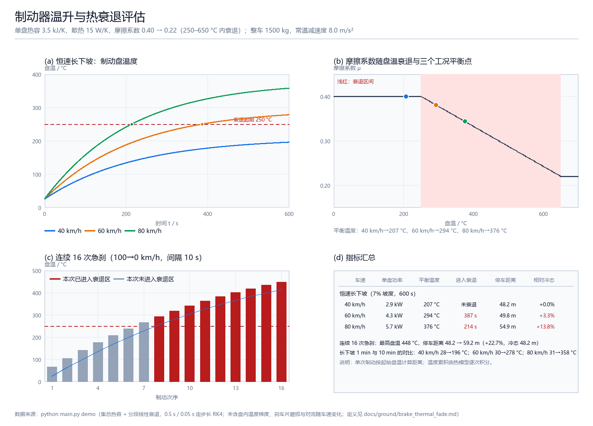

# 制动器温升与热衰退评估

仓库里已有 AEB 决策（`carla_aeb_braking`）、崖边紧急制动（`cliff_brake`）等**逻辑层**模块，
但都假设制动力恒定可用。实际连续制动或长下坡时，制动盘温度升高会让摩擦系数下降
（热衰退），制动距离随之变长——本模块把这件事量化：给定制动盘热参数与摩擦衰退曲线，
算出盘温历程、进入衰退的时间、以及衰退后的停车距离。

模块不依赖 ROS 2、CARLA、AirSim 或 GPU，`python main.py demo` 一条命令即可得到指标
与运行效果图；ROS 2 节点只把"盘温 → 摩擦系数 → 停车距离"的查表接到话题上。

## 目录结构

```text
src/ground/brake_thermal_fade/
├── main.py                       # 入口：demo / check / ros 三种模式
├── launch/main.launch.py         # ROS 2 启动文件
├── package.xml / setup.py / setup.cfg
├── requirements.txt              # numpy、Pillow
├── resource/brake_thermal_fade
├── brake_thermal_fade/
│   ├── disc.py                   # 集总热容 + 分段线性摩擦衰退曲线
│   ├── vehicle.py                # 减速度、停车距离、单盘功率
│   ├── scenario.py               # 长下坡与连续制动两个工况
│   ├── visualize.py              # Pillow 2×2 效果图
│   ├── ros_node.py               # ROS 2 适配节点
│   └── cli.py                    # 命令行分派
├── tests/                        # 37 个单元测试
└── results/                      # demo 输出：metrics.json、demo_screenshot.png
```

## 运行环境

| 项目 | 版本 |
|---|---|
| 操作系统 | Windows 11 |
| Python | 3.12.14 |
| NumPy | 2.3.5 |
| Pillow | 12.3.0 |

ROS 2 节点按 ROS 2 Humble 的 `ament_python` 约定编写，**未在本机验证**（开发机没有
ROS 2 环境）。

## 快速开始

```bash
python -m pip install -r src/ground/brake_thermal_fade/requirements.txt
cd src/ground/brake_thermal_fade
python main.py demo
```

可选参数：

```bash
python main.py demo --grade 0.06 --duration 900     # 6% 坡度、15 分钟长下坡
python main.py demo --cycles 20 --cooldown 5        # 20 次急刹、间隔 5 s
python main.py demo --out /tmp/brake                # 指定输出目录
python main.py check --speed 80 --temperature 400   # 单车速 / 单温度速查
```

`python main.py` 不带参数等价于 `demo`。

## 运行效果

`results/demo_screenshot.png`（约 152 KB，1600×1150）：



- (a) 恒速长下坡时三种车速的盘温历程，红色虚线为衰退起始温度；
- (b) 摩擦系数随盘温的衰退曲线，三个圆点为各车速的平衡温度；
- (c) 连续 16 次急刹的盘温累积（红柱表示该次已进入衰退区）；
- (d) 指标汇总表。

本次实测（0.07 坡度、600 s；退化为 250 °C 起的线性段）：

| 车速 | 单盘功率 | 平衡温度 | 进入衰退 | 100→0 停车距离 | 相对冷态 |
|---|---|---|---|---|---|
| 40 km/h | 2.86 kW | 207 °C | 未衰退 | 48.2 m | +0.0% |
| 60 km/h | 4.29 kW | 294 °C | 387 s | 49.8 m | +3.3% |
| 80 km/h | 5.72 kW | 376 °C | 214 s | 54.9 m | +13.8% |

连续 16 次 100→0 km/h 急刹（间隔 10 s）：盘温 25 → **448 °C**，第 8 次起进入衰退区，
停车距离 48.2 → **59.2 m（+22.7%）**。

## 模型与指标定义

**热模型**（单只制动盘，温度均匀的集总热容）：

```text
C dT/dt = P_in - hA (T - T_amb) - ε σ A [(T+273.15)^4 - (T_amb+273.15)^4]
```

`C = m c_p` 为盘热容（默认 3.5 kJ/K），`hA` 为对流散热（默认 15 W/K），后一项为辐射散热。
1 ms~0.5 s 定步长 RK4 积分。

**摩擦衰退**：分段线性，`μ = 0.40` 直到 250 °C，在 250–650 °C 内线性降到 `μ = 0.22`，
之后保持不变（最坏情况）。

**指标**：

| 指标 | 定义 | 单位 |
|---|---|---|
| 单盘功率 | `m g sinθ v / 4`（恒速下坡时重力分量全部由制动器平衡） | W |
| 平衡温度 | 散热功率等于输入功率时的盘温（二分求解） | °C |
| 进入衰退时间 | 从环境温度升到 `fade_start_c` 所需时间 | s |
| 可用减速度 | `a = a_ref · μ(T)/μ_cold` | m/s² |
| 停车距离 | `v² / (2a)`，`v` 取 100 km/h | m |

**单次制动的量级**：100→0 km/h 的动能是 `½·1500·27.8² ≈ 578 kJ`，平均分给 4 个盘，
每盘升温约 **41 K**——所以单次急刹不会热衰退，但短间隔连续 8 次以上就会。

## 参数

| 参数 | 默认值 | 含义 |
|---|---|---|
| `disc_mass_kg` | 7.0 | 单个制动盘质量（kg） |
| `specific_heat_j_per_kgk` | 500 | 盘比热容（J/(kg·K)） |
| `cooling_w_per_k` | 15.0 | 对流散热系数（W/K） |
| `radiation_area_m2` | 0.06 | 辐射散热面积（m²） |
| `emissivity` | 0.80 | 发射率 |
| `ambient_c` | 25.0 | 环境温度（°C） |
| `mu_cold` / `mu_hot` | 0.40 / 0.22 | 常温与完全衰退后的摩擦系数 |
| `fade_start_c` / `fade_end_c` | 250 / 650 | 衰退起止温度（°C） |
| `mass_kg` | 1500 | 整车质量（kg） |
| `reference_decel_mps2` | 8.0 | 常温下的制动减速度（m/s²） |
| `brake_count` | 4 | 制动盘数量 |

## ROS 2 节点

```bash
cd ~/ros2_ws
colcon build --packages-select brake_thermal_fade
source install/setup.bash
ros2 launch brake_thermal_fade main.launch.py
ros2 topic pub -r 2 /vehicle/brake_temperature std_msgs/msg/Float64 "{data: 420.0}"
ros2 topic echo /vehicle/brake_thermal
```

| 话题 | 类型 | 方向 | 说明 |
|---|---|---|---|
| `/vehicle/brake_temperature` | `std_msgs/Float64` | 订阅 | 制动盘温度（°C） |
| `/vehicle/brake_thermal` | `std_msgs/String` | 发布 | JSON：温度、峰值温度、μ、减速度、停车距离、相对冷态增幅、衰退比例、建议 |

节点参数：`stop_speed_kmh`、`ambient_c`、`fade_start_c`、`fade_end_c`、`mu_cold`、`mu_hot`。

## 单元测试

```bash
cd src/ground/brake_thermal_fade
python -m unittest discover -s tests -v
```

37 个用例，含解析解校验：无输入时盘温按 `exp(-t/τ)` 冷却、绝热工况满足 `ΔT = P·t/C`、
线性散热下平衡温度满足 `T_eq = T_amb + P/hA`、停车距离满足 `v²/(2a)`。

## 已知限制

- **集总热容**：盘内温度梯度、刹车片导热、卡钳传热都被忽略，给出的盘温偏低、衰退偏慢；
- **散热系数固定**：真实对流随车速和通风量变化，这里用常数，因此高速工况的冷却被低估；
- **摩擦曲线是经验形状**：真实衰退与配方、磨损、水膜、连续高温历史有关，这里只取分段线性；
- **单次制动按起始盘温定距离**：没有在单次制动内耦合温度变化（单次升温约 41 K，影响可忽略，
  但严格说应在制动过程中积分）；
- **ROS 2 未实测**：开发机没有 ROS 2 环境，只验证了节点调用的同一套函数。
