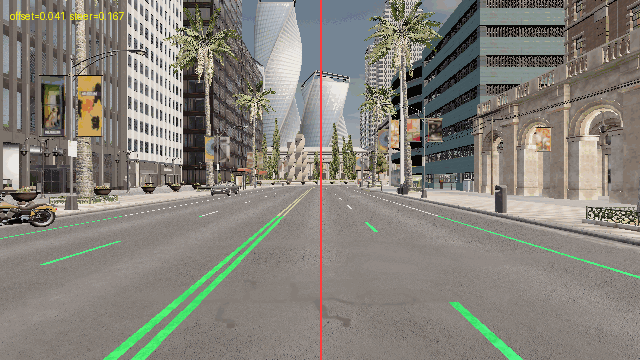
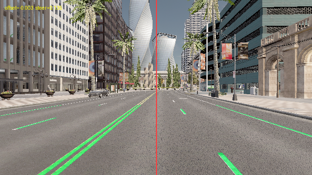
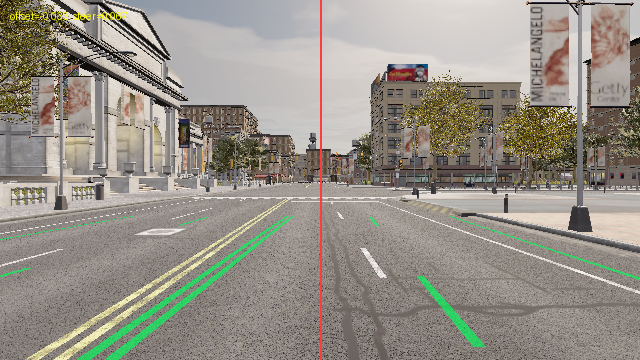

# carla_lane_following — 语义分割车道线巡线实验

## 1. 概述

用**语义分割相机**（而不是手工阈值调色）识别车道线，实时估计「车相对车道中心的横向偏移」和
「车头相对车道的夹角」，用 PID 输出转向，让车在车道内稳定行驶。
这是自动驾驶横向控制最基础的一环，也是后续所有感知/规划模块的基座。

## 2. 与已有示例的区别

| 对比项 | 官方示例 | 本模块 |
|---|---|---|
| 感知 | `manual_control.py` 靠人开车；无车道线识别 | 语义分割 tag=24(RoadLines) → 近场/远场车道中心 → 横向偏移 + 航向误差 |
| 起点 | 固定出生点，弯道上一开始就跑偏 | 自动筛选「够直 + 能同时看到左右车道线」的起点（实测跳过若干不可用点） |
| 控制 | 无闭环 | PID（含 EMA 平滑、丢线保护）20 Hz 闭环横向控制 + 比例速度环 |
| 取证 | 无 | 带标注的关键帧（车道线高亮 + offset/steer）+ 三联曲线 + CSV |

## 3. 环境要求

- Windows + OpenHUTB 2.10.1 服务端；Python 3.10；`numpy`、`matplotlib`、`PyYAML`、`Pillow`
- 客户端 `hutb-2.10.1-cp310` wheel
- 必须 `set_files_base_folder()` 后再 `get_world()`（地图文件按需下载机制）

## 4. 安装

```bat
# 下面两个路径是示例，按你的 OpenHUTB 安装位置替换（也可设 HUTB_ROOT 环境变量）
python -m pip install %HUTB_ROOT%\PythonAPI\carla\dist\hutb-2.10.1-cp310-cp310-win_amd64.whl
python -m pip install -r requirements.txt   # numpy / matplotlib / PyYAML / pillow
```

## 5. 运行

```bat
:: 终端 1
%HUTB_ROOT%\CarlaUE4.exe Town10HD_Opt -windowed -carla-rpc-port=2000

:: 终端 2
cd src\ground\carla_lane_following
python main.py            :: 或 main.bat；参数同 AEB（--host/--port/--map/--save-dir）
```

## 6. 预期输出

```text
[lane] 已连接 127.0.0.1:2000 | 地图 Carla/Maps/Town10HD_Opt
[lane] 选定起点 spawn[61]（score=0.0，初始偏移 0.041）
[lane] 开始巡线：目标车速 8.0 m/s
[lane] 标注帧 -> lane_018.3s.png（offset=0.048 steer=0.061）
[lane] 达到设定时长 20.0s，正常结束
[lane] 平均偏移 0.0858（315/315 帧测到，丢线 0.0%），时长 20.0s/20.0s，结论：PASS
```

## 7. 输出文件

| 文件 | 内容 |
|---|---|
| `docs/lane_*.png` | 标注帧：车道线掩码高亮 + 中心线 + offset/steer 文本 |
| `docs/run_log.csv` | 逐帧 `t / offset(真实测量) / offset_used(控制用) / steer / speed_kmh / lost / source` |
| `docs/result.png` | 横向偏移、转向、车速三联曲线 |
| `docs/summary.md` | 帧数、丢线帧数、平均/最大横向偏移 |

## 8. 目录结构

```text
carla_lane_following/
├── main.py                  # 便捷入口（等价于 ros2 run carla_lane_following carla_lane_following）
├── main.sh / main.bat       # 一键运行脚本（自动挑解释器）
├── package.xml              # ament_python 包描述（含执行依赖）
├── setup.py / setup.cfg     # 安装脚本与 console_scripts 入口
├── carla_lane_following/
│   ├── __init__.py
│   └── app.py               # 全部实现（感知 / 决策 / 控制 / 取证）
├── launch/
│   ├── main.launch          # ROS1 风格（直连，不需要 bridge）
│   └── main.launch.py       # ROS2 launch（Node 调 console_scripts）
├── config/
│   └── params.yaml          # 全部可调参数
├── resource/
│   └── carla_lane_following           
├── test/
│   └── test_carla_lane_following.py   # 纯逻辑单元测试（不需要仿真器）
├── docs/                    # 运行证据（曲线图 / CSV / 关键帧 / summary.md）
└── README.md
```

## 9. 已知限制

1. 只在**有清晰车道线**的路段有效：实测第 24 类标记在部分路段缺失（贴瓷砖/磨损），此时依赖丢线保护柔性保持转向。
2. 归一化偏移与实际横向距离之间只差一个相机内参比例，本模块用归一化量做控制，没有标定到米。
3. 遇到路口（跨路口车道线中断）时会短暂丢线，长距离巡线需要叠加地图先验。

## 10. Linux / ROS 2 上的客户端限制（实测）

在 Ubuntu + ROS 2 Humble 环境里 `colcon build` 与 `ros2 launch <包名> main.launch.py` 都能正常工作
（节点会启动并正确接收 `--host/--port/--map` 参数），但**连接仿真器会失败**：

- 上游 `carla` 客户端（0.9.13 / 0.9.15 / 0.9.16 实测）与 OpenHUTB 2.10.x 的定制协议不兼容，
  调用 `get_world()` 时直接 `std::bad_alloc` abort（进程级崩溃，Python 捕获不到）；
- 与之配套的 `hutb` 客户端目前**只有 Windows wheel**，Linux 上没有现成轮子。

因此本模块在连接前会做一次预检（`check_client_compat`），发现是上游客户端 + OpenHUTB 服务端时，
打印明确提示并以退出码 2 结束，而不是产生 core dump。
在 Linux 上要真正跑通，需要用 OpenHUTB 源码自行编译 libcarla（`make PythonAPI`，cp38/cp310 均可）。

## 11. 关于「跑多远」与统计口径（2026-11-10 按评审意见修正）

- **统计口径**：只有「两侧都看不到车道线（source=none）」才算丢线；单侧可见时用历史车道宽度
  补另一侧（source=left_only/right_only），这是常规车道跟踪做法。CSV 里 `offset` 只记本帧
  真实测量值，`offset_used` 才记用于控制的平滑值，均值只用真实测量帧计算。
- **为什么只跑 20 s**：这条路线在约 20 s（约 160 m）之后进入无标线路段，40 s 版本实测
  丢线 287/635 帧（45.2%），无法作为车道保持的验证。因此实验时长设为 20 s 并要求跑满；
  若提前结束，判据直接判 FAIL（`evaluation.require_complete`）。
- **车速**：目标 8 m/s，实测平均 23.1 km/h（6.4 m/s）、最大 24.2 km/h，受该路段车辆限速与
  弯道影响达不到目标值，README 不再宣称「达到 29 km/h」。

## 运行效果（截图 / 动图）







> 动图由实际运行的帧合成（GIF < 5 MB）；素材与生成脚本见 `tools/build_media.py`、`tools/build_lidar_media.py`、`tools/build_air_media.py`。
