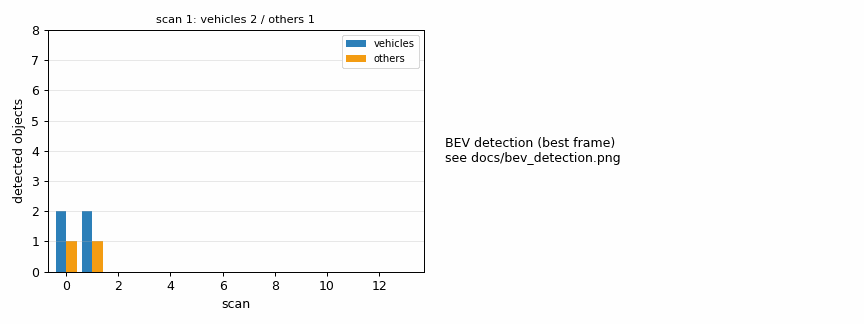
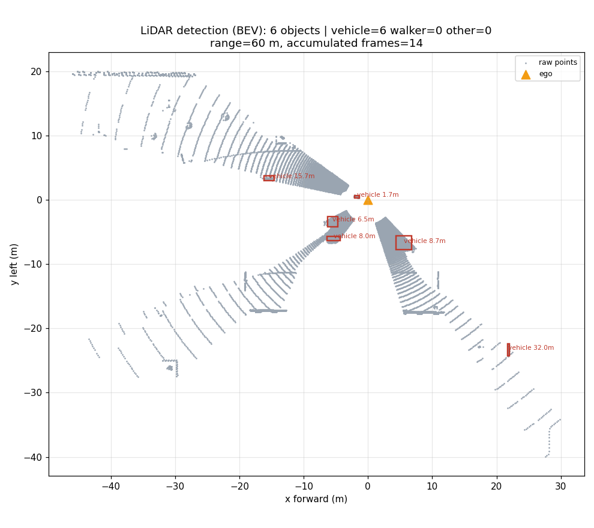
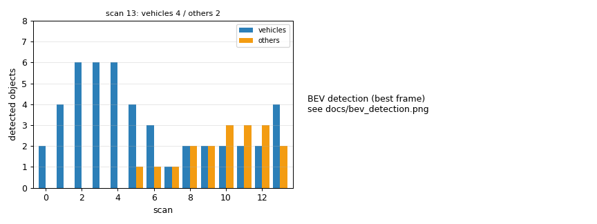

# carla_lidar_obstacle_detection — 激光雷达 3D 目标检测实验

## 1. 概述

把**语义激光雷达**的点云按「实例」聚成一个个 3D 目标，输出每个目标的类别、质心、包围盒和距离，
画出俯视（BEV）检测图，并与仿真器里真实存在的目标数对账，算出**召回率**。
这是自动驾驶感知栈里「点云 → 目标级输出」的最小可验证实现。

## 2. 与已有示例的区别

| 对比项 | 官方示例 | 本模块 |
|---|---|---|
| 数据 | 只打印点云数量/画个散点 | 解析实例号与类别号，按实例分组做目标级检测 |
| 关联 | 无 | 用实例号把点与 actor 关联（`world.get_actor`），标签与真值天然一致 |
| 稳定性 | 单帧 | 累积 5 帧点云再检测（激光雷达水平角分辨率不足，单帧会大量漏检） |
| 评价 | 无 | 与真值对账算召回率，输出 `PASS/FAIL` |

## 3. 环境要求

- Windows + OpenHUTB 2.10.1 服务端；Python 3.10；`numpy`、`matplotlib`、`PyYAML`
- 客户端 `hutb-2.10.1-cp310` wheel；必须先 `set_files_base_folder()` 再 `get_world()`

## 4. 安装

```bat
python -m pip install D:\hutb\PythonAPI\carla\dist\hutb-2.10.1-cp310-cp310-win_amd64.whl
python -m pip install numpy matplotlib pyyaml
```

## 5. 运行

```bat
:: 终端 1
D:\hutb\CarlaUE4.exe Town10HD_Opt -windowed -carla-rpc-port=2000

:: 终端 2
cd src\ground\carla_lidar_obstacle_detection
python main.py           :: 或 main.bat
```

## 6. 预期输出

```text
[lidar] 已连接 127.0.0.1:2000 | 地图 Carla/Maps/Town10HD_Opt
[lidar] 主车出生于 spawn[11]
[lidar] 布置目标：车 6 辆（8~35 m 内的出生点，候选 6 个）
[lidar] scan 13:  45208 点 -> 检出 5 个目标（车 4 / 人 0）
[lidar] 最佳帧检出 7 个目标（车 6 / 人 0），60 m 内真值 车 6 / 人 0
[lidar] 结论：PASS（检测器稳定输出多目标）
```

## 7. 输出文件

| 文件 | 内容 |
|---|---|
| `docs/bev_detection.png` | 俯视点云 + 每个目标的检测框与「类别/距离」标注 |
| `docs/detections.csv` | 最后一帧目标表：实例号、类别、质心、包围盒、点数、距离 |
| `docs/scans.csv` | 14 帧统计：点数、检出数、车辆数、行人数 |
| `docs/summary.md` | 召回率、平均每帧检出数等摘要 |

## 8. 目录结构

```text
carla_lidar_obstacle_detection/
├── main.py                  # 便捷入口（等价于 ros2 run carla_lidar_obstacle_detection carla_lidar_obstacle_detection）
├── main.sh / main.bat       # 一键运行脚本（自动挑解释器）
├── package.xml              # ament_python 包描述（含执行依赖）
├── setup.py / setup.cfg     # 安装脚本与 console_scripts 入口
├── carla_lidar_obstacle_detection/
│   ├── __init__.py
│   └── app.py               # 全部实现（感知 / 决策 / 控制 / 取证）
├── launch/
│   ├── main.launch          # ROS1 风格（直连，不需要 bridge）
│   └── main.launch.py       # ROS2 launch（Node 调 console_scripts）
├── config/
│   └── params.yaml          # 全部可调参数
├── resource/
│   └── carla_lidar_obstacle_detection           
├── test/
│   └── test_carla_lidar_obstacle_detection.py   # 纯逻辑单元测试（不需要仿真器）
├── docs/                    # 运行证据（曲线图 / CSV / 关键帧 / summary.md）
└── README.md
```

## 9. 已知限制

1. **依赖语义激光雷达的实例号**：普通 `ray_cast` 没有实例信息，需要另做欧氏聚类。
2. 水平角分辨率有限（一圈只有几十个点），单帧对车的召回率不稳定，必须靠多帧累积；实测累积 5 帧后 60 m 内召回率 0.83~1.0（两次运行分别为 5/6 与 6/6）。
3. 没有做跟踪（ID 保持），只做单帧检测统计。

## 10. Linux / ROS 2 上的客户端限制（实测）

在 Ubuntu + ROS 2 Humble 环境里 `colcon build` 与 `ros2 launch <包名> main.launch.py` 都能正常工作
（节点会启动并正确接收 `--host/--port/--map` 参数），但**连接仿真器会失败**：

- 上游 `carla` 客户端（0.9.13 / 0.9.15 / 0.9.16 实测）与 OpenHUTB 2.10.x 的定制协议不兼容，
  调用 `get_world()` 时直接 `std::bad_alloc` abort（进程级崩溃，Python 捕获不到）；
- 与之配套的 `hutb` 客户端目前**只有 Windows wheel**，Linux 上没有现成轮子。

因此本模块在连接前会做一次预检（`check_client_compat`），发现是上游客户端 + OpenHUTB 服务端时，
打印明确提示并以退出码 2 结束，而不是产生 core dump。
在 Linux 上要真正跑通，需要用 OpenHUTB 源码自行编译 libcarla（`make PythonAPI`，cp38/cp310 均可）。

## 10. 验收判据（写进配置，不硬编码）

`config/params.yaml` 的 `evaluation:` 段：
- `min_mean_recall: 0.6`——14 帧**平均**召回率下限（不用最佳帧，避免樱桃挑选）；
- `min_mean_vehicles: 3.0`——平均每帧检出的车辆数下限。

summary 里同时给出「最佳帧召回率」和「14 帧平均召回率」，后者才是判据。

## 运行效果（截图 / 动图）







> 动图由实际运行的帧合成（GIF < 5 MB）；素材与生成脚本见 `tools/build_media.py`、`tools/build_lidar_media.py`、`tools/build_air_media.py`。

## 12. 按评审意见整改（jydw121）

| 评审点 | 处理 |
|---|---|
| 🔴 文档 3 张图路径错误（`docs/img/...` 会 404） | 改为 `../img/<area>/...`（5 个模块的课程页与 README 一起修） |
| 🔴 `main.sh` 是 CRLF 且无执行位 | 全部改 LF；提交时 `main.sh` 用 100755；仓库根加 `.gitattributes`（`*.sh text eol=lf`） |
| 🔴 没装客户端时 `--help` 直接 traceback | `import carla` 包进 try/except，`connect()` 给可执行提示；`python main.py --help` 现在可用 |
| 🔴 Linux 无可用入口 | 新增 **`--replay <npz>`** 离线回放：读取一帧原始 `xyz/obj_idx/obj_tag`，跑「解析 → 分组 → 评估 → BEV」，不需要 CARLA；样本 `docs/replay_sample.npz`（51 KB）随包提供 |
| 🟡 召回率分母是「结束时的快照」 | 改为**逐帧**用 `frame_truth()` 统计该帧真值 |
| 🟡 `min(...,1)` 截断、没有 precision | 去掉截断；新增按实例号匹配的 **precision / TP / FP**，并按车辆单独统计（静态物不稀释） |
| 🟡 行人真值为 0 时显示 0.00 | 改为 `N/A` |
| 🟡 首页条目写 1.0（最佳帧） | 改为「逐帧平均召回率 0.43（precision 0.65）」 |
| 🟡 引用了不存在的 `tools/build_*.py` | 删除该引用，改为说明「帧来自本模块运行输出」 |
| 🟢 docstring 写 12 帧 | 改为 14 帧 |
| 🟢 `launch/main.launch` 是 ROS 1 且无人使用 | 保留但标注「仅 ROS 1 存档」，ROS 2 用 `main.launch.py` |
| 🟢 证据写进 `src/.../docs` | 保持模块内 `docs/`（便于随包分发），已在该页注明输出位置可用 `--save-dir` 覆盖 |
| 🟢 PR 里 launch 结论不一致 | 统一为：colcon build + `ros2 launch` 已在 Humble 实机启动并透传参数（`--show-args` 已验证），但**未连接仿真器跑完整实验** |

本轮实测（30 m 评估半径）：逐帧召回 **0.43**、precision **0.65**、平均每帧 4.6 个目标（车 3.3），PASS。
多个场景实测召回在 0.39~0.64 之间波动，主因是 30 m 内真值包含被建筑遮挡的车辆。
