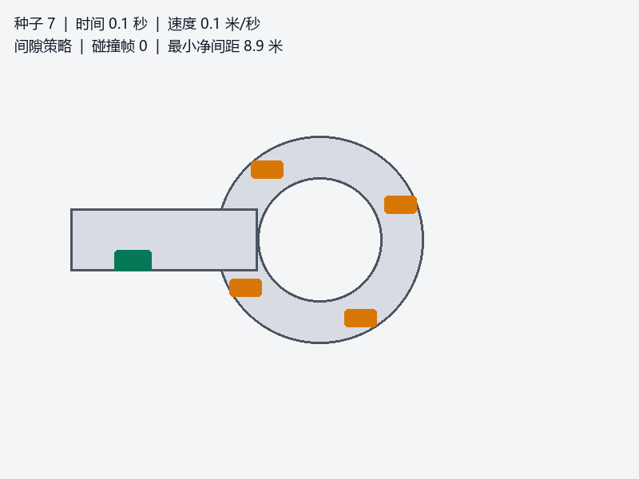
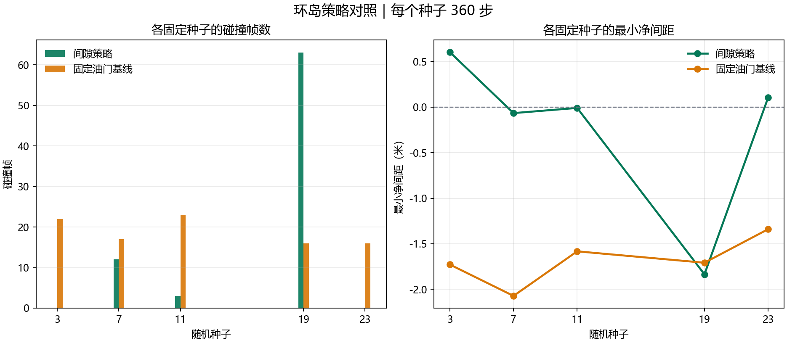

# 无信号环岛汇入仿真

本模块通过固定随机种子的二维运动学模型，展示车辆在无信号环岛入口的等待、汇入和避碰过程。配套包含间隙策略、固定油门基线、图像到控制模型、模拟测距、占据栅格更新及 A* 路径搜索。






## 运行仿真

在 ROS 2 Humble 工作空间构建并加载本包：

```bash
colcon build --packages-select carla_nn_roundabout_entry
source install/setup.bash
```

运行固定种子的间隙策略仿真，也可切换固定油门基线或图像控制模型：

```bash
ros2 run carla_nn_roundabout_entry roundabout_sim --seed 7 --steps 360 --controller gap-policy
ros2 run carla_nn_roundabout_entry roundabout_sim --seed 7 --steps 360 --controller baseline
ros2 run carla_nn_roundabout_entry roundabout_sim --seed 7 --steps 360 --controller image-model
```

在桌面环境中运行可交互窗口：

```bash
ros2 run carla_nn_roundabout_entry roundabout_sim --gui --seed 7
```

使用 W 或上方向键加速，S 或下方向键制动，A/D 或左右方向键转向。

## ROS 2 话题集成

同步启动仿真传感器和导航节点，输出占据栅格、A* 路径及运行指标：

```bash
ros2 launch carla_nn_roundabout_entry main.launch.py
```

仿真节点发布 `/scan`、`/odom`、`/simulation/collision`、`/simulation/route_complete` 和 `/simulation/done`。导航节点发布 `/map`、`/planned_path` 与 `/slam_navigation/metrics`，并将汇总保存至 `/tmp/roundabout_navigation_metrics.json`。

## 指标说明

| 指标 | 含义 |
|---|---|
| `collision_frames` | 至少与一辆环道车发生模型碰撞的仿真步数，每步最多计一次 |
| `minimum_clearance_m` | 车辆中心距离减去模型碰撞阈值 2.2 米后的最小值；负值表示发生模型碰撞 |
| `map_rays_integrated` | 已写入占据栅格的模拟测距数量 |
| `path_search_frames` | 执行 A* 搜索的仿真步数 |
| `path_found_frames` | 找到已观测空闲路径的仿真步数 |
| `policy_wait_frames`、`policy_enter_frames` | 间隙策略选择等待和尝试汇入的步数 |

A* 只在已观测为空闲的栅格中搜索，未知区域和障碍物均不可通行。路径搜索结果用于展示规划状态，不直接控制车辆。

## 端到端控制

图像模型使用合成的 16×16 灰度观测训练方向、油门和制动输出。可运行训练与评估：

```bash
python3 -m carla_nn_roundabout_entry.main --mode demo
```

程序生成合成道路、车流和测距数据，不连接 CARLA，也不读取外部传感器；图表和指标只描述本运动学模型。完整图文说明见[环岛汇入教程](../../../docs/ground/roundabout_nn.md)。

## 测试

```bash
colcon test --packages-select carla_nn_roundabout_entry
```
