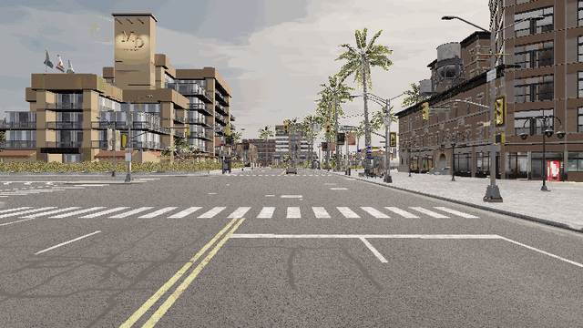
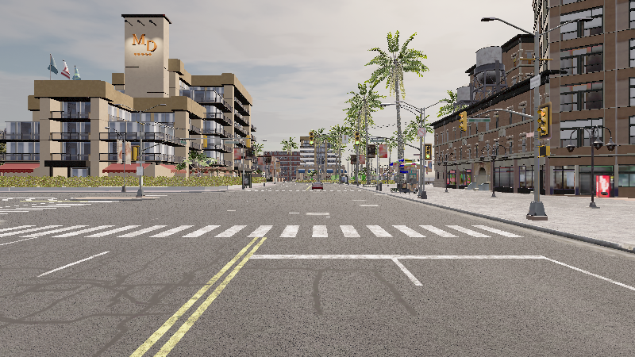
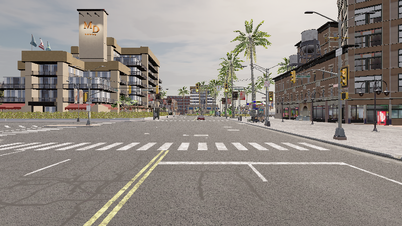

# carla_ttc_emergency_braking — 自动紧急制动（AEB）实验

## 1. 概述

主车以约 50 km/h 巡航逼近一辆静止前车，程序用**语义激光雷达**做前向测距并按
**TTC（Time To Collision）** 判据决策，在 TTC ≤ 1.6 s 或距离 ≤ 22 m 时输出满制动，
最终**停在前车之前不发生碰撞**。这是自动驾驶安全功能里最基础、也最容易量化的一个闭环：
感知 → 决策 → 控制 → 验证。

## 2. 与已有示例的区别

| 对比项 | `PythonAPI/examples/` 里的官方示例 | 本模块 |
|---|---|---|
| 世界与地图 | 手工 `spawn_actor` 摆一个车就结束 | 自动挑选「够直且不穿路口」的路段，主车/前车按车道几何对齐摆放 |
| 传感器 | 相机、激光雷达各写各的 demo | 语义激光雷达（实例级取最近点）+ RGB 关键帧取证，两路同时工作 |
| 控制 | 大多只发一次 `VehicleControl` | 20 Hz 闭环：巡航 → TTC 判据触发 → 满制动 → 停稳判定 |
| 结论 | 无 | 输出逐帧 CSV + 三联曲线 + `PASS/FAIL` 判定 |

## 3. 环境要求

- Windows 10/11 + **OpenHUTB 2.10.1**（服务端版本字符串 `3ea2130ed`，内核基于 CARLA 0.9.16）
- **Python 3.10**（系统解释器即可）：`numpy`、`matplotlib`、`PyYAML`
- 客户端：`hutb-2.10.1-cp310-cp310-win_amd64.whl`（随仿真器一起分发，**不需要联网下载**）

> ⚠️ 两个必踩的坑：
> 1. `carla==0.9.13`（cp38）连这个服务端会**段错误**，`0.9.15` 会 `std::bad_alloc`，必须用配套的 hutb 客户端或 `carla==0.9.16`。
> 2. 客户端必须先 `client.set_files_base_folder(...)` 再 `get_world()`，否则只会抛一条没有信息的 `RuntimeError`（OpenHUTB 2.10.x 的地图文件按需下载机制）。

## 4. 安装

```bat
:: Windows（wheel 就在仿真器目录里）
python -m pip install D:\hutb\PythonAPI\carla\dist\hutb-2.10.1-cp310-cp310-win_amd64.whl
python -m pip install numpy matplotlib pyyaml
```

## 5. 运行

```bat
:: 终端 1：启动服务端（不要带 settings.json 里的 SimMode:Multirotor，否则会进无人机模式）
D:\hutb\CarlaUE4.exe Town10HD_Opt -windowed -carla-rpc-port=2000

:: 终端 2：跑本实验
cd src\ground\carla_ttc_emergency_braking
python main.py                 :: 或 main.bat / bash main.sh
:: 可选参数：--host 192.168.29.1 --port 2000 --map Town10HD_Opt --no-render
```

## 6. 预期输出

```text
[aeb] 已连接 127.0.0.1:2000 | 服务端版本 3ea2130ed | 地图 Carla/Maps/Town10HD_Opt
[aeb] 自动选择直路段：spawn[75]（方向偏差 0.0°）
[aeb] 前车 vehicle.audi.tt 位于前方 56.0 m
[aeb] 开始实验：巡航油门 0.75，TTC 阈值 1.60s，初始距离 56.0 m
[aeb] >>> 触发制动 t=4.36s 激光雷达 dist=17.8m speed=50.2km/h ttc=1.28s source=latched
[aeb] >>> 停稳 t=6.11s 激光雷达测距 3.5 m（真值 4.5 m；传感器失效帧 0）
[aeb] 结论：PASS（制动成功，未发生碰撞）
```

## 7. 输出文件

| 文件 | 内容 |
|---|---|
| `docs/run_log.csv` | 逐帧 `t / speed_kmh / lidar_m / truth_distance_m / ttc / braking / sensor_lost / decision_source / instance / tag` |
| `docs/result.png` | 车速、前车距离（雷达点 + 真值线）、TTC 三联图（标出阈值线与停稳距离） |
| `docs/frame_*.png` | 关键帧：逼近（`frame_approach_*`）/ 触发制动（`frame_brake_*`）/ 停稳（`frame_stopped_*`） |
| `docs/summary.md` | 实验摘要（初始距离、制动时刻、停稳距离、检出帧数、关键帧清单） |

## 8. 目录结构

```text
carla_ttc_emergency_braking/
├── main.py                  # 便捷入口（等价于 ros2 run carla_ttc_emergency_braking carla_ttc_emergency_braking）
├── main.sh / main.bat       # 一键运行脚本（自动挑解释器）
├── package.xml              # ament_python 包描述（含执行依赖）
├── setup.py / setup.cfg     # 安装脚本与 console_scripts 入口
├── carla_ttc_emergency_braking/
│   ├── __init__.py
│   └── app.py               # 全部实现（感知 / 决策 / 控制 / 取证）
├── launch/
│   ├── main.launch          # ROS1 风格（直连，不需要 bridge）
│   └── main.launch.py       # ROS2 launch（Node 调 console_scripts）
├── config/
│   └── params.yaml          # 全部可调参数
├── resource/
│   └── carla_ttc_emergency_braking           
├── test/
│   └── test_carla_ttc_emergency_braking.py   # 纯逻辑单元测试（不需要仿真器）
├── docs/                    # 运行证据（曲线图 / CSV / 关键帧 / summary.md）
└── README.md
```

## 9. 已知限制

1. 前车是**静止**的：没有做相对速度估计，因此 TTC 用自车速度近似；若要跟驰行驶车辆，需要加上目标速度跟踪。
2. 感知只有一路**语义激光雷达**（按实例 + 车辆标签取最近点），没有接入视觉检测（YOLO 之类）；
   语义标签编号依赖平台（本环境实测车辆为 `14`），换平台要先 probe 再改 `config/params.yaml`。
3. 单帧实例点数门限（≥ 4 点）会让中远距目标偶发漏检：本次运行 99 帧里只有 9 帧成目标，
   51 m→18 m 有漏检窗口，所以实际触发距离（17.8 m）可能小于 22 m 的设计门限（制动一旦触发会锁存，停稳距离不受影响）。
4. 制动是固定 `brake=1.0` 的开关式控制，没有做舒适性（减速度限幅）优化。

## 10. Linux / ROS 2 上的客户端限制（实测）

在 Ubuntu + ROS 2 Humble 环境里 `colcon build` 与 `ros2 launch <包名> main.launch.py` 都能正常工作
（节点会启动并正确接收 `--host/--port/--map` 参数），但**连接仿真器会失败**：

- 上游 `carla` 客户端（0.9.13 / 0.9.15 / 0.9.16 实测）与 OpenHUTB 2.10.x 的定制协议不兼容，
  调用 `get_world()` 时直接 `std::bad_alloc` abort（进程级崩溃，Python 捕获不到）；
- 与之配套的 `hutb` 客户端目前**只有 Windows wheel**，Linux 上没有现成轮子。

因此本模块在连接前会做一次预检（`check_client_compat`），发现是上游客户端 + OpenHUTB 服务端时，
打印明确提示并以退出码 2 结束，而不是产生 core dump。
在 Linux 上要真正跑通，需要用 OpenHUTB 源码自行编译 libcarla（`make PythonAPI`，cp38/cp310 均可）。

## 11. 验收判据（写进配置，不硬编码）

`config/params.yaml` 的 `evaluation:` 段：
- `min_stop_distance: 2.0`（米）——停稳后距前车小于该值视为追尾；
- `require_brake: true`——实验过程中必须真的触发过制动。

代码只读配置，不再写死 `final_distance > 2.0`。

## 运行效果（截图 / 动图）







> 动图由实际运行的帧合成（GIF < 5 MB）；素材与生成脚本见 `tools/build_media.py`、`tools/build_lidar_media.py`、`tools/build_air_media.py`。

## 12. 决策与清理的边界（PR #955 评审整改）

| 项 | 早期实现 | 现在 |
|---|---|---|
| 清理 | 遍历全世界的 `vehicle./sensor./walker.` 全部 destroy | 生成时给 actor 打 `role_name = aeb_*`，只清理本模块残留（`cleanup_leftovers` + `owned_by_module`），不碰别人的对象 |
| 制动输入 | 先读仿真器 actor 列表（真值），激光雷达只作回退 | **只用语义激光雷达观测**：按实例号取正前方最近的车辆（`front_vehicle_distance`），真值只写日志/摘要用于对账 |
| 横向门限 | `abs(y) < 4.0`，相邻车道更近的车会被误选 | `abs(y) < 2.2`，且按**实例质心**判断（单点压线不算），与真值对账口径一致 |
| 车辆语义标签 | 把 `(14, 15, 16, 18)` 当成 Car/Truck/Bus/Motorcycle | 只保留本环境 probe 实测的 `14`，并做成配置项 `sensor.vehicle_tags` |
| 客户端识别 | 按「先安装的 distribution」判断 hutb / carla | 按实际 import 到的 `carla.Client` 是否有 `set_files_base_folder` 判断 |
| 失效安全 | 无 | 点云流超过 `sensor_timeout_s`（默认 1 s）没更新 → 判定传感器故障并制动；**"走廊里没目标"不算故障** |
| 制动锁存 | 无（丢一帧目标就松刹车再加速） | 一旦触发即锁存到停稳 |
| 单测 | 8 项 | **24 项**：含邻道更近车辆、质心门限、语义标签过滤、客户端识别、单点噪声、传感器失效、归属判断 |

停稳判定的两个距离：
- `激光雷达测距`：到前车**最近表面**的距离（决策口径）；
- `真值距离`：**中心距**，比前者大约半个车长，只用于评估。

实测（2026-11-12，最终代码）：制动 t=4.36 s，停稳 t=6.11 s，雷达最后一次有效测距 3.55 m（真值中心距 4.49 m），未碰撞 → PASS。

## 13. 感知盲区与控频说明

- **近距盲区**：`front_vehicle_distance(min_x=3.0)` 只统计车体前方 3 m 以外的车辆实例点，
  3 m 以内视为盲区（本实验停车距离 4~7 m，不影响判据；若用于更低速/更近距离场景需调小 `min_x`，
  并注意自车车顶回波会混入）。传感器在 1 s 内没有任何更新时才按「失效」处理并制动，
  「前方暂时没有目标」属于正常工况、不制动。
- **控频方式**：主循环用 `time.sleep(0.05)` 控制约 20 Hz 的决策频率，而不是 CARLA 的固定步长模式
  （`world.tick()` / synchronous mode）。因此 `run_log.csv` 的 `t` 是墙钟时间，负载抖动时会与仿真时间
  有毫秒级偏差；实验里以「停稳 + 距离」为判据，不受该偏差影响，但做精确时序分析时应改用同步模式。
